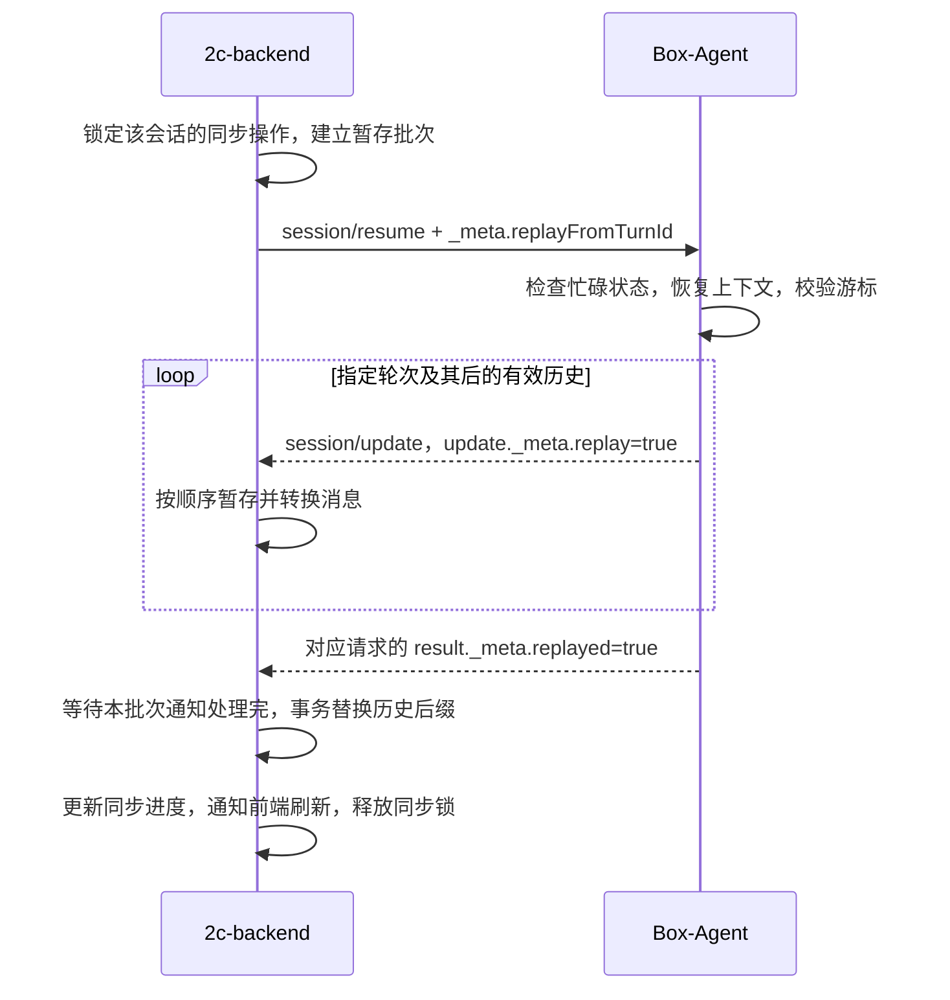

# 2c-backend 对接：ACP v1 resume 游标回放

本扩展由 Box-Agent 与调用方约定，不是 ACP v1 的标准回放参数。
适用于 2c-backend 补齐云端历史；本地客户端仍发送不带游标的 `session/resume`。

实现位置：Box-Agent `feat/acp-resume-replay`，基于 main `4ab76461`。下面描述含本扩展的代码行为；上线前需确认云端运行时已包含该改动。源码与本地协议测试已通过，云端部署及联调待完成。

## 后端要完成的工作

1. 保存产品会话与 Box-Agent 返回的 ACP `sessionId`、云端 `cwd` 的关联，以及每轮请求使用的 `turnId`。产品会话 ID 不能直接替代 ACP sessionId。
2. 判断数据完整性：完整则普通 resume；需要补齐则选择回放起点。Box-Agent 不负责比较后端数据库。
3. 为同一 ACP 会话串行执行恢复、回放和新 prompt。发请求前建立回放接收批次，收集通知并按接收顺序处理。
4. 校验完成回执，事务性替换相应历史后，再更新同步进度并通知前端刷新。
5. 对忙碌、游标失效、超时及断线分别处理，不能把普通 resume 成功当成补齐成功。

### 游标怎么选

游标表示“从这一轮开始重新获取”，不是“这一轮已经收完，跳过它”。

| 后端状态 | 请求选择 |
| --- | --- |
| 已确认历史完整，只需要恢复会话 | 不带游标的 resume |
| 第 1～4 轮完整，第 5 轮只有部分内容 | `replayFromTurnId = 第5轮ID`；回放第 5 轮及后续 |
| 第 1～4 轮完整，不知道后续轮次的 ID | 可从已确认存在的第 4 轮重放，整体替换第 4 轮及后续 |
| 历史为空，没有可信的有效轮次 ID | 使用 session/load 全量回放 |
| 不能确认游标之前的历史仍与云端一致 | 选择更早的可信游标，或全量回放 |

必须按业务保存的轮次顺序选择游标，不能对 UUID 排序。该接口不会检查游标之前的差异，也不携带历史版本号。`turnStatus=complete` 仅是轮次结果，不能单独作为后端已完整收到并持久化这一轮的证据。

### 时序



上述流程只支持空闲会话的历史同步。云端 WS 如何转发 ACP、新连接如何绑定仍在运行的任务，需由云端服务单独实现；本接口不提供运行中任务的重新订阅能力。

## 请求与完成回执

参数放在 `params._meta.replayFromTurnId`，不增加 `box-agent` 嵌套，不传 `type` 或 `historyRevisionId`。

| 参数 | 类型 | 说明 |
| --- | --- | --- |
| sessionId | string | 创建会话时 Box-Agent 返回的 ACP ID，原样保存和传入 |
| cwd | string | 原会话在云沙盒中的工作区路径，不是本地客户端路径；工作区不匹配会失败 |
| mcpServers | array | 按现有恢复配置传入；未配置时为 `[]` |
| _meta.replayFromTurnId | string，可省略 | 有效轮次 ID，精确匹配；不要自行加前缀、格式化或改写 |

下面 sessionId、cwd、turnId 都是示例，调用时替换为实际保存的值。

```json
{
  "jsonrpc": "2.0",
  "id": 42,
  "method": "session/resume",
  "params": {
    "sessionId": "acp-v1-ZGVtbw",
    "cwd": "/workspace",
    "mcpServers": [],
    "_meta": {"replayFromTurnId": "turn-2"}
  }
}
```

- 不传 `replayFromTurnId`：恢复上下文，不发送历史；不自动继续未完成的模型执行。
- 传入非空字符串：从该轮用户输入开头回放，包含该轮及其后续有效历史。
- 显式传 `null`、空白字符串或其他类型：`-32602`，`error.data.code = INVALID_REPLAY_CURSOR`。
- 游标仅在当前有效、可展示的历史中定位。未知、被历史编辑撤销、被 `surface/reset` 清除，或无法唯一定位的游标返回 `-32602`，`error.data.code = REPLAY_CURSOR_NOT_FOUND`；不会先发送部分历史。旧消息若没有保存输入身份，也不能充当游标。
- 游标值沿用对应用户消息的 `input_facts.id`，与 load 通知中的 `_meta.turnId` 一致。正常 ACP prompt 将调用方传入的轮次 ID 保存为该输入 ID。不能使用 JSON-RPC 请求 ID、补充输入 ID 或日志行号代替。
- 会话正在执行任务、编辑历史或回放时，沿用已有忙碌检查；运行中的任务返回 `SESSION_BUSY`，不会被取消或替换。
- 回放筛选只影响下行历史，不裁剪恢复给模型的上下文。

所有回放通知发送完成后，resume 才返回响应。下例只列出相关 `_meta` 字段，实际响应保留原有恢复元数据：

```json
{
  "jsonrpc": "2.0",
  "id": 42,
  "result": {
    "_meta": {"replayed": true, "replayFromTurnId": "turn-2"}
  }
}
```

`replayed: true` 表示服务端完成了发送，不表示后端已持久化。调用方应暂存本次回放，在收到成功回执后提交覆盖：保留游标之前的完整历史，替换指定轮次及其后的数据。响应报错、断线或缺少匹配的完成回执时，不提交这批数据，可重新请求。游标失效时可选择 `session/load` 全量同步。新旧实时流的衔接不在此扩展范围内。

## 接收、去重与落库规则

- **识别位置**：读取 `params.sessionId` 和 `params.update._meta.replay`；不是 `params._meta.replay`。
- **批次关联**：通知本身没有 resume 请求 ID。后端用“当前连接 + ACP sessionId + 唯一进行中的同步批次”关联，响应再按 JSON-RPC `id` 对应请求；同一会话不能并发发起两次回放。
- **隔离实时处理**：`replay=true` 的通知进入暂存批次，不按实时消息直接追加到数据库或向前端逐条追加。其他会话的通知仍按它们自己的会话分流。
- **保留顺序**：用户输入可能拆为多个内容块，同一轮也可能包含多条助手消息和工具调用。按接收顺序消费；不能按 turnId 去重，也不能拿 eventId 字符串排序。
- **事件去重**：如转发链路可能重复投递，在当前暂存批次内按 `(sessionId, eventId)` 去重。重试开启新批次，不能因为上一批次见过相同 eventId 就跳过此次完整重建。
- **文本组装**：同轮不同 eventId 的正文都要保留、按序组合；回放正文是保存后的消息内容，不是对旧正文追加的 token 增量。不要依赖实时流的 messageId/outputId 或 llm_output 快照，本回放格式不提供这些身份字段。
- **工具组装**：按会话内的 toolCallId 关联调用和结果；rawInput 是参数对象，结果在 content 中，此路径不提供 rawOutput。tool_call 可能没有 status，后续 tool_call_update 给出最终状态。
- **补充输入**：`inputKind=user_supplement` 使用 inputId 区分；它属于当前 turnId，不新建一轮。
- **附件与图片**：保留原内容块类型及字段，不压平成正文。resource_link 等引用按原内容保存，回放不会替后端上传文件或替换云端地址；图片可能包含 base64 数据，接收链路须沿用现有 ACP 图片的报文大小和存储支持。
- **提交屏障**：完成响应可能比异步通知处理任务更早处理完。收到成功响应后，还必须等待之前收到的本批次通知都完成暂存；然后在一个事务中替换该轮及后续 ACP 展示数据，包括插入后端原本缺少的轮次。事务成功后才标记同步完成。
- **前端刷新**：后端提交成功后通知前端替换或重新拉取相应历史。具体 SSE/业务事件由 2c-backend 定义，不属于此次 ACP 扩展。

完成回执要求：响应 `id` 匹配、没有 `error`、`result._meta.replayed === true`、`result._meta.replayFromTurnId` 与请求一致。缺少任何一项都不能确认本次游标同步成功。现有实现未新增专用的游标能力声明，标准 resume 能力也不代表支持本扩展；部署时应确认运行的是含此改动的版本。

## 错误与重试

优先依据 `error.data.code` 分类；原有部分恢复错误只有 `error.message`，需保留该信息。不要把所有错误统一当成“会话不存在”并创建新会话。

| 场景 | 当前错误 | 后端处理 |
| --- | --- | --- |
| 游标为空、null 或类型错误 | `-32602` / `INVALID_REPLAY_CURSOR` | 修正请求；不原样重试 |
| 游标不属于有效可回放历史 | `-32602` / `REPLAY_CURSOR_NOT_FOUND` | 放弃本批，按需改用 load 全量同步 |
| 同一实例会话正在运行、绑定或回放 | `-32010` / `SESSION_BUSY` | 保留补齐需求，等执行结束或适度退避后重试；不要自动取消任务 |
| 日志被其他写入者持有 | `-32012` / `SESSION_BUSY` | 检查会话路由、实例归属和锁占用后重试；不能当损坏日志重建 |
| sessionId 非法或日志不存在 | `UNKNOWN_SESSION_ID`（可能为 `-32602` 或 `-32012`） | 检查保存的 ID、沙盒及会话归属 |
| 恢复元数据中的 session_id 与 ACP ID 不符 | `-32602` / message=`SESSION_ID_MISMATCH` | 修正会话映射；通常无需额外传内部 session_id |
| 工作区不匹配 | `-32012` / `SESSION_WORKSPACE_MISMATCH` | 使用原云端工作区路径 |
| 日志损坏 | `-32012` / `SESSION_LOG_CORRUPTED` | 保留已有历史并报错，人工排查；不要自动覆盖原日志 |
| 断线、超时、发送失败、无匹配完成回执 | 可能无完整 JSON-RPC 响应 | 放弃未提交暂存批次，确认连接/前次操作状态后，从原游标重新请求 |

游标失效错误示例：

```json
{
  "jsonrpc": "2.0",
  "id": 42,
  "error": {
    "code": -32602,
    "message": "REPLAY_CURSOR_NOT_FOUND",
    "data": {"code": "REPLAY_CURSOR_NOT_FOUND", "turnId": "turn-2"}
  }
}
```

当前回放函数在失败后会关闭并移除本次恢复的会话绑定，后续可以重新 resume/load；已持久化的日志不会因此被删除。后端超时不保证服务端已停止发送，不能把旧连接/旧批次的迟到通知混入新批次。

全量恢复使用 `session/load`，传入相同 `sessionId/cwd/mcpServers`，不传游标。它发送同格式的回放通知，完成响应包含 `result._meta.replayed=true`，但没有游标回执。全量同步也要暂存后整体替换对应 ACP 展示历史；正在执行的会话仍会被拒绝。

## 日志到 ACP 的转换

`resume` 与 `load` 共用 `_replay_session_history()`。流程如下：

```text
Session Log JSONL
  → history_messages()：应用历史修订和 surface/reset，排除压缩副本与 surfaceDerived
  → resume 按输入 ID 截取后缀；load 保留全部
  → 按消息角色转换为 ACP update
  → session/update 通知
  → resume/load 完成响应
```

| 持久化内容 | 下行 sessionUpdate | 转换内容 |
| --- | --- | --- |
| user/message，source=user | user_message_chunk | 按 `input_facts.blocks` 原顺序逐块发送；旧记录缺少 facts 时回退到文本 |
| 输入图片 | user_message_chunk | 通过 `imageIndex` 从保留的图片 blob 恢复 `image` 内容；丢失时发送占位文本 |
| 输入中保存的 image_tool 准备结果 | tool_call、tool_call_update | 恢复当时的调用参数、结果和完成状态，不重新处理图片 |
| assistant/message 的正文 | agent_message_chunk | 保存的完整正文作为文本发送，不复现原始 token 分片 |
| assistant/message 的 tool_calls | tool_call | `id → toolCallId`，`function.name → title`，参数对象 `function.arguments → rawInput` |
| tool/result | tool_call_update | 关联原 toolCallId，结果转换为文本内容；保存的 error 或 `result.success=false` 对应 failed，否则 completed |

每个 update 的 `_meta` 包含：

| 字段 | 含义 |
| --- | --- |
| replay | 固定为 true |
| eventId | `日志 seq:该消息生成的 update 下标`；同一历史重复回放保持一致，不是实时流游标 |
| turnId | 最近一条非补充输入的 input_facts.id；旧记录可能缺少 |
| turnStatus | 根据有效 turn/binding 和 turn/end 推导：complete、cancelled、error；无对应结束记录则 interrupted |
| inputKind、inputId | 补充输入额外携带 user_supplement 及其输入 ID；不会作为新的轮次起点 |

实时执行中的推理片段、进度、权限交互等不会因本次回放而重新执行或完整重现。回放恢复的是持久化的展示历史，不是原始 ACP 流的逐帧重播。

## 下行示例

普通用户文本（`_meta` 在 `params.update` 内）：

```json
{
  "jsonrpc": "2.0",
  "method": "session/update",
  "params": {
    "sessionId": "acp-v1-ZGVtbw",
    "update": {
      "sessionUpdate": "user_message_chunk",
      "content": {"type": "text", "text": "读取报告"},
      "_meta": {"replay": true, "eventId": "12:0", "turnId": "turn-2", "turnStatus": "complete"}
    }
  }
}
```

下列是后续通知的 `params.update` 示例，外层信封相同。字段取值仅作示意：

```json
{
  "sessionUpdate": "tool_call",
  "toolCallId": "call-1",
  "title": "read_file",
  "rawInput": {"path": "/workspace/report.txt"},
  "_meta": {"replay": true, "eventId": "15:0", "turnId": "turn-2", "turnStatus": "complete"}
}
```

```json
{
  "sessionUpdate": "tool_call_update",
  "toolCallId": "call-1",
  "status": "completed",
  "content": [{"type": "content", "content": {"type": "text", "text": "报告内容"}}],
  "_meta": {"replay": true, "eventId": "16:0", "turnId": "turn-2", "turnStatus": "complete"}
}
```

```json
{
  "sessionUpdate": "agent_message_chunk",
  "content": {"type": "text", "text": "报告的总结如下……"},
  "_meta": {"replay": true, "eventId": "18:0", "turnId": "turn-2", "turnStatus": "complete"}
}
```

## 实现与验证入口

后端联调验收：

| 用例 | 预期 |
| --- | --- |
| 普通 resume | 无回放通知，恢复后可以继续 prompt |
| 三轮历史，从第二轮回放 | 仅收到第二、三轮，包含第二轮用户输入；第一轮数据库内容不变 |
| 第二轮只收过部分正文，第三轮完全缺失 | 提交后正文不重复，缺失轮次被补齐 |
| 同一游标重复请求 | 最终历史一致，不产生重复文本、附件或工具记录 |
| 图片、附件、工具调用、补充输入 | 类型与关联保持，无再次执行模型或工具 |
| 回放中断或后端事务失败 | 原历史仍完整，重试后可正确替换 |
| 响应先处理完、通知处理队列未完成 | 等队列完成后才提交，不丢尾部通知 |
| 被历史编辑撤销的游标 | 明确游标失效，没有回放消息；可全量恢复 |
| 任务运行中请求回放 | SESSION_BUSY，原任务不被取消 |
| 旧运行时忽略游标并返回普通 resume 成功 | 缺少匹配回执，判定本次补齐未成功 |

本分支已完成 75 项本地回归测试，涵盖下列测试文件及 `tests/test_acp_request_state.py`、`tests/test_acp_history_edit.py`；云端 WS、2c-backend 数据库事务与前端刷新仍需按上表联调。

- [ACP 恢复与回放](../box_agent/acp/__init__.py)：`resume_session`、`load_session`、`_replay_session_history`。
- [有效历史提取](../box_agent/session_log.py)：`history_messages`。
- [游标及并发测试](../tests/test_acp_resume_replay.py)。
- [真实 SDK/stdio 重启测试](../tests/test_acp_input_restart_stdio.py)：验证 wire `_meta`、附件和工具回放，以及恢复后继续对话。
- [图片输入测试](../tests/test_user_input_contract.py)：验证图片准备结果原样回放，无再次执行。
