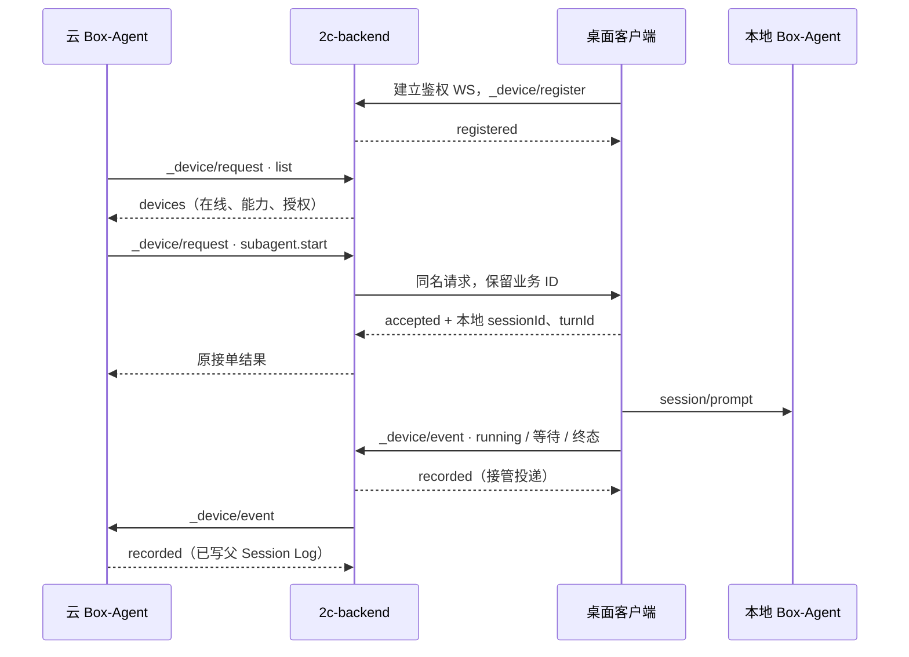

# 云端委派到本机 · 2c-backend 交接

**交付目标**　云 Box-Agent 可以发现已授权的端，向指定桌面异步派发子任务；用户换端查看云会话、桌面短暂离线或连接落在不同 Pod 时，任务身份和结果仍可找回。2c 负责身份、路由、状态快照和可靠投递。父轮何时继续由云 Box-Agent Harness 决定，本机工具与审批由桌面执行。

**当前进度**　Box-Agent 基于 `main@dcd65ffb`，桌面基于 `feat/cloud-computer@da2127b10`，两端源码已用独立项目 `device-delegation-mock` 联调。以下线协议可对接。本次未修改 2c。mock 以单进程内存保存路由、用 HTTP 轮询模拟云侧投递；生产需要接入现有认证、云会话连接和跨 Pod 投递。2c 本地 `master@f8d82ef7e` 的 `internal/service/http/web/desktop_conversation_relay_ws_ticket.go`、`desktop_conversation_relay_publisher.go` 可分别参考现有连接鉴权和跨实例扇出。

## 1. 一次委派如何流转



**启用条件**　2c 已能处理设备反向请求，并且该云会话允许委派时，在云 `session/new` 的 `params._meta` 放入 `{"device":{"version":1}}`；需要恢复此能力的 `session/load` 或 `session/resume` 也携带它。普通 ACP 链路继续按原参数建会话。`version` 为整数。桌面在连接建立后注册，和用户打开哪一个云会话无关。

## 2. 按方法分派

线上传 JSON-RPC 2.0。保留 `_device/` 前缀及 `operation` 值。每跳用 JSON-RPC `id` 关联请求与回包；通过别的连接转发时可以分配新的 `id`，但要把返回帧关联回原请求。

| 方向 | method | 谁处理，返回什么 |
| --- | --- | --- |
| 桌面 → 2c | `_device/register` | 校验登录账号和设备凭据，登记该条 WS 的主机名与能力，返回 `{"registered":true}` |
| 云 Box → 2c → 执行方 | `_device/request` | 下表八种 operation 共用入口。读请求也带 `operationId` |
| 桌面 → 2c → 云 Box | `_device/event` | 两跳都有请求 ID 和回执。2c 记录事件及待投递状态；云 Box 写 Session Log 后确认 |
| 已登录的用户界面 → 2c → 桌面 | `_device/permission_decision` | 仅放行有权审批该云会话的人；桌面校验并返回 `{"applied":true}` |
| 云 Box → 云会话接入方 | `_device/turn` | 无 ID 的通知，`{version,sessionId,turnId,phase}`，`phase` 为 `started` 或 `finished`。转给需要跟踪父轮的调用方 |
| 云会话接入方 → 云 Box | `_device/cancel_turn` | 按用户点击时的云 `{sessionId,turnId}` 停止当前父轮，返回 `{"accepted":true}` 或 `false`；子轮取消由 Harness 发出 |

下表参数为 `_device/request.params.args` 的内容。指定单台设备时，`deviceId` 在 `params`；`wait` 则在每个 target 内给出设备。三个分页操作支持可选 `cursor` 和 `limit`（1–100），续页使用返回的 `nextCursor`。

| 模型工具 / operation | 执行方 | args | 返回要点 |
| --- | --- | --- | --- |
| `device_list` / `list` | 2c | 分页 | `devices[]` 含 `deviceId,online,capabilities,authorization.{view,execute}`；展示端允许无执行能力 |
| `device_session_list` / `session.list` | 桌面 | 分页 | `sessions[]`；两侧按发起的云会话过滤受委派历史 |
| `device_session_read` / `session.read` | 桌面 | `sessionId`、分页 | `sessionId,messages[]`；先校验子会话归属 |
| `device_subagent_start` / `subagent.start` | 桌面 | `instruction` | 新子会话、新子轮，落盘后立即回 `accepted` |
| `device_subagent_send` / `subagent.send` | 桌面 | `sessionId,instruction` | 复用指定子会话，新子轮；仍有执行中子轮时返回 `SESSION_BUSY` |
| `device_subagent_get` / `subagent.get` | 在线走桌面，确认离线走 2c | `sessionId,turnId` | 在线返回本机状态；离线返回最后一次观测 |
| `device_subagent_wait` / `subagent.wait` | 2c | `targets[],timeoutMs?` | 等任一目标就绪。1–32 个不同目标，默认 30000 ms，范围 0–60000；直接查已收快照 |
| `device_subagent_cancel` / `subagent.cancel` | 桌面 | `sessionId,turnId` | `accepted` 表示是否接收取消请求；通过子轮终态确认实际结果 |

`instruction` 为非空字符串，最长 4096 字符。分页游标按字符串原样回传。收到未知操作或当前设备未声明的操作时返回明确错误，上游可据此改选设备。若后端还不能路由这组方法，保持云会话的设备能力关闭；旧客户端可继续使用常规 prompt、权限请求、取消和恢复。

### 串起来看的报文

下例的 `PC-A` 表示先从 `list` 发现且具备执行授权的设备。ID 均为示意值。`cloud-1` 是父会话，`c1` 是发起委派的父轮；`remote-device-01` 和 `t1` 由桌面接单后分配。有身份校验的查询和取消始终使用 `(deviceId, 本地 sessionId, 本地 turnId)`。

```json
{"jsonrpc":"2.0","id":11,"method":"_device/request","params":{"version":1,"sessionId":"cloud-1","parentTurnId":"c1","operationId":"start-01","operation":"subagent.start","deviceId":"PC-A","args":{"instruction":"在默认工作区生成 report.txt 并报告结果"}}}
```

```json
{"jsonrpc":"2.0","id":11,"result":{"deviceId":"PC-A","sessionId":"remote-device-01","turnId":"t1","status":"accepted"}}
```

```json
{"jsonrpc":"2.0","id":21,"method":"_device/event","params":{"version":1,"sessionId":"cloud-1","event":{"operationId":"start-01","deviceId":"PC-A","sessionId":"remote-device-01","turnId":"t1","seq":1,"status":"running"}}}
```

```json
{"jsonrpc":"2.0","id":12,"method":"_device/request","params":{"version":1,"sessionId":"cloud-1","operationId":"wait-01","operation":"subagent.wait","args":{"targets":[{"deviceId":"PC-A","sessionId":"remote-device-01","turnId":"t1"}],"timeoutMs":0}}}
```

```json
{"jsonrpc":"2.0","id":12,"result":{"timedOut":true,"results":[],"states":[{"deviceId":"PC-A","sessionId":"remote-device-01","turnId":"t1","status":"running","seq":1,"observedAt":"2026-11-19T10:00:01Z","deviceOnline":true,"source":"backend"}]}}
```

```json
{"jsonrpc":"2.0","id":22,"method":"_device/event","params":{"version":1,"sessionId":"cloud-1","event":{"operationId":"start-01","deviceId":"PC-A","sessionId":"remote-device-01","turnId":"t1","seq":2,"status":"succeeded","summary":"已在桌面工作区生成 report.txt"}}}
```

`get` 发给在线桌面时 `source:"device"`。`wait` 从路由侧观察同一子轮，不需要 `afterSeq`。已有终态、`waiting_input` 或 `waiting_approval`，立即返回 `{"timedOut":false,"results":[…]}`；重复调用应能读到同一结果。运行中超时按上例返回。在线请求无响应应报传输错误；只有连接已确认断开时，`get` 才返回 `deviceOnline:false,source:"backend",stale:true,currentStatus:"unknown"`。从未观测过子轮事件时，离线快照 `status:"unknown",observedAt:null`。

## 3. 可靠投递和隔离

| 生产场景 | 2c 要实现的行为 |
| --- | --- |
| 注册、换设备、账号切换 | 以已认证账号隔离设备目录，绑定设备凭据与注册名。`deviceId` 是桌面清洗后的主机名；授权取自服务端。同一持有者断线后可重连；另一持有者或仍在线的重名连接得到 `DEVICE_NAME_IN_USE`。已授权用户可换设备查看同一云会话，原子任务仍路由回接单设备 |
| 接单回包丢失、先到事件 | 转发前登记设备、父会话、父轮、`operationId` 及原参数。相同 start/send/cancel 重试原样投递；相同操作 ID 携带不同内容须拒绝。事件可先于接单回执到达；两者只可绑定同一个目标。send 尤须核对请求中的本地 sessionId。cancel 用自己的操作 ID，状态事件继续引用创建子轮的 start/send ID |
| 重复、缺号、断线 | `seq` 在每个子轮从 1 开始。按子轮顺序投递，重复事件幂等确认。mock 在桌面入口遇到缺号返回 `DEVICE_EVENT_SEQUENCE_GAP`。云 Box 可暂存乱序事件，回执可带 `throughSeq,nextSeq`；从 `nextSeq` 补投，缺号补齐前不能将后续终态视为已连续交付 |
| 云连接断开或跨 Pod | 让连接持有 Pod 转发，按账号、设备或云会话维护连接归属。连接代次用于防止旧连接的 close 清掉新路由。生产收到桌面事件，应在可恢复地保存事件及投递进度后回 `recorded:true`；云 Box 确认前可重投。桌面断开不应同时销毁云会话连接。WS 连接状态可配传输层保活，无需新增业务心跳 |
| 等用户、等审批、人工 Stop | `waiting_input` 可带 `inputRequest.question`，答复入口在原桌面。`waiting_approval` 带 `approvalRequestId,title,expiresAt,decisions`（包在 `approval` 内）。2c 展示或转交状态；审批接收方见客户端交接。`succeeded/failed/cancelled/interrupted` 为终态。运行中注入结果、自然结束后唤醒、用户 Stop 后抑制唤醒均由云 Harness 负责 |

**权限边界**　按当前账号和父云会话检查工具调用、每一个 wait target、子会话历史以及审批。设备上报能力不授予执行权。允许 `session.read` 的范围为当前父会话获授权的委派会话；任意本地聊天 ID 不构成访问凭据。用户审批通道校验身份及完整目标，再转发原决策；云模型没有审批工具。

## 4. 接手顺序和验收

1. **打通单实例**。接入生产鉴权与注册回执，先跑通 `list → start → accepted → running → succeeded`。保留方法前缀，先在云侧维持一个独立于观看端的连接。
2. **补可靠性**。落地操作幂等、子轮归属、快照和待投递事件；验证丢接单回执不会二次执行、掉线 `get` 返回旧快照、重连不重复交付。生产持久化与多 Pod 连接归属是后端交付项。
3. **联合验收**。令云会话连接在 Pod A、新设备观看连接在 Pod B；原桌面断线再上线后，用户仍看到同一任务结果。验证未授权账号不能读历史或审批、超时不取消、晚到回执不唤醒已手动停止的父轮。
4. **本地复现**。在独立 `device-delegation-mock` 仓执行 `npm ci`、`npm test`。`broker.mjs` 是路由参照，`device-registration.mjs` 负责注册，`device-approval-control.mjs` 提供 wait/审批范例。`_mock/cloud/register`、`_mock/events` 和本地 `/rpc` 属于调试工具。五个跨仓场景及环境变量见[客户端交接](DEVICE_DELEGATION_CLIENT_HANDOFF_CN.md)。线上地址、账号凭据签发方式与多 Pod 故障切换仍待联合验收。

Box 侧字段和恢复规则见[设备委派协议说明](DEVICE_DELEGATION_LOCAL.md)。
