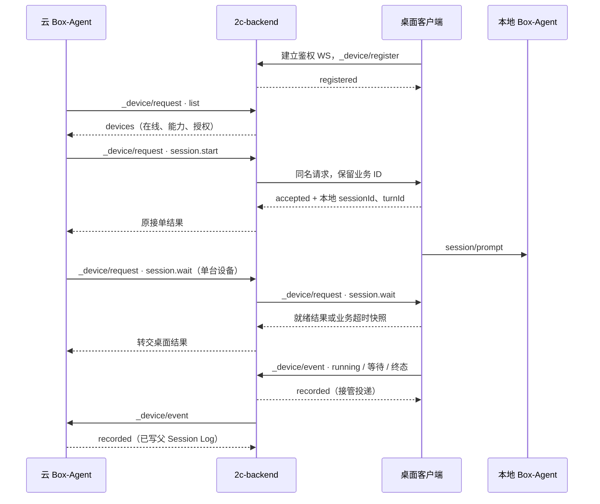

# 云端委派到本机 · 2c-backend 交接

**交付目标**　云 Box-Agent 可以发现已授权的端，向指定桌面异步派发子任务；用户换端查看云会话、桌面短暂离线或连接落在不同 Pod 时，任务身份和结果仍可找回。2c 提供设备目录、鉴权、路由和可靠投递。桌面提供子轮业务快照。父轮何时继续由云 Box-Agent Harness 决定，本机工具与审批由桌面执行。

**当前进度**　Box-Agent 的对接实现见 PR #291（`feat/device-subagent-main`），桌面实现见 raccoon-lab MR !1276（`feat/device-subagent-cloud`）。两端已通过独立 `device-delegation-mock` 做源码联调。mock 以单进程内存保存路由，用 HTTP 轮询模拟云侧投递。生产 2c 的认证、持久投递和跨 Pod 路由仍由后端接手。2c 本地 `master@f8d82ef7e` 的 `internal/service/http/web/desktop_conversation_relay_ws_ticket.go`、`desktop_conversation_relay_publisher.go` 可分别参考现有连接鉴权和跨实例扇出。

## 本轮改动与生产接入清单

| 负责方 | 本轮协议要求 | 验收点 |
| --- | --- | --- |
| Box-Agent | 按下表更新模型工具和 ACP operation；按真实设备拆分 wait，并行等待；保留工具级截止时间；区分业务结果和投递错误 | 三台桌面共享一次截止时间；无回包时父轮拿到工具错误；Stop 能中断等待 |
| 桌面 | 按能力组注册，按新的 session 操作名分派；承接本机 get_turn、wait 和 artifact.upload；为同机发起端增加 ACP 反向请求接入与事件返回 | 等待、断线释放、重连补报和同机断开 2c 均可复现 |
| 2c / 独立 mock | 按新的 operation 校验和透传。跨端工具中仅 list 由路由生成业务结果；取消离线 get、路由聚合 wait 和缓存取件代答；透传 RPC 错误详情 | 普通请求离线即返回；接单丢回执重试只执行一次；注册、鉴权、归属与逐跳回执仍生效 |

PR #291、MR !1276 和已有整链记录是改造前基线。下文是本轮源码协议。独立 mock 作为 2c 的联调实现，生产 2c 仍需按此表接入。

## 1. 一次委派如何流转



**启用条件**　2c 已能处理设备反向请求，并且该云会话允许委派时，在云 `session/new` 的 `params._meta` 放入 `{"device":{"version":1}}`；需要恢复此能力的 `session/load` 或 `session/resume` 也携带它。普通 ACP 链路继续按原参数建会话。`version` 为整数。桌面在连接建立后注册，和用户打开哪一个云会话无关。

支持文件取件的父会话在同一位置传 `{"device":{"version":1,"artifactUpload":true}}`，恢复时沿用已授权的能力配置。云 Box 因此加载第九个工具 `device_artifact_upload`，并允许 start/send 携带 `artifactDelivery`。路由到具体设备时仍要检查该设备最近一次注册是否声明 `artifact.upload`，以及当前账号的执行授权。仅支持基础委派的父会话继续使用八个工具。

## 2. 按方法分派

设备连接使用 JSON-RPC 2.0。Box 通过扩展方法 `_device/request` 发起请求，`params.operation` 描述对目标会话执行的动作。2c 向桌面转发时原样传递这两个字段。每跳用 JSON-RPC `id` 关联请求与回包；通过别的连接转发时可以分配新的 `id`，但要把返回帧关联回原请求。

父会话仍用标准 `session/update` 展示工具调用。以 `session_start` 为例，工具开始和结束共用一个 `toolCallId`；结束时 `status:"completed"` 表示派发完成，`rawOutput.status:"accepted"` 表示桌面接单。这份接单结果也作为工具消息进入父模型上下文。客户端只在收到 `_device/request` 时执行设备指令；回放工具卡片只更新展示。随后上报的 `_device/event` 更新子轮状态。

| 方向 | method | 谁处理，返回什么 |
| --- | --- | --- |
| 桌面 → 2c | `_device/register` | 校验登录账号和设备凭据，登记该条 WS 的主机名与能力，返回 `{"registered":true}` |
| 云 Box → 2c → 执行方 | `_device/request` | 下表八项基础操作和可选取件操作共用入口。读请求也带 `operationId` |
| 桌面 → 2c → 云 Box | `_device/event` | 两跳都有请求 ID 和回执。2c 记录事件及待投递状态；云 Box 写 Session Log 后确认 |
| 已登录的用户界面 → 2c → 桌面 | `_device/permission_decision` | 仅放行有权审批该云会话的人；桌面校验并返回 `{"applied":true}` |
| 云 Box → 云会话接入方 | `_device/turn` | 无 ID 通知。自动续跑开始时带 `version,sessionId,turnId,phase:"started"`。结束时使用同一 turnId、`phase:"finished"`，并在 params 内带 `result` 或 `error`。result 沿用普通 ACP PromptResponse 的 `stopReason` 和 `_meta`（如有），error 沿用 JSON-RPC 错误对象。普通用户轮次走原有 prompt 链路 |
| 云会话接入方 → 云 Box | `_device/cancel_turn` | 按用户点击时的云 `{sessionId,turnId}` 停止当前父轮，返回 `{"accepted":true}` 或 `false`；子轮取消由 Harness 发出 |

部署时桌面、路由和 Box-Agent 须一起切换；注册报文沿用 `version: 1`，注册和设备目录沿用现有 `capabilities` 字段。目录原样返回组名，`authorization` 仍由服务端提供。

| 能力组 | 路由检查 |
| --- | --- |
| `session.history` | 放行已获准的 `session.list`、`session.read` |
| `session.execute` | 桌面支持下表五项会话执行操作及子轮上报。针对 wait 校验该组全部目标归属 |
| `artifact.upload` | 支持按版本取件。要求云端交付的 start/send 还要检查此组 |

按明确的 operation 映射检查能力。未知组不影响已知组注册，未知操作返回不支持。联调期不双写旧能力列表，不要求迁移旧测试会话。普通 ACP 会话沿用现有入口。

### 本轮 ACP 报文差异

| 报文位置 | 改造前联调版 | 本轮协议 |
| --- | --- | --- |
| `_device/register.params.capabilities`、`_device/request(list).result.devices[].capabilities` | 按具体 operation 声明和匹配 | 两处都传能力组。注册只声明能力，目录另外返回服务端计算的 `authorization` |
| `_device/request.params.operation` | 五个执行动作使用旧名称，逐项见下表 | 同机与跨端均使用 `session.*` 执行动作；发送、鉴权、分派和联调断言同时切换 |
| `_device/request(session.wait).params` | targets 可以跨设备，路由端聚合，外层没有目标设备 | 每笔必传 `deviceId`。同一笔的所有 targets 都指向该设备；模型仍只发起一次 wait |
| `session.get_turn / session.wait / artifact.upload` 的成功回包 | 路由可用历史状态、聚合结果或缓存引用代答 | 2c 透传源桌面的结果。get/wait 快照中的 `source` 为 `device`，wait 到期由桌面返回实测状态 |
| `_device/request` 的投递错误 | 旧 mock 的错误帧只保存 code 和 message | 对设备定向请求增加 `error.data.deviceId`、`error.data.delivery`，沿每一跳保留，区分发送前离线和发送后结果未知 |

同机与跨端使用同一张映射表。联调三方直接切换至目标 operation，旧执行操作按未知操作处理。委派关系仍由父会话、派发记录和子轮身份校验；新命名沿用现有访问范围。

例如，停止指定目标子轮时，发起方发送 `method:"_device/request"`，参数取 `operation:"session.cancel"`。目标桌面核对设备、会话和轮次后，才向本地 Box-Agent 发送 ACP `session/cancel`。

下表参数为 `_device/request.params.args` 的内容。指定单台设备时，`deviceId` 在 `params`；模型调用 `wait` 在每个 target 内给出设备；拆分后每笔 ACP 请求的外层也必须有 `params.deviceId`，且与组内每个 target 相同。三个分页操作支持可选 `cursor` 和 `limit`（1–100），续页使用返回的 `nextCursor`。

| 模型工具 / 目标 operation | 改造前 operation | 执行方 | args | 返回要点 |
| --- | --- | --- | --- | --- |
| `device_list` / `list` | 同目标值 | 2c | 分页 | `devices[]` 含 `deviceId,online,capabilities,authorization.{view,execute}`；展示端允许无执行能力 |
| `session_list` / `session.list` | 同目标值 | 桌面 | 分页 | `sessions[]`；两侧按发起的云会话过滤受委派历史 |
| `session_read` / `session.read` | 同目标值 | 桌面 | `sessionId`、分页 | `sessionId,messages[]`；先校验子会话归属 |
| `session_start` / `session.start` | `subagent.start` | 桌面 | `instruction`，按需加 `artifactDelivery:"cloud"` | 新子会话、新子轮，落盘后立即回 `accepted` |
| `session_send` / `session.send` | `subagent.send` | 桌面 | `sessionId,instruction`，按需加 `artifactDelivery:"cloud"` | 复用指定子会话，新子轮；仍有执行中子轮时返回 `SESSION_BUSY` |
| `session_get_turn` / `session.get_turn` | `subagent.get` | 目标桌面 | `sessionId,turnId` | 返回本机快照；设备不可达时返回投递错误 |
| `session_wait` / `session.wait` | `subagent.wait` | Box 分组，各目标桌面分别响应 | `targets[],timeoutMs?` | 模型一次传 1–32 个不同目标，默认 30000 ms，范围 0–60000；每笔 ACP 只含一台设备的目标 |
| `session_cancel` / `session.cancel` | `subagent.cancel` | 桌面 | `sessionId,turnId` | `accepted` 表示是否接收取消请求；通过子轮终态确认实际结果 |
| `device_artifact_upload` / `artifact.upload`（可选） | 同目标值 | 2c 校验归属并转源桌面 | `sessionId,turnId,artifactId` | 桌面返回 `deviceId,sessionId,turnId,artifactId,name,cloudFileRef`。持有云引用的调用方可直接使用文件服务 |

`instruction` 为非空字符串，最长 4096 字符。分页游标按字符串原样回传。收到未知操作或当前设备缺少所需能力组的操作时返回明确错误，上游可据此改选设备。若后端还不能路由这组方法，保持云会话的设备能力关闭；旧客户端可继续使用常规 prompt、权限请求、取消和恢复。

### 串起来看的报文

下例的 `PC-A` 表示先从 `list` 发现且具备执行授权的设备。ID 均为示意值。`cloud-1` 是父会话，`c1` 是发起委派的父轮；`remote-device-01` 和 `t1` 由桌面接单后分配。有身份校验的查询和取消始终使用 `(deviceId, 本地 sessionId, 本地 turnId)`。

```json
{"jsonrpc":"2.0","id":10,"method":"_device/request","params":{"version":1,"sessionId":"cloud-1","operationId":"list-01","operation":"list","args":{}}}
```

```json
{"jsonrpc":"2.0","id":10,"result":{"devices":[{"deviceId":"PC-A","online":true,"capabilities":["session.history","session.execute","artifact.upload"],"authorization":{"view":true,"execute":true}}]}}
```

```json
{"jsonrpc":"2.0","id":11,"method":"_device/request","params":{"version":1,"sessionId":"cloud-1","parentTurnId":"c1","operationId":"start-01","operation":"session.start","deviceId":"PC-A","args":{"instruction":"在默认工作区生成 report.txt 并报告结果"}}}
```

```json
{"jsonrpc":"2.0","id":11,"result":{"deviceId":"PC-A","sessionId":"remote-device-01","turnId":"t1","status":"accepted"}}
```

```json
{"jsonrpc":"2.0","id":21,"method":"_device/event","params":{"version":1,"sessionId":"cloud-1","event":{"operationId":"start-01","deviceId":"PC-A","sessionId":"remote-device-01","turnId":"t1","seq":1,"status":"running"}}}
```

```json
{"jsonrpc":"2.0","id":12,"method":"_device/request","params":{"version":1,"sessionId":"cloud-1","operationId":"wait-01","operation":"session.wait","deviceId":"PC-A","args":{"targets":[{"deviceId":"PC-A","sessionId":"remote-device-01","turnId":"t1"}],"timeoutMs":0}}}
```

```json
{"jsonrpc":"2.0","id":12,"result":{"timedOut":true,"results":[],"states":[{"deviceId":"PC-A","sessionId":"remote-device-01","turnId":"t1","status":"running","seq":1,"observedAt":"2026-11-19T10:00:01Z","deviceOnline":true,"source":"device"}]}}
```

```json
{"jsonrpc":"2.0","id":22,"method":"_device/event","params":{"version":1,"sessionId":"cloud-1","event":{"operationId":"start-01","deviceId":"PC-A","sessionId":"remote-device-01","turnId":"t1","seq":2,"status":"succeeded","summary":"已在桌面工作区生成 report.txt"}}}
```

以上 wait 请求与成功回包为单设备示例。正常响应来自桌面，`source:"device"`。get 和 wait 共用目标子轮快照；wait 不传游标，重复等待已就绪的子轮应立即返回。断线后若父 Harness 已持有历史观测，可注明其来源与观测时间供模型参考；新 get 仍须收到桌面回执才能成功。

桌面已记录 seq=2 的终态。父会话再次等同一子轮时，使用新的请求标识，桌面立即返回完整结果。

```json
{"jsonrpc":"2.0","id":13,"method":"_device/request","params":{"version":1,"sessionId":"cloud-1","operationId":"wait-02","operation":"session.wait","deviceId":"PC-A","args":{"targets":[{"deviceId":"PC-A","sessionId":"remote-device-01","turnId":"t1"}],"timeoutMs":30000}}}
```

```json
{"jsonrpc":"2.0","id":13,"result":{"timedOut":false,"results":[{"deviceId":"PC-A","sessionId":"remote-device-01","turnId":"t1","status":"succeeded","seq":2,"complete":true,"source":"device","deviceOnline":true,"observedAt":"2026-11-19T10:00:02Z","summary":"已在桌面工作区生成 report.txt"}]}}
```

查询同一子轮使用 `session.get_turn`。外层 `sessionId` 标识发起方，`args.sessionId` 和 `args.turnId` 定位目标。get 直接返回子轮快照，wait 将就绪快照放入 `results[]`。

```json
{"jsonrpc":"2.0","id":14,"method":"_device/request","params":{"version":1,"sessionId":"cloud-1","operationId":"get-01","operation":"session.get_turn","deviceId":"PC-A","args":{"sessionId":"remote-device-01","turnId":"t1"}}}
```

```json
{"jsonrpc":"2.0","id":14,"result":{"deviceId":"PC-A","sessionId":"remote-device-01","turnId":"t1","status":"succeeded","seq":2,"complete":true,"source":"device","deviceOnline":true,"observedAt":"2026-11-19T10:00:02Z","summary":"已在桌面工作区生成 report.txt"}}
```

### wait 到期时怎样回包

| 桌面最后一次读取本组快照时 | 桌面业务回包（2c 透传） |
| --- | --- |
| 所有目标仍在运行、接单或状态未知 | 正常成功回包，`timedOut:true`、`results:[]`，`states` 恰好包含每个请求目标一次。每项含三元组、`status` 及已有的 `seq,observedAt,deviceOnline,source`。文件仍在上传时保留 `deliveryStatus:"pending"`。中间工具轨迹和正文留在桌面 |
| 至少一个目标就绪，包括截止时刚完成的目标 | `timedOut:false`，`results` 返回已就绪目标的完整快照。终态带 `seq`、`complete:true`，按实际结果保留 `summary,result,error,permissionIssue`；等待用户的子轮仍为 `complete:false`，带可用的 `inputRequest` 或 `approval` |
| 目标重复、越权或无效 | 拒绝整个请求。每个 target 只含 `deviceId,sessionId,turnId`；权限错误的响应中不附带其他目标的快照 |

父 Harness 拆分前先检查整批目标的数量、重复项及已知归属。每组独立分配 JSON-RPC id 和 operationId，转发时保持业务 ID。桌面检查外层设备、每项目标、父会话授权。Box 按每个已发分组验证返回的目标、序号和结果完整性。有越权或非法响应时按错误处理，不返回该响应中的数据。业务截止处状态刚变为就绪时，返回完整就绪快照。

**多设备合并在 Box 内完成。** 各组并行；任一组就绪就交付。设备不可达时，仍等待其他可达组；所有组不可达时立即返回工具错误。部分不可达时，模型工具结果可增加 `unavailable`（每项含 `deviceId,reason,delivery`），仅列已确认的投递问题。其余各组若全部业务超时则返回 `timedOut:true,results:[],states`，states 仅汇总实际回包；任一就绪则返回 `timedOut:false,results`。仍在等待的组不合成超时或离线。此字段属于 Box 聚合结果，单设备 ACP 成功回包沿用上表。没有可用业务回包且到达硬截止，返回工具错误。

### ACP 投递错误与发起端截止时间

同一请求只有一个 JSON-RPC `result` 或 `error`。结构化投递信息放在 `error.data`；2c 和 ACP 适配层应透传到 Box 的错误处理与工具结果。下列为对同一 start 请求的两种替代回包。

```json
{"jsonrpc":"2.0","id":11,"error":{"code":-32004,"message":"DEVICE_OFFLINE","data":{"deviceId":"PC-A","delivery":"not_sent"}}}
```

```json
{"jsonrpc":"2.0","id":11,"error":{"code":-32008,"message":"DEVICE_DELIVERY_UNKNOWN","data":{"deviceId":"PC-A","delivery":"unknown"}}}
```

| 触发点 | 发起方处理 |
| --- | --- |
| 路由在写入前确认设备已离线 | 返回 `not_sent`；普通请求不留到上线后执行。该值只描述本次尝试。若相同 operationId 之前已经接单或投递结果未知，保留既有记录，仍按同一键核对接单 |
| 已尝试转发，随后断线或回执超时 | 返回 `unknown`；Box 自己先超时则本地生成同义工具错误。保留已观测事件。start/send 未取得接单证据时记录 `unknown_delivery`，同一次操作重试复用原 operationId |
| 首次投递结果未知，重试时授权被拒 | 向本次调用返回拒绝原因，保留原 operationId 和待确认状态。同一父轮恢复授权后再次提交相同指令，用原 ID 取回桌面的接单回执 |
| 已接单后掉线 | 桌面可继续运行，journal 保存未确认事件；重连补投。父端最后已知状态与当前可达性分别记录 |
| 用户 Stop 时子轮设备离线 | 父轮立即停止等待，持久化本轮的待取消意图，恢复后只定向补发取消。若原接单回执丢失，等事件绑定子轮后再取消。晚到终态照常记录；父轮抑制自动唤醒 |

普通 RPC 发起端上限 10 秒，start/send 只等接单；文件取件上限 130 秒。wait 的业务预算默认 30 秒、最长 60 秒，Box 从工具调用开始用单调时钟设置唯一硬截止：业务预算加 10 秒（默认 40 秒、最长 70 秒）。按剩余预算并行发组，各跳的计时须容纳业务等待及回包；重新分组、转发、重试均不得重新起算总预算。正常 `timedOut:true` 是桌面成功响应。RPC 超时释放等待并把错误交给父 loop，不据此取消子轮、判设备离线或自动轮询 get。Stop、首个结果或超时后释放发起端其余等待；下游挂起的 waiter 收到可见的断连即释放，否则最迟在其本地期限释放。

注册回执及事件的 `recorded:true` 是逐跳基础设施确认。保留现有 `_device/event`、`_device/permission_decision`、`_device/turn`、`_device/cancel_turn` 及普通 ACP 会话入口。

## 3. 可靠投递和隔离

| 生产场景 | 2c 要实现的行为 |
| --- | --- |
| 注册、换设备、账号切换 | 以已认证账号隔离设备目录，绑定设备凭据与注册名。`deviceId` 是桌面清洗后的主机名；授权取自服务端。同一持有者断线后可重连；另一持有者或仍在线的重名连接得到 `DEVICE_NAME_IN_USE`。已授权用户可换设备查看同一云会话，原子任务仍路由回接单设备 |
| 接单回包丢失、先到事件 | 转发前登记设备、父会话、父轮、`operationId` 及原参数。相同 start/send/cancel 重试原样投递；相同操作 ID 携带不同内容须拒绝。事件可先于接单回执到达；两者只可绑定同一个目标。send 尤须核对请求中的本地 sessionId。cancel 用自己的操作 ID，状态事件继续引用创建子轮的 start/send ID |
| 重复、缺号、断线 | `seq` 在每个子轮从 1 开始。按子轮顺序投递，重复事件幂等确认。mock 在桌面入口遇到缺号返回 `DEVICE_EVENT_SEQUENCE_GAP`。云 Box 可暂存乱序事件，回执可带 `throughSeq,nextSeq`；从 `nextSeq` 补投，缺号补齐前不能将后续终态视为已连续交付 |
| 云连接断开或跨 Pod | 让连接持有 Pod 转发，按账号、设备或云会话维护连接归属。连接代次用于防止旧连接的 close 清掉新路由。生产收到桌面事件，应在可恢复地保存事件及投递进度后回 `recorded:true`；云 Box 确认前可重投。桌面断开不应同时销毁云会话连接。WS 连接状态可配传输层保活，无需新增业务心跳 |
| 等用户、等审批、人工 Stop | `waiting_input` 可带 `inputRequest.question`，答复入口在原桌面。`waiting_approval` 带 `approvalRequestId,title,expiresAt,decisions`（包在 `approval` 内）。2c 展示或转交状态；审批接收方见客户端交接。`succeeded/failed/cancelled/interrupted` 为终态。运行中注入结果、自然结束后唤醒、用户 Stop 后抑制唤醒均由云 Harness 负责 |
| 查询回包早于事件 | 已认证桌面的 get_turn 或 wait 可能先交付产物引用或待审批项。校验父会话、设备及子轮归属后，该回包也可作为具体 ID 的依据。随后可立即发起取件或人工审批，桌面校验原始文件修订或当前待审批项。事件仍按 seq 顺序入账 |

**权限边界**　按当前账号和父云会话检查工具调用、每一个 wait target、子会话历史以及审批。设备上报能力不授予执行权。允许 `session.read` 的范围为当前父会话获授权的委派会话；任意本地聊天 ID 不构成访问凭据。用户审批通道校验身份及完整目标，再转发原决策；云模型没有审批工具。

**父轮何时继续**　`recorded:true` 确认事件已由该跳接收。2c 可据此推进投递进度；父模型是否已读由 Box 单独记录。父轮运行中，Harness 在后续模型请求中提供未消费的子轮状态，完整的 `get/wait` 结果已在上下文时复用该结果。Box 在模型响应落盘后记录消费回执，没有待确认项时跳过历史摘要计算。2c 原样转交桌面产生的快照、事件和序号。

发起委派的父轮自然结束后，未消费的等待状态或终态可触发一个新的运行时父轮。父会话正在等自己的用户答复时，Box 先保留设备结果；用户手动停止某一父轮时，只取消该轮派发的子轮，其晚到事件照常记录并抑制自动唤醒。Backend 收到上述回执时，继续转交事件和展示状态，无需构造用户 prompt。

## 4. 接手顺序和验收

协议联调时，分别截取 Box 发出和桌面收到的五种执行请求，断言两跳的 `method`、`params.operation` 和 `operationId` 一致。验证旧执行名返回“不支持操作”；只声明 `session.history` 的设备应拒绝执行操作，同时仍能读取已授权的历史。状态事件继续携带原 start/send 的 `operationId`，用于关联目标子轮。

1. **打通单实例**。接入生产鉴权与注册回执，先跑通 `list → start → accepted → running → succeeded`。保留方法前缀，先在云侧维持一个独立于观看端的连接。
2. **补可靠性**。落地操作幂等、子轮归属和待投递事件；验证发出前断线返回 not_sent、丢接单回执返回 unknown 且重试只执行一次、重连不重复交付。生产持久化与多 Pod 连接归属是后端交付项。
3. **联合验收**。令云会话连接在 Pod A、新设备观看连接在 Pod B；原桌面断线再上线后，用户仍看到同一任务结果。验证未授权账号不能读历史或审批、超时不取消、晚到回执不唤醒已手动停止的父轮。
4. **本地复现**。在独立 `device-delegation-mock` 仓执行 `npm ci`、`npm test`。`server.mjs` 提供测试传输，`broker.mjs` 处理路由，`device-registration.mjs` 和 `device-approval-control.mjs` 分别处理设备注册及审批。wait 由桌面处理，mock 负责转发。`_mock/cloud/register`、`_mock/events` 和 `/rpc` 是调试接口。两端整链复用这一个服务；桌面脚本保留丢包注入、SQLite 和回放断言。环境变量及证据读取方法见[桌面整链入口](DEVICE_DELEGATION_CLIENT_HANDOFF_CN.md#桌面整链入口)。

Box 侧字段和恢复规则见[设备委派协议说明](DEVICE_DELEGATION_LOCAL.md)。

## 文件服务对接

1. **派发时绑定云工作区。** 给支持 `artifact.upload` 的桌面转发 start/send 时，从父云会话记录取得工作区 ID，写入转发请求的 `params.workspaceId`。即使本次只要摘要，也要保留这个绑定，以便之后取件。它与桌面本地默认目录 `RaccoonWork` 各有用途。桌面把工作区与原请求一起保存；重投同一操作时沿用原值。
2. **按身份和具体版本取件。** 从登录账号、云父会话、设备、本地子会话和子轮定位清单，再按 `artifactId` 取件。源设备和查看会话的设备可以不同。调用方已收到 `cloudFileRef` 时可直接访问云文件；新发出的取件 RPC 均转源设备，写入前确认离线则回 `DEVICE_OFFLINE`。桌面保留取件 ID 和原始修订的关联。面向用户的取件入口也校验其对父会话的访问权限。
3. **区分子轮完成与文件交付完成。** 只需摘要时，终态可带仅有 `deviceId,artifactId,name` 的引用。指定 `artifactDelivery:"cloud"` 后，上传中的快照为 `running`、`deliveryStatus:"pending"`、`complete:false`。全部文件都有文件服务确认的 `cloudFileRef` 后才返回成功；交付失败时保留 `deliveryStatus:"failed"` 和 `error`。独立 mock 向桌面转发取件的超时为 120 秒，Box 为该 RPC 预留 130 秒。
4. **合并终态后的补报。** 桌面以同一子轮、原 start/send 的 `operationId` 和更高的 `seq` 上报累计清单。2c 可靠转交累计清单。桌面和父 Harness 按原 `artifactId` 合并新增引用，校验设备和文件名，保留原结论、摘要及先前引用。未知条目或冲突的云引用须拒绝；重复事件可幂等确认。这样同一子轮后续的 get/wait 能读到云引用，已消费的完成结果不会再次唤醒父轮。

取件请求、成功回包、文件服务路径和桌面重启后的恢复规则见[客户端产物交付](DEVICE_DELEGATION_CLIENT_HANDOFF_CN.md#设备产物按需交付)。后端验收可分别运行 `--artifact-required` 和 `--artifact-later`，核对上传期间等待、跨父会话拒绝、终态补报、已有云引用离线可用，以及新取件在源机离线时返回投递错误。
