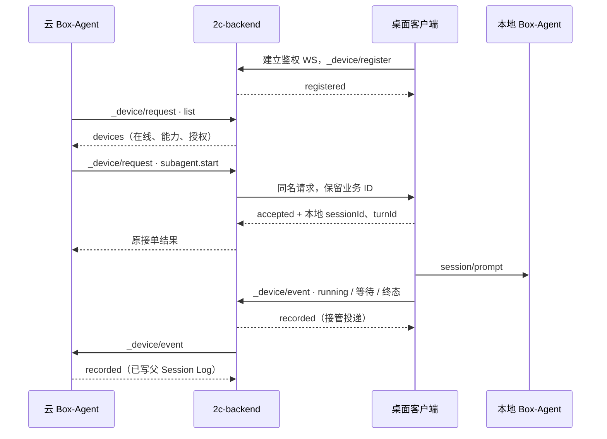

# 云端委派到本机 · 2c-backend 交接

**交付目标**　云 Box-Agent 可以发现已授权的端，向指定桌面异步派发子任务；用户换端查看云会话、桌面短暂离线或连接落在不同 Pod 时，任务身份和结果仍可找回。2c 负责身份、路由、状态快照和可靠投递。父轮何时继续由云 Box-Agent Harness 决定，本机工具与审批由桌面执行。

**当前进度**　Box-Agent 的对接实现见 PR #291（`feat/device-subagent-main`），桌面实现见 raccoon-lab MR !1276（`feat/device-subagent-cloud`）。两端已通过独立 `device-delegation-mock` 做源码联调。mock 以单进程内存保存路由，用 HTTP 轮询模拟云侧投递。生产 2c 的认证、持久投递和跨 Pod 路由仍由后端接手。2c 本地 `master@f8d82ef7e` 的 `internal/service/http/web/desktop_conversation_relay_ws_ticket.go`、`desktop_conversation_relay_publisher.go` 可分别参考现有连接鉴权和跨实例扇出。

## 1. 一次委派如何流转



**启用条件**　2c 已能处理设备反向请求，并且该云会话允许委派时，在云 `session/new` 的 `params._meta` 放入 `{"device":{"version":1}}`；需要恢复此能力的 `session/load` 或 `session/resume` 也携带它。普通 ACP 链路继续按原参数建会话。`version` 为整数。桌面在连接建立后注册，和用户打开哪一个云会话无关。

支持文件取件的父会话在同一位置传 `{"device":{"version":1,"artifactUpload":true}}`，恢复时沿用已授权的能力配置。云 Box 因此加载第九个工具 `device_artifact_upload`，并允许 start/send 携带 `artifactDelivery`。路由到具体设备时仍要检查该设备最近一次注册是否声明 `artifact.upload`，以及当前账号的执行授权。仅支持基础委派的父会话继续使用八个工具。

## 2. 按方法分派

线上传 JSON-RPC 2.0。保留 `_device/` 前缀及 `operation` 值。每跳用 JSON-RPC `id` 关联请求与回包；通过别的连接转发时可以分配新的 `id`，但要把返回帧关联回原请求。

| 方向 | method | 谁处理，返回什么 |
| --- | --- | --- |
| 桌面 → 2c | `_device/register` | 校验登录账号和设备凭据，登记该条 WS 的主机名与能力，返回 `{"registered":true}` |
| 云 Box → 2c → 执行方 | `_device/request` | 下表八项基础操作和可选取件操作共用入口。读请求也带 `operationId` |
| 桌面 → 2c → 云 Box | `_device/event` | 两跳都有请求 ID 和回执。2c 记录事件及待投递状态；云 Box 写 Session Log 后确认 |
| 已登录的用户界面 → 2c → 桌面 | `_device/permission_decision` | 仅放行有权审批该云会话的人；桌面校验并返回 `{"applied":true}` |
| 云 Box → 云会话接入方 | `_device/turn` | Harness 为设备结果自动开启父轮时发送的无 ID 通知，`{version,sessionId,turnId,phase}`，`phase` 为 `started` 或 `finished`。普通用户发起的轮次通过原有 ACP prompt 链路跟踪 |
| 云会话接入方 → 云 Box | `_device/cancel_turn` | 按用户点击时的云 `{sessionId,turnId}` 停止当前父轮，返回 `{"accepted":true}` 或 `false`；子轮取消由 Harness 发出 |

下表参数为 `_device/request.params.args` 的内容。指定单台设备时，`deviceId` 在 `params`；`wait` 则在每个 target 内给出设备。三个分页操作支持可选 `cursor` 和 `limit`（1–100），续页使用返回的 `nextCursor`。

| 模型工具 / operation | 执行方 | args | 返回要点 |
| --- | --- | --- | --- |
| `device_list` / `list` | 2c | 分页 | `devices[]` 含 `deviceId,online,capabilities,authorization.{view,execute}`；展示端允许无执行能力 |
| `device_session_list` / `session.list` | 桌面 | 分页 | `sessions[]`；两侧按发起的云会话过滤受委派历史 |
| `device_session_read` / `session.read` | 桌面 | `sessionId`、分页 | `sessionId,messages[]`；先校验子会话归属 |
| `device_subagent_start` / `subagent.start` | 桌面 | `instruction`，按需加 `artifactDelivery:"cloud"` | 新子会话、新子轮，落盘后立即回 `accepted` |
| `device_subagent_send` / `subagent.send` | 桌面 | `sessionId,instruction`，按需加 `artifactDelivery:"cloud"` | 复用指定子会话，新子轮；仍有执行中子轮时返回 `SESSION_BUSY` |
| `device_subagent_get` / `subagent.get` | 在线走桌面，确认离线走 2c | `sessionId,turnId` | 在线返回本机状态；离线返回最后一次观测 |
| `device_subagent_wait` / `subagent.wait` | 2c | `targets[],timeoutMs?` | 等任一目标就绪。1–32 个不同目标，默认 30000 ms，范围 0–60000；直接查已收快照 |
| `device_subagent_cancel` / `subagent.cancel` | 桌面 | `sessionId,turnId` | `accepted` 表示是否接收取消请求；通过子轮终态确认实际结果 |
| `device_artifact_upload` / `artifact.upload`（可选） | 2c 校验归属，命中云引用时直接返回，否则转源桌面 | `sessionId,turnId,artifactId` | `deviceId,sessionId,turnId,artifactId,name,cloudFileRef`。文件数据走文件服务，路由只收发引用 |

`instruction` 为非空字符串，最长 4096 字符。分页游标按字符串原样回传。收到未知操作或当前设备未声明的操作时返回明确错误，上游可据此改选设备。若后端还不能路由这组方法，保持云会话的设备能力关闭；旧客户端可继续使用常规 prompt、权限请求、取消和恢复。

### 串起来看的报文

下例的 `PC-A` 表示先从 `list` 发现且具备执行授权的设备。ID 均为示意值。`cloud-1` 是父会话，`c1` 是发起委派的父轮；`remote-device-01` 和 `t1` 由桌面接单后分配。有身份校验的查询和取消始终使用 `(deviceId, 本地 sessionId, 本地 turnId)`。

```json
{"jsonrpc":"2.0","id":11,"method":"_device/request","params":{"version":1,"sessionId":"cloud-1","parentTurnId":"c1","operationId":"start-01","operation":"subagent.start","deviceId":"PC-A","args":{"instruction":"在默认工作区生成 report.txt 并报告结果"}}}
```

```json
{"jsonrpc":"2.0","id":11,"result":{"deviceId":"PC-A","sessionId":"remote-device-01","turnId":"t1","status":"accepted"}}
```

```json
{"jsonrpc":"2.0","id":21,"method":"_device/event","params":{"version":1,"sessionId":"cloud-1","event":{"operationId":"start-01","deviceId":"PC-A","sessionId":"remote-device-01","turnId":"t1","seq":1,"status":"running"}}}
```

```json
{"jsonrpc":"2.0","id":12,"method":"_device/request","params":{"version":1,"sessionId":"cloud-1","operationId":"wait-01","operation":"subagent.wait","args":{"targets":[{"deviceId":"PC-A","sessionId":"remote-device-01","turnId":"t1"}],"timeoutMs":0}}}
```

```json
{"jsonrpc":"2.0","id":12,"result":{"timedOut":true,"results":[],"states":[{"deviceId":"PC-A","sessionId":"remote-device-01","turnId":"t1","status":"running","seq":1,"observedAt":"2026-11-19T10:00:01Z","deviceOnline":true,"source":"backend"}]}}
```

```json
{"jsonrpc":"2.0","id":22,"method":"_device/event","params":{"version":1,"sessionId":"cloud-1","event":{"operationId":"start-01","deviceId":"PC-A","sessionId":"remote-device-01","turnId":"t1","seq":2,"status":"succeeded","summary":"已在桌面工作区生成 report.txt"}}}
```

`get` 发给在线桌面时 `source:"device"`。`wait` 从路由侧观察同一子轮，不需要 `afterSeq`。已有终态、`waiting_input` 或 `waiting_approval`，立即返回 `{"timedOut":false,"results":[…]}`；重复调用应能读到同一结果。运行中超时按上例返回。在线请求无响应应报传输错误；只有连接已确认断开时，`get` 才返回 `deviceOnline:false,source:"backend",stale:true,currentStatus:"unknown"`。从未观测过子轮事件时，离线快照 `status:"unknown",observedAt:null`。

### wait 到期时怎样回包

| 读取最后一次快照时 | 2c 的回包 |
| --- | --- |
| 所有目标仍在运行、接单或状态未知 | 正常成功回包，`timedOut:true`、`results:[]`，`states` 恰好包含每个请求目标一次。每项含三元组、`status` 及已有的 `seq,observedAt,deviceOnline,source`。文件仍在上传时保留 `deliveryStatus:"pending"`。中间工具轨迹和正文留在桌面 |
| 至少一个目标就绪，包括截止时刚完成的目标 | `timedOut:false`，`results` 返回已就绪目标的完整快照。终态带 `seq`、`complete:true`，按实际结果保留 `summary,result,error,permissionIssue`；等待用户的子轮仍为 `complete:false`，带可用的 `inputRequest` 或 `approval` |
| 目标重复、越权或无效 | 拒绝整个请求。每个 target 只含 `deviceId,sessionId,turnId`；权限错误的响应中不附带其他目标的快照 |

云 Box 会逐项校验身份、重复项及超时快照是否齐全。若 2c 在 `timedOut:true` 的最终快照中已观察到就绪目标，Box 会从该项直接生成就绪结果。因此最终读取必须保留刚完成目标的完整数据。一轮 `wait` 只需一次请求，超时不会触发隐式 `get` 或取消。整个 RPC 的网络超时与服务成功返回的 `timedOut:true` 分开处理。

## 3. 可靠投递和隔离

| 生产场景 | 2c 要实现的行为 |
| --- | --- |
| 注册、换设备、账号切换 | 以已认证账号隔离设备目录，绑定设备凭据与注册名。`deviceId` 是桌面清洗后的主机名；授权取自服务端。同一持有者断线后可重连；另一持有者或仍在线的重名连接得到 `DEVICE_NAME_IN_USE`。已授权用户可换设备查看同一云会话，原子任务仍路由回接单设备 |
| 接单回包丢失、先到事件 | 转发前登记设备、父会话、父轮、`operationId` 及原参数。相同 start/send/cancel 重试原样投递；相同操作 ID 携带不同内容须拒绝。事件可先于接单回执到达；两者只可绑定同一个目标。send 尤须核对请求中的本地 sessionId。cancel 用自己的操作 ID，状态事件继续引用创建子轮的 start/send ID |
| 重复、缺号、断线 | `seq` 在每个子轮从 1 开始。按子轮顺序投递，重复事件幂等确认。mock 在桌面入口遇到缺号返回 `DEVICE_EVENT_SEQUENCE_GAP`。云 Box 可暂存乱序事件，回执可带 `throughSeq,nextSeq`；从 `nextSeq` 补投，缺号补齐前不能将后续终态视为已连续交付 |
| 云连接断开或跨 Pod | 让连接持有 Pod 转发，按账号、设备或云会话维护连接归属。连接代次用于防止旧连接的 close 清掉新路由。生产收到桌面事件，应在可恢复地保存事件及投递进度后回 `recorded:true`；云 Box 确认前可重投。桌面断开不应同时销毁云会话连接。WS 连接状态可配传输层保活，无需新增业务心跳 |
| 等用户、等审批、人工 Stop | `waiting_input` 可带 `inputRequest.question`，答复入口在原桌面。`waiting_approval` 带 `approvalRequestId,title,expiresAt,decisions`（包在 `approval` 内）。2c 展示或转交状态；审批接收方见客户端交接。`succeeded/failed/cancelled/interrupted` 为终态。运行中注入结果、自然结束后唤醒、用户 Stop 后抑制唤醒均由云 Harness 负责 |

**权限边界**　按当前账号和父云会话检查工具调用、每一个 wait target、子会话历史以及审批。设备上报能力不授予执行权。允许 `session.read` 的范围为当前父会话获授权的委派会话；任意本地聊天 ID 不构成访问凭据。用户审批通道校验身份及完整目标，再转发原决策；云模型没有审批工具。

**父轮何时继续**　`recorded:true` 确认事件已由该跳接收。2c 可据此推进投递进度；父模型是否已读由 Box 单独记录。父轮运行中，Harness 在后续模型请求中提供未消费的子轮状态，完整的 `get/wait` 结果已在上下文时复用该结果。Box 在模型响应落盘后记录消费回执，没有待确认项时跳过历史摘要计算。2c 只需提供准确的快照和序号。

发起委派的父轮自然结束后，未消费的等待状态或终态可触发一个新的运行时父轮。父会话正在等自己的用户答复时，Box 先保留设备结果；用户手动停止某一父轮时，只取消该轮派发的子轮，其晚到事件照常记录并抑制自动唤醒。Backend 收到上述回执时，继续转交事件和展示状态，无需构造用户 prompt。

## 4. 接手顺序和验收

1. **打通单实例**。接入生产鉴权与注册回执，先跑通 `list → start → accepted → running → succeeded`。保留方法前缀，先在云侧维持一个独立于观看端的连接。
2. **补可靠性**。落地操作幂等、子轮归属、快照和待投递事件；验证丢接单回执不会二次执行、掉线 `get` 返回旧快照、重连不重复交付。生产持久化与多 Pod 连接归属是后端交付项。
3. **联合验收**。令云会话连接在 Pod A、新设备观看连接在 Pod B；原桌面断线再上线后，用户仍看到同一任务结果。验证未授权账号不能读历史或审批、超时不取消、晚到回执不唤醒已手动停止的父轮。
4. **本地复现**。在独立 `device-delegation-mock` 仓执行 `npm ci`、`npm test`。`server.mjs` 提供测试传输，`broker.mjs` 处理路由，`device-registration.mjs` 和 `device-approval-control.mjs` 实现注册、等待和审批。`_mock/cloud/register`、`_mock/events` 和 `/rpc` 是调试接口。两端整链复用这一个服务；桌面脚本保留丢包注入、SQLite 和回放断言。环境变量及证据读取方法见[桌面整链入口](DEVICE_DELEGATION_CLIENT_HANDOFF_CN.md#桌面整链入口)。

Box 侧字段和恢复规则见[设备委派协议说明](DEVICE_DELEGATION_LOCAL.md)。

## 文件服务对接

1. **派发时绑定云工作区。** 给支持 `artifact.upload` 的桌面转发 start/send 时，从父云会话记录取得工作区 ID，写入转发请求的 `params.workspaceId`。即使本次只要摘要，也要保留这个绑定，以便之后取件。它与桌面本地默认目录 `RaccoonWork` 各有用途。桌面把工作区与原请求一起保存；重投同一操作时沿用原值。
2. **按身份和具体版本取件。** 从登录账号、云父会话、设备、本地子会话和子轮定位清单，再按 `artifactId` 取件。源设备和查看会话的设备可以不同。已有 `cloudFileRef` 时直接响应，源设备离线也可用；仅有本地引用时转发到该设备，已确认离线则回 `DEVICE_OFFLINE`。桌面保留取件 ID 和原始修订的关联。面向用户的取件入口也校验其对父会话的访问权限。
3. **区分子轮完成与文件交付完成。** 只需摘要时，终态可带仅有 `deviceId,artifactId,name` 的引用。指定 `artifactDelivery:"cloud"` 后，上传中的快照为 `running`、`deliveryStatus:"pending"`、`complete:false`。全部文件都有文件服务确认的 `cloudFileRef` 后才返回成功；交付失败时保留 `deliveryStatus:"failed"` 和 `error`。独立 mock 向桌面转发取件的超时为 120 秒，Box 为该 RPC 预留 130 秒。
4. **合并终态后的补报。** 桌面以同一子轮、原 start/send 的 `operationId` 和更高的 `seq` 上报累计清单。2c 按原 `artifactId` 合并新增引用，校验设备和文件名，保留原结论、摘要及先前引用。未知条目或冲突的云引用须拒绝；重复事件可幂等确认。这样同一子轮后续的 get/wait 能读到云引用，已消费的完成结果不会再次唤醒父轮。

取件请求、成功回包、文件服务路径和桌面重启后的恢复规则见[客户端产物交付](DEVICE_DELEGATION_CLIENT_HANDOFF_CN.md#设备产物按需交付)。后端验收可分别运行 `--artifact-required` 和 `--artifact-later`，核对上传期间等待、跨父会话拒绝、终态补报和源机离线后的缓存命中。
