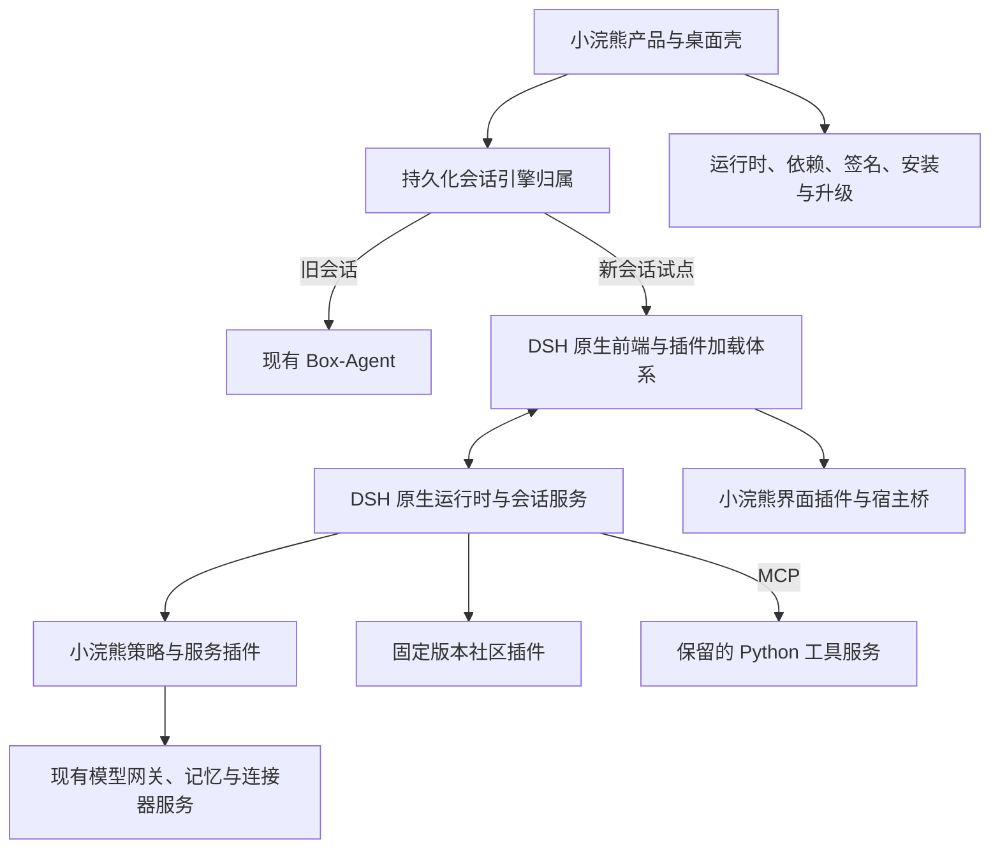

# 小浣熊现有能力盘点与 DSH 迁移表

日期：2026-11-16（Asia/Shanghai）。状态：**源码盘点与迁移设计，尚未实施、未验证 DSH 产品集成。**

本文延续已确认方向：保留小浣熊产品和桌面壳，采用 DSH 原生运行时与插件前端；可独立调用的 Python 能力通过 MCP 复用；生命周期策略迁入 DSH 插件；旧会话由 Box-Agent 承接，新会话分批试用 DSH，一个会话只有一个主引擎。客户只安装小浣熊，所需 Node、Python、插件依赖与原生模块由产品交付。

## 1. 阅读结论与盘点范围

已有投入可以保留，但“功能继续存在”“后端继续调用”“源码直接搬过去”是不同层次。可直接保留的主要是业务服务、Skill 内容、模板、纯处理脚本和外围产品；主要改造集中在服务接入、生命周期、产品协议、权限与发布链路。

本表按**用户能力和行为契约**组织，不按 Python 文件逐个翻译成 TypeScript。每行同时标明可复用部分和需要重接的部分；复用测试用例的业务意图，不意味着旧 Python 单测能直接验证新引擎。

| 优先判断 | 主要能力 | 应先阅读 |
| --- | --- | --- |
| 保留资产与服务 | Skill/模板/处理脚本、账号/模型/记忆后端、云端编辑器与业务 UI | T19–T24、H01/H21/H22 |
| 优先 MCP 复用 | Jupyter、JSONL/邮件解析、网页提取、独立文档/多媒体处理、已有 MCP 服务 | T02/T03/T06/T10/T11/T13、S08–S13 |
| 必须迁移运行语义 | 模型适配、权限、计划与续跑、Skill 状态、自动记忆、子 Agent 策略 | R01–R18、S01–S18 |
| 最大产品接入成本 | 会话/恢复归属、原生前端、审批与取消、身份/凭据、桌面记忆、全平台交付 | H02/H05/H14/H20、S11/S17/S18、B0–B4 |

建议先看上述大项，再按能力 ID 查第 3 节；第 4 节对账工具、全部 Skill 和桌面功能清单，第 5 节给共享工作与验收。

### 1.1 源码基线与证据级别

| 对象 | 本次基线 | 证据边界 |
| --- | --- | --- |
| Box-Agent 工作区 | `1298dc225d95d37499ec754b564c8acf0d31d558`，`main` | 盘点开始时无工作区改动；源码、注册路径与测试文件核对，不代表当前安装版 |
| Box-Agent 远端主分支 | `77e0892a1b957ca8510779fb53aaf48657491a1d` | `git ls-remote origin refs/heads/main` 当日核对；比工作区多 29 个提交，均为 PR #264 相关权限变化；通过 `git show/diff` 单列增量，未切分支或更新业务文件 |
| Raccoon Lab | `00c5fc77a99664596210e1e3a20b22a03ab97423`，当前桌面开发分支 | 核对 `Lab:apps/office-desktop`、`Lab:apps/office` 及所需共享包；本地未跟踪配置和缓存不纳入、不读取、不修改；该分支不是线上版本证明 |
| DSH 参考接口 | `39163dd30f703a79079e2d2446545cff3c453738` | 当日上游 HEAD 与固定提交官方架构/接口文档核对；这是设计参考，正式试点仍需锁定经过验证的版本及完整依赖 |
| Box-Agent 图谱 | `699b67a2be71fe174f1bd090d48d0c4cf41b5bb3`，元数据时间 `2026-09-10T22:58:09.934Z` | 明显早于当前源码；相关 `box_agent/`、`docs/` 有 533 个变更路径，仅作导航，结论依据实际源码；无 `last-run-summary.json` |
| 既有插件实验 | 2026-11-14，安装版小浣熊 1.2.0 / Box-Agent 1.0.10，macOS ARM64 | 固定三个社区插件的隔离实验；模型输出为脚本，界面是独立试验视图；不是完整 DSH 桌面集成、真实模型质量或全平台验收 |

“完整”限定为上述可检查的 Box-Agent 与小浣熊桌面接入范围：运行时、模型、工具、Skill、记忆、连接器、桌面交互、云/本地入口和交付。独立服务端仓库、企业私有部署实现、用户自装的任意 MCP/Skill、未合并分支及真实线上配置不在本次源码证据内；涉及这些部分的行明确保留接口与待核验项，不把调用入口当作服务端实现证明。

表中代码位置默认属于 Box-Agent；标注 `Lab:` 的位置属于 Raccoon Lab。行号为固定基线定位提示，后续变动以符号名和源码为准。`origin/main:` 表示仅远端增量，不能按当前工作区文件解释。测试名称是**未来迁移验收的现有锚点**，本轮没有运行这些行为测试。

### 1.2 迁移类别与改造量

| 类别 | 含义 | 不包含的承诺 |
| --- | --- | --- |
| R：直接复用 | 保留内容、模板、纯算法、已有业务服务或外围产品模块 | 不保证入口、路径、授权、依赖或界面绑定零修改 |
| M：MCP 复用 | 保留 Python/独立进程实现，向 DSH 提供工具或资源 | 新封装仍需身份、取消、进度、错误、资源清理和依赖打包；不是把整个 Box 主循环塞入 MCP |
| P：DSH 插件 | 迁移产品策略、事件处理、服务 Provider 或前端扩展 | 优先消费 DSH 原生服务，不另造会话账本、主循环和调度器 |
| H：宿主/产品适配 | 修改桌面桥、界面状态、身份/协议映射或交付接入 | “两边都支持 ACP”不等于私有元数据、恢复和界面契约相同 |
| N：DSH 原生承接 | 使用原生 Loop、Session、Tools、MCP、Skills、子 Agent 等机制 | 原生能力同名不等于与 Box 行为等价，小浣熊规则仍需 P/H 验收 |
| L：旧链路保留 | 旧会话、旧 CLI/SDK 和历史数据继续由 Box 处理 | 切换新会话默认引擎不代表跨引擎历史能够无损转换 |

组合类别表示同一能力分层迁移，例如 `R+M+P` 表示“算法保留、工具以 MCP 暴露、触发时机迁为插件”，不是三个任选方案。

| 改造量 | 估算口径 | 典型工作 |
| --- | --- | --- |
| S（小） | 内容/配置接入，基本没有新增运行状态 | 资源路径、名称和元数据对齐，少量既有用例回放 |
| M（中） | 单一能力适配，存在清楚的输入输出和有限生命周期 | MCP 封装、Provider 接入、结构化输出转换及错误/取消测试 |
| L（大） | 状态、权限、流式事件或持久化语义需要重接 | 主模型流、自动记忆、Skill 状态、进程/浏览器所有权 |
| XL（很大） | 跨引擎或跨仓库、多平台交付，失败可能破坏会话或授权一致性 | 原生前端接入、会话恢复、子 Agent 约束、产品权限、安装升级 |

这些是**相对工程规模和不确定性估算，不是人日、人月或排期承诺**。默认沿用现有服务和产品规则，开发人员熟悉相关代码，且不扩大业务范围。共享基座只建设一次，表内成本有重叠，不能按行累加。出现必须修改 DSH 核心接口、全新后台协议或跨引擎历史转换时，应拆出新工作包并重新估算。

## 2. 目标边界与 DSH 接入位置

| 接入点 | DSH 已有承载机制 | 小浣熊迁移责任 |
| --- | --- | --- |
| 启动与配置 | named profile、bundle、ordered patch；桌面 Host 通过共享 profile runner 启动 | 产品专用组合、配置迁移、版本锁定、资源路径和健康状态；实验中的直接 Cordis 组装不作为正式启动方案 |
| 回合与会话 | `ctx.agents`、`ctx.sessions`、`agent/*`、会话事件和持久化服务 | 产品身份、控制映射、去重与恢复规则；新会话只有 DSH 一份权威运行状态 |
| 主模型 | `ctx.llm`、模型适配接口、请求与流式事件 | 网关、认证、路由、推理参数、错误、预算与计费；不通过普通工具调用替代主模型协议 |
| 工具与 MCP | `ctx.tools`、原生 MCP client/manager | 工具 schema、业务权限、连接器身份、结果与产物；保留 Python 的部分通过标准 MCP 接入 |
| Skill 与团队 | `ctx.skills` Provider/作用域、原生子 Agent 激活/继续执行机制 | 22 项默认内置与其他技能可见性、专家包快照、子任务授权和预算等产品规则 |
| 审批与隔离 | `ctx.approval`、sandbox/文件系统/子进程服务 | 小浣熊授权语义与执行前校验；各平台能力差异逐项验证，不能把声明权限当成已强制执行 |
| 原生前端 | Client Modules、Gateway/Remote、Client models、Conversation、Slots | 复用完整加载与状态机制，再接产品视觉/卡片/宿主操作；不是仅复制几个 React 组件 |

DSH 官方将 ACP 入口定位为 automation bridge。小浣熊现有 ACP 私有扩展可在产品边界适配，但不应要求它承载全部原生插件前端协议。下表中的 P/H 是建议接入位置，最终以固定版本源码和试点验证，不代表已经存在对应的小浣熊插件。

**原生插件信任边界**：首批纳入发行版的原生 DSH 插件按经确认来源和版本的可信代码管理。统一权限/审批验收针对受控工具、文件系统和执行服务入口，不能证明任意插件直接调用 Node 文件、网络或进程 API 也受这些钩子约束。DSH 的子进程 sandbox 与 Cordis 服务作用域都不能作为任意不可信原生插件的完整隔离保证。若产品要求安装并强隔离任意不可信代码，需要另设隔离工作包、重新估量，不能隐藏在普通 P/H 适配内；具体依据见固定版本 [安全说明](https://github.com/deepseek-ai/deepseek-harness/blob/39163dd30f703a79079e2d2446545cff3c453738/SAFETY.md)。

## 3. 能力迁移总表

### 3.1 运行时、会话、控制与权限（R01–R18）

| ID | 能力与当前行为 | 代码位置与关键符号 | 分类及具体改造 | 改造量与依据 | 迁移验收方式 | 现有测试锚点（未运行） |
| --- | --- | --- | --- | --- | --- | --- |
| R01 | Agent 主循环、流式输出、工具后续请求、终止原因、步数/Token 上限、Provider 停滞处理 | `box_agent/kernel/loop.py:626` `_run_agent_loop_impl`；`box_agent/kernel/loop.py:3039` `AgentLoopKernel`；`box_agent/composition.py:374`；`box_agent/api/run.py:31` `TerminationKind` | **N + P + L**。新会话由 DSH 独占主循环；把小浣熊特有终止分类、限制和恢复策略映射到原生事件/插件；旧 Box 保留。不要通过 MCP 运行一个完整 Box 主循环再伪装成 DSH 主循环。 | **L**：目标并非代码移植，而是多种停止、失败和预算语义对齐；与 R04/R13/R18 共用工作。 | 固定模型响应对照普通回答、工具→后续模型请求、空回答、达到预算、流中断、Provider 不再输出；每轮只产生一个终态，错误不冒充成功；DSH 原生社区流程插件与产品策略共存。 | `tests/test_agent.py`、`tests/test_core.py`、`tests/test_llm_timeout.py`、`tests/test_truncation_continuation.py` |
| R02 | 插件依赖、process/session/run 作用域、初始化失败清理、会话资源归属 | `box_agent/plugins/descriptors.py:12` `PluginScope`；`box_agent/plugins/host.py:155` `PluginHost`；`box_agent/plugins/runtime.py:24` `PluginSession`、`:95` `PluginRuntime`；`box_agent/agent_session.py:200` `AgentSession.open` | **N + P + L**。新链路复用 DSH 原生服务和生命周期；现有 Python 插件描述符不能直接当 Cordis 插件加载，逐个把其业务贡献迁入 DSH 插件或独立服务；Box 宿主只服务旧会话。 | **L**：需重映射依赖、共享资源与异步清理，不只是改清单格式。 | 两会话不同配置不串用资源；初始化失败回收已创建部分；关闭一个会话不清理另一个；活跃任务结束后才释放其资源；重复关闭幂等。 | `tests/test_plugin_host.py`、`tests/test_plugin_host_context.py`、`tests/test_plugin_runtime_lifecycle.py`、`tests/test_session_plugins.py` |
| R03 | 自定义 Hook：运行/步/模型响应观测、工具参数干预、结果文本处理、超时与清理 | `box_agent/hook_bus.py:118` `HookBus`、`:395` `before_tool`、`:435` `after_tool`；`box_agent/plugins/hooks.py` `HookSpec`/`HookOwner`；`box_agent/composition.py:119` `register_run_hooks` | **P + R + L**。保留业务判断规则及回归样本，把每个实际使用的 Hook 改为 DSH 对应事件监听/拦截插件。旧 Python Hook API 仅保留旧链路；不建设完整 HookBus 仿真层。 | **L**：事件顺序、参数修改、结果抑制、取消及异常传播会影响真实执行；具体 Hook 数量需结合部署配置盘点，源码无法枚举用户外部 Hook。 | 对照观测顺序；参数改写后必须重新经过权限/Schema 校验；抑制展示不能伪造“工具未执行”；超时 Hook 不阻塞整个会话；晚到错误和持久化错误可见；跨会话注册不泄漏。 | `tests/test_hook_bus.py`、`tests/test_hook_plugins.py`、`tests/test_hooks.py`、`tests/test_managed_kernel_services.py` |
| R04 | 协议中立的 Run API、SDK、暂停/恢复/取消、审批回包与事件/结果消费 | `box_agent/api/run.py:12` `ControlCommandKind`、`:85` `RunRequest`；`box_agent/agent_service.py:45` `start`；`box_agent/agent_run.py:282` `send`；`box_agent/run_control.py:17` `RunControl`；`box_agent/sdk.py:16` `AgentClient` | **H + P + N + L**。保留产品所需的输入/控制/终态契约，DSH 侧适配原生会话和控制。现有 Python SDK 的对象接口不能直接换成 DSH；旧调用方先保留 Box，若要支持 DSH 再提供明确的新后端适配。 | **L**：有运行归属、异步等待、流式/结果式两种消费、取消与审批竞争；SDK 兼容范围需明确。 | 重复启动同一会话被拒绝；暂停时不发生下一步外部操作；等待审批时取消能解除等待；旧 run 的控制不能影响新 run；事件消费者退出时资源回收，result-only 模式可得到错误终态。 | `tests/test_run_api.py`、`tests/test_run_control.py`、`tests/test_sdk.py`、`tests/test_agent_session.py`、`tests/test_run_delivery.py` |
| R05 | 会话持久化、独占写锁、稳定 cwd、崩溃后的工具未知结果与恢复 | `box_agent/session_log.py:292` `SessionLog`、`:422` `open_or_create`、`:1164` `replay`、`:1345` `repair_interrupted_turn`；`box_agent/session_projection.py:18` `SessionProjection` | **N + H + L**。新 DSH 会话使用原生日志；保存引擎归属，旧日志继续由 Box 读取。跨引擎历史转换作为单独项目；首批不承诺无损转换，也不让两个引擎写同一份日志。 | **XL（若含历史转换）/ L（新旧隔离）**：工具调用状态、图片/Skill 引用、修订与业务状态并非普通消息数组。 | 独立进程重启后继续同一原生会话；错误 cwd/双写拒绝；执行后未落结果的副作用标为未知，不自动重放；未真正分发工具可以辨认；保存失败不得继续假装成功；旧 Box 会话完整回归。 | `tests/test_session_log.py`、`tests/test_agent_session_persistence.py`、`tests/test_session_restore.py`、`tests/test_session_log_images.py` |
| R06 | 历史编辑、回退到指定用户轮次、修订冲突与重试幂等 | `box_agent/session_history.py:50` `revision_request`、`:85` `revise_agent_history`；`box_agent/session_log.py:350` `current_revision` | **H + P + N + L**。将产品“编辑历史后重跑”的精确锚点、revision 和重试规则映射到 DSH 历史能力；缺失语义补插件/适配，不能只截断 UI 消息列表。 | **L**：历史回退同时影响工具成对关系、Goal/Plan/Todo/Skill 投影；涉及数据版本。 | 同请求重试不重复创建修订；过期 revision、失效 turn 锚点拒绝；回退后不能混入已丢弃未来的状态；工具调用/结果成对；Skill 源失效时先失败，原日志不被部分改写。 | `tests/test_acp_history_edit.py`、`tests/test_session_log.py`、`tests/test_session_continuation.py` |
| R07 | 执行中补充输入、请求去重、撤销排队输入、结构化输入事实持久化 | `box_agent/injections.py:127` `submit_user_input`、`:161` `InjectionManager`、`:300` `aapply_next`；`box_agent/api/input.py` `UserInput`；`box_agent/input_preparation.py`；`box_agent/agent_run.py:282` | **P + H + N**。以 DSH 原生 inbox/输入机制承接；保留输入 ID、内容指纹、接收/消费/撤销回执和事实与指令分离规则；文件/选区上下文由产品适配层投递。 | **L**：运行中输入必须与日志提交及取消协调，普通 MCP 调用不能替代当前 run 的接收/消费回执。 | 同 ID 同内容幂等、不同内容冲突；撤销成功的排队输入不进入模型；取消前后边界明确；提交失败不得报已消费，回滚后明确返回丢弃/失败；已提交输入不重复消费；当前待消费队列与回执是 run-scoped transient，不能承诺崩溃后恢复未消费队列；原始输入与推导提示可区分。 | `tests/test_message_injections.py`、`tests/test_input_context.py`、`tests/test_run_control.py`、`tests/test_context_request_commit.py` |
| R08 | 模型上下文投影、Skill 正文/资源去重与分页、请求预算、请求事实可追踪 | `box_agent/context_input.py:68` `DefaultContextEngine`、`:243` `aprepare_request`；`box_agent/context_resources.py`；`box_agent/model_history.py`；`box_agent/skill_runtime.py:26` `SkillRuntime` | **P + N + R**。复用 Skill 内容、输入规范和样本；把小浣熊选择/作用域/去重/预算策略接到 DSH 上下文装配，原 Python Context/Skill 对象不直接复用。Skill 业务内容由另表覆盖。 | **L**：读取事实、源快照、可见权限和当前模型预算共同参与投影，不能仅拼 system prompt。 | 同一 Skill 已读正文不重复膨胀；过长正文可分页且不得绕过授权；显式选择、失效来源、上下文不足有可解释结果；预览请求不写入已消费事实；恢复后仍能定位使用过的资源。 | `tests/test_context_engine_contract.py`、`tests/test_context_input.py`、`tests/test_context_resources.py`、`tests/test_context_request_commit.py`、`tests/test_skill_context_regressions.py` |
| R09 | 自动上下文压缩、摘要失败兜底、保留近期工具组与业务状态 | `box_agent/kernel/compact_engine.py:8` `DefaultCompactEngine`；`box_agent/kernel/context_engine.py:738` `_maybe_summarize`、`:230` `_deterministic_history_fallback`；`box_agent/context_input.py:186` `compact_history` | **N + P + R**。采用 DSH 原生压缩存储路径，迁入仍需要的预算/保留/降级策略和回归语料；不把两套压缩器同时作用到同一会话。 | **L**：摘要模型、图片、工具分组、Skill 资源和持久化投影都有关联。 | 超长会话在实际模型上下文限制内继续；摘要请求失败仍有有界兜底；工具 call/result 不拆散；压缩后计划、待办、目标与必要资源仍可用；避免压缩后再次超预算的循环。 | `tests/test_context_compaction_e2e.py`、`tests/test_compaction_budget_convergence.py`、`tests/test_compaction_resource_retention.py`、`tests/test_skill_append_only_context.py` |
| R10 | Goal 状态、跨轮自动推进、时间/次数预算与无进展停止 | `box_agent/agent.py:124` `GoalState`、`:204` `should_continue_goal_autopilot`；`box_agent/goal_runtime.py:49` `GoalAutopilotController`；`box_agent/acp/__init__.py:3387`；`box_agent/cli.py:2360` | **N + P + H + R**。以 DSH 原生 Goal/调度/持久化承载，保留目标状态定义、预算与无进展规则为小浣熊策略插件，CLI/桌面只展示和控制；与社区续跑插件建立单一续跑决策归属。 | **L**：当前续跑有宿主循环参与，不能只把 `goal_write` 做成 MCP 后期待调度自然等价。 | 完成/阻塞/等待用户/取消后不继续；次数和时长上限准确；无进展能停止；并用社区续跑插件不重复发轮次；重启后状态与产品展示一致。 | `tests/test_goal_runtime.py`、`tests/test_agent_session.py`、`tests/test_acp.py`、`tests/test_cli_runtime.py` |
| R11 | 可见计划、强制先计划、计划审批后才能执行、等待用户状态 | `box_agent/tools/plan_tool.py:131` `PlanStore`、`:181` `PlanWriteTool`；`box_agent/kernel/loop.py:1341`/`:2860` 计划审批门控；`box_agent/agent_session.py:66` `pending_plan_approval` | **N + P + H + R**。原生 Plan 服务承载状态，计划结构与业务要求复用；把审批关联和可执行工具范围放到小浣熊 DSH 策略插件及产品交互适配，执行时重新核验审批。 | **L**：属于真实执行门控，不是 plan 工具 JSON 显示；要保持主动写计划与强制计划两个入口一致。 | 计划审批门控激活时仅放行 `plan_write`，包括读取工具在内的其他工具不默认放行；未激活门控的场景按普通权限策略；错误计划 ID/旧请求审批拒绝；批准后正常继续；取消和新任务不复用旧审批；`waiting_for_user` 与已完成区分；计划重启后可恢复。 | `tests/test_plan_tool.py`、`tests/test_core.py`、`tests/test_waiting_for_user.py`、`tests/test_acp.py` |
| R12 | Todo 增删改、顺序推进、单个进行中项、恢复与压缩提示 | `box_agent/tools/todo_tool.py:255` `TodoStore`、`:524` `TodoWriteTool`、`:798` `TodoReadTool`；`box_agent/session_projection.py` | **N + P + R + H**。由 DSH 原生 Todo 服务承载任务状态，保留所需规则、Schema 和用例并按差异补小浣熊策略，前端映射现有快照；不让独立 Python TodoStore 成为第二份会话事实。 | **M**：状态相对局部，但需对接日志、UI、压缩投影。 | 只能有一个进行中项；完成当前项后按规则推进；非法状态与重复 ID 拒绝；重启恢复；跨会话隔离；显示预览裁剪不丢失底层完整记录。 | `tests/test_todo_tool.py`、`tests/test_session_log.py` |
| R13 | “说要做却停止”的有限续跑、输出截断恢复与辅助判定预算 | `box_agent/turn_continuation.py:427` `TurnContinuationController`；`box_agent/kernel/loop.py:2148` 截断判断路径；`box_agent/llm/task_budgets.py` | **P + N + R**。保留判定规则、边界样本和预算，迁到 DSH 的请求/回合结束扩展；与 Goal、社区 Loop Continue 和能力完成检查协调，不叠加多套自动重试。 | **L**：正常结束、用户提问、Provider 截断、工具 JSON 不完整和业务未完成是不同原因。 | 已完成/说明性回答不续跑；确实欠执行时有限补做；等待用户不替用户做决定；判定超时不当完成；工具实际进展才能重置续跑计数；图片/推理原文不泄漏给辅助判定；不重复已执行副作用。 | `tests/test_turn_continuation.py`、`tests/test_turn_continuation_thinking.py`、`tests/test_truncation_continuation.py` |
| R14 | 子 Agent 一般执行与 batch_files、子日志、流式进度及结果汇总 | `box_agent/tools/sub_agent_tool.py:180` `SubAgentTool`、`:854` `_run_general_loop`、`:1080` `_run_batch_files`、`:264` `_create_child_session_log` | **N + P + R + L**。新会话采用 DSH 子 Agent 原生执行；迁入小浣熊委派输入、任务策略、结果格式和批量文件预读/汇总规则；旧 Python 子循环留给 Box。不能把整个旧 `sub_agent` MCP 化后宣称就是 DSH 原生子 Agent。 | **XL**：涉及父子会话归属、调度、取消、状态、用量和工具能力；与 R15 和团队业务行共享成本。 | 真实双子任务、依赖顺序、同一子会话继续追问；取消父任务会处理子执行；失败子任务不会虚报完成；批量文件读取失败可定位；子任务产物、进度和用量归到正确父任务；新引擎不出现隐藏 Box 子主循环。 | `tests/test_sub_agent_tool.py`、`tests/test_sub_agent_execution.py`、`tests/test_sub_agent_thinking.py`、`tests/test_sub_agent_prompt_projection.py` |
| R15 | 子 Agent 能力最小化、Skill 白名单、写目录限制与共享执行预算 | `box_agent/tools/sub_agent_capabilities.py:594` `CapabilityResolver`；`box_agent/tools/sub_agent_tool.py:110` `_WriteScopedTool`；`box_agent/tools/delegated_budget.py:36` `BudgetCharge` | **P + R**。规则和测试向量复用；在 DSH 子 Agent 创建与工具执行边界实现父级实时权限交集、Skill 来源限制、写范围和共享预算，不只依赖角色提示词。 | **L**：策略跨父子权限、工具发现、执行与预算账本；未知 MCP/进程工具默认拒绝不能丢。 | 子 Agent 不能扩大父级工具/Skill/目录权限；运行中权限撤销生效；读工具不能夹带写/外部动作；并发子调用不能超共享额度；未执行调用释放预留，已执行调用不重复收费；batch_files 不偷开通用执行能力。 | `tests/test_sub_agent_capabilities.py`、`tests/test_sub_agent_tool.py`、`tests/test_delegated_budget.py` |
| R16 | 资源权限判定、临时/持久目录授权、用户审批、审批与运行身份绑定 | `box_agent/tools/permissions.py:137` `PermissionEngine`、`:223` `check`；`box_agent/run_control.py:98` `PermissionBroker`、`:214` `respond`；`box_agent/tools/engine/execution.py` 权限重试链 | **P + H + R；M 仅可保留工具侧检查**。DSH 侧建立宿主可信权限策略与审批关联；Python MCP 工具仍保留本地执行检查，不能把权限放成一个可由模型选择不调用的 MCP 工具。 | **XL**：覆盖 DSH 原生工具、可信社区插件的受控执行入口及 Python 服务；统一授权来源与撤销行为；不含任意原生代码的强隔离。 | 未授权路径拒绝、批准后仅授权范围可用；内置 Skill 目录写保护优先；过期/其他 run 的审批无效；取消期间审批不复活操作；跨会话/账号不串授权；模型输出和插件描述不能自授权限。 | `tests/test_permissions.py`、`tests/test_permission_negotiation.py`、`tests/test_tool_engine_permission_stream.py`、`tests/test_run_control.py` |
| R17 | 文件系统边界、符号链接解析、危险 shell、产品资源保护与 scratch 清理 | `box_agent/tools/permissions.py:254` `_check_filesystem`；`box_agent/tools/safety.py:28` `builtin_skill_write_error`、`:280` `detect_dangerous_command`、`:344` `is_safe_scratch_cleanup`；`box_agent/tools/shell_inspection.py` | **R + M + P**。Python 工具服务内保留现有检查；DSH 原生 shell/文件工具必须覆盖等价保护，或明确由同一受控执行服务承接。上游已有权限功能不代表覆盖小浣熊产品目录规则。 | **L**：shell 展开、链接和复制目标的实际解析不能只靠字符串关键词；主报告另叠加 origin/main 的最新权限修复。 | 普通 workspace 未授权越界、受保护目录覆盖/同步/删除被拒；链接策略按工具类型及 Δ03 产品目录例外分别验证；合法工具与 scratch 清理可用；产品内置 Skill 只读；原生工具与 MCP 不能成为互相绕过路径；沿用最新 shell 回归语料。 | `tests/test_safety.py`、`tests/test_permissions.py`、`tests/test_bash_tool.py`、`tests/test_python_mutation_guard.py` |
| R18 | 共享工具执行链、请求绑定 Schema/目标、并行/超时、调用记录与完成校验接缝 | `box_agent/tools/engine/engine.py:66` `DefaultToolEngine`；`box_agent/tools/engine/execution.py:37` `invoke_tool_once`；`box_agent/kernel/loop.py:975` `CompletionChecks.create`；`box_agent/tools/completion_checks.py:42` `CompletionChecks` | **N + P + M + R**。DSH 原生工具管线负责调度与日志；Python 工具保留执行实现；移植必须保留的参数校验、回执、结果引用和能力所属完成检查语义。工具级 TableCompletionGate 由工具/表格行细化。 | **L**：工具成功、消息展示、可验证完成是不同事实；不能用单个 MCP `tools/call` 成功代替整轮完成。 | Schema 验证失败无副作用；运行中工具目录更新不让已有请求错指工具；并行超时保留已完成结果并回收未完成任务；一次执行对应一次可靠记录；表格未通过可信校验不得报告成功，补充输入/重启继续校验不会串任务。 | `tests/test_tool_engine_compatibility.py`、`tests/test_tool_engine_call_records.py`、`tests/test_tool_engine_permission_stream.py`、`tests/test_table_execution_gate.py` |

### 3.2 模型、连接器、MCP 与记忆（S01–S18）

| ID | 当前能力与必须保留的语义 | 源码位置、关键入口 | 分类与具体改造 | 改造量与依据 | 验收方法（新链路必须执行） | 已有测试锚点（本轮未执行） |
| --- | --- | --- | --- | --- | --- | --- |
| S01 | 多模型提供商、商汤网关和推理方言。当前统一包装 OpenAI-compatible / Anthropic；deep-think 对 SenseNova、DeepSeek、Qwen、Gemini、Kimi 等模型存在不同 wire 映射。 | `box_agent/llm/llm_wrapper.py:153` `LLMClient`；`box_agent/llm/openai_client.py:137` `_apply_thinking_params`、`:949` `_prepare_request`；`box_agent/llm/anthropic_client.py:356` `_prepare_request`。 | **R+N+P**：保留已有服务端网关及模型配置；采用 DSH 模型服务，做小浣熊 provider/请求策略插件，迁移实际参数、工具 schema、错误语义。Python provider 留给 Box 旧会话。**主模型流不能包装成普通 MCP 工具来假装完成迁移**，否则运行时失去模型调用、usage 与取消的所有权。 | **L**：多个提供商与方言，需要对照真实请求，不只是改 endpoint。 | 对每个支持的模型/provider 捕获深思开/关、有/无 tools 的请求；检查不支持参数不发送、合法工具调用与文本均可返回；模型切换后配置即时正确且不串会话。 | `tests/test_llm_clients.py`、`tests/test_reasoning_disabled_policy.py`、`tests/test_openai_client_sensenova.py`、`tests/test_thinking.py`。 |
| S02 | 自定义模型 Profile、会话版本固定与缺失修订恢复。`profileId + profileRevision` 构造隔离客户端；修订丢失时只在同 profile、provider/apiBase 唯一时恢复，歧义直接失败。显式图像能力与上下文窗口会参与客户端构造。 | `box_agent/llm/model_profiles.py:55` `load_model_profile_revision`、`:171` `client_for_model_profile`；`box_agent/llm/llm_wrapper.py:551` `SessionBoundLLM`；`box_agent/llm/capabilities.py:100` `image_input_support`。 | **R+P+H**：复用产品 Profile 数据和设置 UI；增加 DSH 会话模型绑定与修订解析适配，凭据继续留在宿主侧；转换时保留来源、修订、能力、窗口限制，不自动用默认模型掩盖缺失配置。 | **L**：会话持久化、模型客户端、宿主设置三方契约。 | A/B 两会话绑定不同 endpoint/凭据互不污染；旧修订仍固定；缺失修订单一路由可恢复、多路由报错；恢复历史不偷偷换模型。 | `tests/test_model_profiles.py`、`tests/test_llm_image_capability_config.py`、`tests/test_acp.py`。 |
| S03 | 自动模型路由、轻量任务和辅助调用预算。只有宿主显式提供候选池才允许自动选型；手动模式锁定当前模型。标题、摘要、记忆、语音清理等辅助任务按目的限制输出，克隆客户端而不修改主执行客户端。 | `box_agent/llm/model_routing.py:246` `select_auto_model`、`:442` `resolve_model_client`；`box_agent/llm/task_budgets.py:39` `lightweight_output_budget`、`:51` `cap_auxiliary_client`；`box_agent/llm/lightweight.py`。 | **R+P+H**：复用候选池数据、路由规则与测试样例；把路由和预算移到 DSH 模型选择/辅助服务，宿主继续传手动/自动模式。可独立的辅助业务服务保留 Python，但不能让它借用并修改主循环客户端。 | **L**：主任务、子任务和辅助调用都需要统一遵守绑定及预算。 | 手动模式任何辅助任务不换模型；自动模式只从 allowlist 选；上下文不足时给明确诊断；摘要输出触顶不当成完整结果；辅助预算不降低后续主任务预算。 | `tests/test_model_routing_baseline.py`、`tests/test_lite_llm_routing.py`、`tests/test_lightweight_prompt.py`、`tests/test_openai_token_limits.py`。 |
| S04 | 流式响应、重试、错误恢复与工具参数容错。区分 retryable LLM/stream error；每次尝试重置累积状态；拆分 thinking/text；恢复部分 provider 的工具参数及伪工具调用；保留明确的截断/中断结论。 | `box_agent/llm/openai_client.py:397` `_repair_tool_call_arguments`、`:1126` `generate_stream`；`box_agent/llm/anthropic_client.py:500` `generate_stream`；`box_agent/llm/think_tag_splitter.py`；`box_agent/retry.py`；`box_agent/dsml_fallback.py`。 | **N+P**：先复用 DSH 原生流/重试框架，再以 provider adapter/插件补齐小浣熊实际模型兼容；保留历史 wire fixtures，不能用双重 retry 同时重复请求。DSML hook 与主循环的集成需跟运行时盘点合并。 | **L**：分片、重试和调用结果共同决定是否重复执行工具。 | 半包 JSON、thinking 分片、空响应、限流、网络中断分别回放；无重复文本、重复工具副作用；不可重试错误不循环；取消打断等待与重试；截断明确可见。 | `tests/test_stream_retry.py`、`tests/test_retryable_llm_error.py`、`tests/test_retry_should_retry.py`、`tests/test_think_tag_splitter.py`、`tests/test_anthropic_event_order.py`、`tests/test_length_retry_no_double_render.py`。 |
| S05 | 多模态消息、图像输入能力与请求体预算。provider-neutral 图片到各家 wire 转换；图像请求在发送前按准确 body 字节检查，失败不能声称图像已被模型看到；图像能力有显式/未知状态。 | `box_agent/llm/openai_client.py:833` `_convert_messages`；`box_agent/llm/anthropic_client.py:234` `_convert_messages`；`box_agent/llm/image_payload.py:93` `inspect_image_request`、`:117` `validate_image_request`；`box_agent/llm/capabilities.py`；`box_agent/image_context.py`。 | **R+N+P**：可复用图像编码/预处理算法及产物，消息与请求预算接到 DSH 模型请求投影；宿主附件进入 DSH 后保留来源与是否已观察事实。不能只把附件转成文件路径。 | **L**：输入事实、上下文裁剪、provider wire、记忆可见性相互关联。 | 多图与大图临界值、无图能力模型、超大非图文本、图像预算失败测试；检查发送字节与模型实际看到的图像一致；失败前没有模型请求且不会授予记忆可见性。 | `tests/test_multimodal_message_conversion.py`、`tests/test_image_request_limits.py`、`tests/test_anthropic_image_request_preflight.py`、`tests/test_image_context_request_preflight.py`。 |
| S06 | Token 用量、缓存 token 计量、付费工具确认与请求诊断。cached prompt tokens 是 prompt 总数的子集；辅助调用也应计入；付费请求要等待 ACP 宿主确认，取消/过期确认失败关闭；日志有敏感字段脱敏和私密载荷范围。 | `box_agent/llm/token_meter.py:44` `TokenAccumulator`；`box_agent/llm/openai_client.py:504` `_token_usage_from_openai`；`box_agent/acp/billing.py:14` `BillingConfirmation`；`box_agent/tools/billing.py:11` `confirm_billing`；`box_agent/llm/debug_logging.py:242` `sanitize_for_logging`；`box_agent/payload_privacy.py:24` `private_payload_scope`。 | **R+P+H**：复用后台计费服务与产品政策；DSH 插件统一收集主/子/辅助 usage、触发付费审批并投递 UI；保留诊断字段和脱敏契约。这里已确认的是 usage/cache 统计，不据此声称有独立跨请求响应缓存。 | **L**：审批必须与当前调用、当前身份及取消绑定，统计需要跨调用聚合。 | 缓存 token 不重复计数；缺 usage 不造数；同一调用拒绝后不发送付费请求；审批中取消、切账号、旧批准重放不执行；图片生成后失败不自动再次计费；日志不出现 token/私密记忆正文。 | `tests/test_token_meter.py`、`tests/test_openai_cache_usage.py`、`tests/test_billing_confirmation.py`、`tests/test_llm_debug_logging.py`、`tests/test_llm_org_headers.py`。 |
| S07 | 托管登录、刷新、私有部署和隔离配置。登录快照把 token 与组织身份绑定；批准后身份改变拒绝；只对允许服务附加产品凭据；显式 `BOX_AGENT_HOME` 不回退继承旧登录环境，配置验证与路径解析独立。 | `box_agent/auth.py:200` `HostedAuthSnapshot`、`:250` `ensure_hosted_auth_ready`、`:300` `refresh_hosted_auth_token_if_needed`、`:463` `should_attach_auth_header`；`box_agent/config.py:470` `Config`、`:488` `_resolve_profile_paths`；`box_agent/user_paths.py:39` `state_path`。 | **R+P+H**：复用账号服务、配置数据和宿主凭据持有边界；给 DSH provider/MCP/自有插件提供受控凭据接口与 profile 命名空间映射，旧 Box 配置继续留给旧会话。不能直接把全部环境变量和 auth 文件交给每个社区插件。 | **L**：影响模型、MCP、图片、记忆与多账号隔离，需统一宿主适配。 | 登录过期可恢复、刷新401提示重登；同一操作中途切账号/组织失败；第三方 endpoint 不带产品 token；私有部署只访问配置服务边界；干净 profile 不读取开发机配置。 | `tests/test_auth.py`、`tests/test_hosted_auth_recovery.py`、`tests/test_cli_config.py`、`tests/test_plugin_config.py`；隔离 profile 的测试入口由主表补齐。 |
| S08 | MCP 配置来源、默认服务引导与更新。system/connector/user 分源，保留 owner/fingerprint；用户不能覆盖保护来源；首次迁移启用历史默认、后续保留显式禁用；刷新安装路径而非要求客户配置 Node。 | `box_agent/tools/mcp_sources.py:52` `configured_mcp_sources`、`:169` `resolve_mcp_sources`；`box_agent/tools/mcp_bootstrap.py:274` `bootstrap_managed_mcp_config`；`box_agent/tools/mcp_config_tool.py:144` `_resolve_write_target`、`:255` `execute`。 | **R+N+P+H**：继续使用既有 MCP 服务/配置内容；让 DSH 原生 MCP 客户端消费经过宿主归属校验的配置；迁移默认项、来源优先级、禁用和安装路径策略到自有插件/产品适配。不要把整个旧 MCP loader 作为第二套客户端嵌入。 | **L**：迁移用户设置、受保护默认和包内执行路径需要同时处理。 | 旧配置导入不丢用户开关；用户同名覆盖被拒；升级只更新拥有的字段；缺失/坏 JSON 不覆盖原文件；空环境使用安装包内绝对命令成功连接。 | `tests/test_mcp_bootstrap.py`、`tests/test_mcp_sources.py`、`tests/test_mcp_config_tool.py`。 |
| S09 | MCP stdio/SSE/Streamable HTTP 生命周期、连接状态、超时、热重连及只读搜索恢复。按服务锁和来源锁协调替换；未就绪更新拒绝；慢连接不阻塞其他服务；仅托管只读搜索在 session expired 后有界重连并重试一次。 | `box_agent/tools/mcp_loader.py:1595` `MCPServerConnection`、`:2733` `load_mcp_tools_async`、`:2943` `reconnect_mcp_server`、`:2999` `replace_mcp_source`、`:1415` `_call_hosted_search`；`box_agent/mcp_runtime.py:37` `MCPRuntimeController`。 | **N+P+H**：采用 DSH 原生 transport/生命周期；补齐按服务启停、状态通知、有界恢复、配置撤销与宿主操作语义。远端服务和现成 stdio MCP 包可直接继续调用；写操作不得照搬只读搜索的自动重放。 | **L**：连接所有权、进程清理、并发调用与原调用超时预算共同作用。 | 三种 transport 建连/断连；热更新 A 不打断 B；启动未完成拒绝更新且不写半配置；只读搜索 session expired 并发恢复只建一连接；副作用工具不自动重放；停止后无残留进程/调用。 | `tests/test_mcp_connection_lifecycle.py`、`tests/test_mcp_web_search_recovery.py`、`tests/test_mcp_sources.py`、`tests/test_mcp_runtime.py`。 |
| S10 | MCP 工具目录、按需搜索、稳定名称、版本与调用期校验。工具名冲突/未授权项隐藏；搜索结果真正投递后才计入已知 schema；压缩后可恢复目录；调用必须匹配当前 generation/目标，子 Agent 仍受父级限制。 | `box_agent/tools/mcp_tool_catalog.py:101` `MCPToolCatalog`；`box_agent/tools/mcp_tool_search.py:45` `ToolSearchTool`、`:565` `MCPToolExposureManager`、`:935` `validate_call`；`box_agent/tools/tool_call_tool.py`。 | **N+P**：先评估 DSH 原生发现/工具注册机制，保留小浣熊“受限发现+当前调用目标校验”契约；按需补插件，不机械保留旧工具名和 Python 目录对象。现有用户 Skill 如依赖 tool_search/call_tool，工具名迁移需与 Skill 表联动。 | **L**：动态 schema 暴露关联会话上下文、权限与热更新，不能仅转发 tools/list。 | 未搜索工具不可被隐式扩大授权；同名冲突明确；search 后撤销/替换，旧调用拒绝；压缩后重新提供必要 schema；子 Agent 无法扩大父级连接器集合。 | `tests/test_mcp_tool_search.py`、`tests/test_mcp_tool_names.py`、`tests/test_mcp_connector_catalogs.py`、`tests/test_tool_engine_call_records.py`。 |
| S11 | 连接器来源、临时凭据、会话选择和授权撤销。凭据仅进程内保存，user 精确 URL 配置与 connectorRef 分开；恢复凭据前不连接；按 connector scope 替换；状态快照只能表示事实，不授予执行权限。 | `box_agent/tools/mcp_loader.py:2432` `set_mcp_runtime_credential`、`:2496` `clear_mcp_runtime_credential`、`:2525` `_materialize_server_config`；`box_agent/acp/__init__.py:1191` `_connector_skill_is_granted`、`:2275` allowed-connector provider；`box_agent/connector_context.py:44` `append_connector_status`、`:68` `restore_connector_status`。 | **R+P+H**：复用 OAuth/连接器后端与现有用户绑定；DSH 插件接收宿主可信来源/凭据/授权变化，执行前再次核对；前端选择和恢复逻辑继续与宿主对账。必须定义凭据更新与撤销的进程/会话作用域。 | **XL**：跨账号、宿主、工具目录、Skill 和并发会话，来源替换容易影响不相关任务。 | A/B 连接器同名冲突拒绝；恢复 A 不发布半恢复 B；凭据缺失不发裸请求；旧 user 凭据不能覆盖保护来源；撤销后旧 schema/子任务不能继续调用；模型伪造状态文本不授权。 | `tests/test_mcp_sources.py`、`tests/test_connector_context.py`、`tests/test_connector_skill_source.py`、`tests/test_mcp_connector_catalogs.py`。 |
| S12 | MCP 调用相关性、产品/私有域边界与结果适配。模型 session 元数据按调用附加；私有 MCP 包括 SSE endpoint event 都不得越过服务边界；截图等二进制结果转瞬时图像或持久引用，适配器按 run/result 清理。 | `box_agent/tools/model_tool_context.py:12` `ModelToolContext`；`box_agent/tools/mcp_loader.py:1143` `MCPTool.execute`、`:1451` `_private_mcp_http_client`、`:1479` `_attach_mcp_session_header`；`box_agent/tools/mcp_result_hooks.py:18` `MCPResultAdapter`、`:56` `mcp_result_processing_scope`。 | **P+H**：把 session/turn 关联、域名判断及结果转译接在 DSH MCP 执行和结果事件处；复用已有服务 wire 协议和图像/产物处理算法。敏感 binding 不进入模型 schema 或会话日志。 | **L**：调用上下文从 Python ContextVar 换为 DSH 作用域，必须防并发串会话；结果能力需和图像/浏览器模块协作。 | 并发会话请求关联正确；第三方/私有部署不泄漏产品会话 header；重定向和 SSE 改 endpoint 均受限；每次截图只送预期图像，过期结果能力失效且不扩大文件权限。 | `tests/test_mcp_session_header.py`、`tests/test_mcp_result_hooks.py`、`tests/test_mcp_cua_screenshots.py`、`tests/test_mcp_reasoning_policy.py`。 |
| S13 | 本地记忆存储、分主题经验、显式检索及核心记忆工具。核心/主题文件、索引、去重、词法匹配、读写事务和旧结构兼容；租户/用户非默认身份使用 hash 目录隔离。 | `box_agent/memory.py:338` `TopicStore`、`:572` `MemoryManager`、`:1267` `search`、`:1345` `auto_match_context`、`:3026` `memory_identity`、`:3031` `scoped_memory_dir`；`box_agent/tools/memory_tool.py`。 | **R+M**（数据与算法）**+P**（注册/上下文）：优先保留文件格式、查询/写入 Python 实现，提供受控 MCP 接口；DSH 插件负责身份、工具注册与是否注入。不要为接入自动改写旧记忆格式。 | **M**：数据/算法可独立复用，但增加 MCP 会话身份与并发边界。若把数据整体迁新存储则另估 L。 | 复制测试数据后读/写/搜索/重启结果一致；A/B 用户和 tenant 无交叉；并发写不损坏索引；非法路径不可穿越；`enable_memory=false` 时工具和注入符合既有开关。 | `tests/test_memory.py`、`tests/test_memory_context_entries.py`、`tests/test_memory_tool.py`、`tests/test_memory_backends.py`。 |
| S14 | 本地自动提取、匹配、记忆维护、OpenClaw 导入与提升审批。压缩前/步间隔/回合结束触发不同冷却条件；维护有衰减、清档、去重、冲突消解与压缩；候选提升需阈值/冷却并处理用户接受或拒绝。 | `box_agent/memory.py:1581` `import_openclaw`、`:1834` `list_promotion_candidates`、`:1963` `plan_promotion`、`:2763` `MemoryExtractor.maybe_extract`；`box_agent/memory_maintainer.py:115` `run_if_due`；`box_agent/cli_memory_proposal.py`；`docs/MEMORY_MATCH_PROTOCOL.md`、`docs/MEMORY_PROPOSAL_PROTOCOL.md`。 | **R+M+P+H**：导入、提取/维护算法可保留 Python 服务；触发时机、预算、幂等与资源关闭迁 DSH 插件，提案 UI 适配 DSH 前端。自动匹配与用户显式搜索的命中统计不能混淆。 | **L**：算法可复用，但核心价值依赖生命周期和用户审批，单套 MCP CRUD 不足。 | 定时触发不堆积；完成后只学一次、取消失败不记为成功；压缩前已处理必要提取；导入重复执行不重复数据；拒绝后不反复提案；开关关闭后无后台写入。 | `tests/test_memory_extractor.py`、`tests/test_memory_maintainer.py`、`tests/test_memory_promotion.py`、`tests/test_acp_memory_proposal.py`、`tests/test_acp_memory_logging.py`。 |
| S15 | 工具/Skill 纠错记忆。错误指纹与工具/Skill subject、版本相关；候选、确认、验证成功、失效/替代有不同状态；外部记忆模式仍保留同身份本地纠错，desktop 模式明确关闭该本地 curator。 | `box_agent/correction.py:235` `CorrectionCurator`、`:431` `notify_tool_failure_for_correction`、`:483` `prepare_correction_context`；`box_agent/memory.py:1035` `write_correction`、`:1213` `remember_verified_correction`、`:1232` `confirm_correction_draft`；`box_agent/desktop_memory/backend.py:176` `correction_curator`。 | **R+M+P**：保留记录/搜索和指纹规则；将工具失败、成功证据、Skill 版本变化与上下文注入接到 DSH 事件。尊重各记忆后端的能力差异，不能把 desktop 默认打开本地纠错。 | **L**：纠错可信度依赖运行证据和能力版本，不能仅让模型调用“记住错误”。 | 未验证教训不升级；一次性环境修复/敏感内容不沉淀；工具或 Skill 升级使旧教训失效；作用域隔离；desktop 模式不新增本地纠错副本。 | `tests/test_correction_memory.py`、`tests/test_memory_backends.py`、`tests/test_desktop_memory_backend.py`。 |
| S16 | 通用外部记忆与 Memsense。配置式 HTTP recall/read/search/save，租户/用户变量、明确能力集、每会话 clone；真实用户轮次刷新、最后成功结果才保存、保存并发/队列/关闭有界。mem0/memu 当前只是 generic 映射占位，没有原生协议适配。 | `box_agent/memory.py:3044` `create_memory_backend`、`:3084` `ExternalMemoryBackend`、`:3239` `MemsenseMemoryBackend`、`:3602` `MemoryRuntime`、`:3708` `memory_user_turn`；`box_agent/config.py:232` `ExternalMemoryConfig`。 | **R+M+P**：原外部服务继续使用；Python 适配可封装服务，或者在 DSH 插件直接按既有 HTTP 契约调用；每轮召回、替换旧上下文、成功后保存与 shutdown 迁插件。不得把“工具可调用”替代自动记忆生命周期。 | **L**：外部业务服务可复用，触发、上下文与落盘结果判断必须重接。 | 首轮真实请求才访问远端；失败清掉过期上下文；轮次取消可终止召回；完成信号后最终结算失败不保存；队列满和关闭放弃有可见诊断；A/B 账号不串数据。 | `tests/test_memory_backends.py`、`tests/test_memory_tool.py`、`tests/test_acp_memory_logging.py`。 |
| S17 | 桌面统一记忆 Host 代理、身份 epoch、不可变轮次 scope 和操作限制。桌面 Host 决定 cloud/legacy_read_only/unavailable；请求 token/control token 分离；操作白名单、body 限制、不跟重定向/环境代理；注销/切账号/关闭记忆立即撤销。 | `box_agent/desktop_memory/backend.py:38` `TurnScope`、`:49` `_scope`、`:136` `DesktopMemoryBackend`；`box_agent/desktop_memory/transport.py:178` `MemoryHostTransport`；`box_agent/desktop_memory/launch.py:26` `desktop_launch_agent`；`box_agent/desktop_memory/windows_files.py`。 | **R+P+H**：保留桌面 Memory Host 与云端服务/数据，新增 DSH 原生客户端/插件承接协议；Python transport 可短期保留为专用服务，但不能把 control token 暴露为模型可调用通用 MCP。将 epoch、scope、撤销与 DSH 会话绑定。 | **XL**：宿主身份、进程启动、会话生命周期、跨平台凭据文件和协议错误边界共同约束。 | A/B/A 切换只见各自记忆；旧 epoch 回包不可消费；自动记忆关闭、离线、只读源严格按能力执行；重定向/伪造 bootstrap/响应超限被拒；取消不自动重放未知写入；Windows 文件权限路径单独验证。 | `tests/test_desktop_memory_backend.py`、`tests/test_desktop_memory_transport.py`、`tests/test_desktop_memory_launch.py`、`tests/test_desktop_memory_windows_files.py`。 |
| S18 | 桌面记忆的可见性证明、证据交接、后台经验学习与未决操作恢复。HTTP 读取成功不足以允许改核心记忆，需完整内容进入已提交且成功返回的模型请求；刷新上下文撤销旧证明；读取前记录 durable attempt，最终成功结果携带原始用户输入证据；经验任务按 lease/冻结输入/修订冲突处理。 | `box_agent/desktop_memory/visibility.py:31` `CoreVisibilityGuard`、`:110` `prepare_context`；`box_agent/desktop_memory/runtime.py:112` `refresh`、`:219` `_finish`；`box_agent/desktop_memory/evidence.py:98` `EvidenceCursor`；`box_agent/desktop_memory/experience.py:107` `_pump`；`box_agent/desktop_memory/tools.py:59` `execute`。 | **R+P+H**：Host 的持久化与经验状态机可继续使用；DSH 插件重接请求投影/提交/响应证明、Session Log 事实映射、轮次终结与后台作业；适配原生记忆工具和 UI。不能以 MCP 返回 200 或已登记工具代替这些证明。 | **XL**：最深的模型请求、持久日志、身份、后台写入和恢复耦合；先验证 DSH 是否提供完整可用挂点。 | HTTP read 成功但未进模型/被截断/模型失败均不可写；后来请求撤销旧证明；日志 flush 失败不发未保护 context；同 turn 重试使用原时间与幂等身份；只完成最终结果后 handoff；取消、切账号、离线、关闭自动学习不产生新学习；未知写入仅对账不盲重放。 | `tests/test_desktop_memory_visibility.py`、`tests/test_desktop_memory_attempts.py`、`tests/test_desktop_memory_evidence.py`、`tests/test_desktop_memory_evidence_integration.py`、`tests/test_desktop_memory_experience.py`、`tests/test_desktop_memory_inputs.py`。 |

### 3.3 工具、文档与 Skill 业务能力（T01–T24）

| ID | 能力及必须保留的现有行为 | 当前代码位置（仓库相对路径、行号/符号） | 迁移归属及具体工作 | 改造量与依据 | 验收方式及现有测试锚点（本次未运行） |
|---|---|---|---|---|---|
| T01 | 文件读写、定位、追加、精确修改；稳定会话 cwd、分页、权限、禁止设备文件/越界、写入回执及较大文件分段提交 | `box_agent/tools/file/read_tool.py:159 ReadTool`；`box_agent/tools/file_tools.py:140 SearchFilesTool/:739 WriteTool/:1402 AppendTool/:1522 EditTool`；`box_agent/tools/file_change_receipts.py`、`box_agent/tools/file_result_adapter.py` | N+P，L 旧实现保留：优先对齐 DSH 文件工具，保留小浣熊受保护目录、写入归属及回执策略；不能仅以工具同名认定等价。若阶段性 M 复用，授权必须服务端落实、不能只依赖调用端提示词 | L：路径/符号链接/权限/回执/大内容预算共同影响 | 对同一夹具完成读写、精确匹配失败、拒绝越界及软链逃逸、取消确认后不启动新写，已执行写入按回执结算，产物关联正确；`tests/test_tools.py`、`tests/test_read_file_bytes.py`、`tests/test_file_tool_size_guard.py`、`tests/test_file_change_receipts.py` |
| T02 | JSONL 大文件有界查询、投影、游标、内容变更识别 | `box_agent/tools/file/jsonl_tool.py:190 JsonlQueryTool` | R+M：保留分页/JSON Pointer/查询解析，封装 MCP，注入服务端可读范围和会话 cwd；不是会话日志接口替代 | M：核心算法独立，需文件权限及结果大小适配 | 大 JSONL 分页到尾无重复/遗漏，旧游标面对文件改变拒绝，损坏行有明确错误，越权读取失败；`tests/test_jsonl_tool_description.py`、`tests/test_tools.py` |
| T03 | 本地邮件读取和附件提取；`.eml`/`.msg` 原文分页，附件元数据，来源 SHA256 校验，只写显式新路径、不覆盖 | `box_agent/tools/file/email_tool.py:51 ReadEmailTool/:109 ExtractEmailAttachmentTool`；`box_agent/tools/file/email_parser.py` | R+M：复用解析与提取器，映射文件权限、来源 hash 和输出回执；不等于邮件服务连接器/外发能力 | M：解析独立但输出文件与权限需桥接 | `.eml`/`.msg` 正文和多附件夹具正确；来源变化拒绝、恶意附件名不逃逸、已有目标不覆盖、子任务写范围不扩张；`tests/test_email_parser.py`、`tests/test_email_tool.py`、`tests/test_email_delegation.py` |
| T04 | CSV/TSV 全量验证与执行门禁；扫描到 EOF、锁定字段合同/输入角色；编辑、替换、删除、移动的终态证据 | `box_agent/tools/file/validate_table_tool.py:68 TableCompletionGate/:294 ValidateTableTool`；`box_agent/tools/file/table_validation.py`；`box_agent/tools/completion_checks.py:42 CompletionChecks` | R+M（解析/扫描）+P（执行前阻断、回合结束检查和持久状态）：DSH 插件必须把已验证来源 hash、用途、变更角色和最终状态接到工具执行/完成节点。只把 `validate_table` 暴露为普通 MCP 工具会丢掉强制门禁 | L：具跨轮状态、执行前与结束后语义；当前工具级 TableCompletionGate 确实存在，不与旧文档删除的通用 workflow owner 混淆 | 错误原表不能经筛选掩盖；未验证不能调用计算 Shell/Python/子任务；更换 schema/输入 hash 拒绝；移动校验字节一致、拒绝复制冒充移动；取消/恢复保持合同；`tests/test_validate_table_tool.py`、`tests/test_table_validation.py`、`tests/test_table_execution_gate.py`、`tests/test_table_quality_eval.py` |
| T05 | Bash/PowerShell 与后台进程；输出轮询/kill、turn/runtime 生命周期、每会话 owner、进程树清理、超时、危险命令和产品资源保护 | `box_agent/tools/bash_tool.py:729 BackgroundShellManager/:954 BashTool/:2085 BashOutputTool/:2182 BashKillTool`；`box_agent/tools/_win_job.py`；`box_agent/tools/shell_inspection.py`、`box_agent/tools/safety.py` | N+P，L 保留旧路径：采用 DSH 进程服务，移植产品目录/CLI 使用策略、owner、长期服务生命周期与输出语义；若短期 M 复用原执行器，仍须唯一进程 owner 和取消协议 | L：平台差异和进程生命周期，不能当无状态 RPC | 轮询不重复输出；turn 结束收掉 turn 进程、runtime 服务按合同保留；取消杀进程树且不误杀其他会话；Windows/Mac/Linux、批准/拒绝/越界均验证；`tests/test_bash_tool.py`、`tests/test_bash_background_output.py`；近期 origin/main 权限增量由总表另列 |
| T06 | Jupyter Python 分析；变量跨调用保留、独立内核/虚拟环境、依赖处理、输出截断、超时失效内核销毁、子进程与写保护 | `box_agent/tools/jupyter_tool.py:460 SandboxEnvironment/:1129 JupyterKernelSession/:1583 JupyterSandboxTool/:1716 _discard_session/:1737 _session_key/:2352 SandboxStatusTool`；`box_agent/tools/python_environment.py`、`box_agent/tools/python_mutation_guard.py` | R+M+P：复用 Python/Jupyter，按 DSH session/agent 派生不可混用的 owner；插件传递 cwd、资源授权、取消及生命周期，MCP 服务负责内核结束/故障回收，产品继续交付 Python 与依赖 | L：长期进程与会话隔离；加 MCP 壳不等于完成 | 两次调用变量延续、不同产品会话使用相同模型侧 Jupyter kernel session_id 时仍按 owner 隔离状态；超时/取消后 busy 内核不可复用；断开/重启语义明确；PPT guard/产品资源保护不丢失；`tests/test_jupyter_timeout_session.py`、`tests/test_jupyter_runtime_python.py`、`tests/test_jupyter_child_commands.py`、`tests/test_jupyter_output.py`、`tests/test_jupyter_tool_pptx_guard.py`、`tests/test_jupyter_artifact_root_guard.py` |
| T07 | 托管浏览器与用户浏览器分流；公开工具命名、每会话上下文、用户当前页、资源图片/截图落盘、重连不盲目重放动作 | `box_agent/tools/browser_tool_names.py:16`；`box_agent/tools/browser_intent.py`；`box_agent/tools/playwright_session_pool.py`；`box_agent/tools/browser_runtime_scope.py`；`box_agent/tools/browser_result_adapter.py`；`box_agent/skills/browser-use/SKILL.md` | R（现有 MCP 服务与 Skill）+P/H：DSH 连接托管 Playwright/browser-gateway；迁移会话隔离、命名与路由策略、浏览器资源/用户页身份、结果与取消处理；避免两引擎争用用户页面 | L：服务现成，运行时控制和浏览器身份强耦合 | 并行会话 cookie/tab 隔离、用户要求沿用当前页时不新开错环境；重连仅恢复连接而不重复提交；截图路径在授权 workspace；`tests/test_playwright_session_pool.py`、`tests/test_browser_runtime_scope.py`、`tests/test_browser_tool_names.py`、`tests/test_browser_intent.py`、`tests/test_browser_use_builtin_skill.py` |
| T08 | CUA 桌面控制及 Office GUI；driver 就绪、OS 权限、后台优先操作、最新快照绑定、串行协调和截图多模态 | `box_agent/plugins/cua/ready_tool.py:16 CuaService/:62 EnsureCuaReadyTool`；`box_agent/plugins/cua/lifecycle.py:30 CuaRuntimeManager`；`box_agent/mcp_servers/cua_server.py:84 TOOLS/:201 CuaService/:417 build_server`；`box_agent/mcp_servers/cua_adapter.py:386 Adapter`；`skills/computer-use`、`mac-cua`、`office-gui-basics` | R+M（已有 driver/app MCP）+P/H（就绪、关闭/禁用、运行时声明、权限提示、事件和截图）：已有 server 能复用，但 adapter 和 driver 的进程所有权仍需接入 DSH。不能宣称所有平台都已可用；app adapter 中有 Mac 专用行为 | L：原生二进制、OS 授权、后台操作/快照时效及原生交付 | 打包环境启动和开关；权限缺失只报准确诊断；过期元素不可误点；取消释放串行队列；Office 打开/另存和输入位置核对；`tests/test_cua_ready_tool.py`、`tests/test_cua_lifecycle.py`、`tests/test_cua_server.py`、`tests/test_cua_wiring.py`、`tests/test_cua_office_regressions.py`、`tests/test_cua_offswitch_noop.py` |
| T09 | WebSearch/图片搜索结果、引用与预算；去重、站点排序、新旧查询批次、引用链接及图片资料 | `box_agent/tools/web_search_runtime.py:157 _normalize_web_search_refs/:248 _bind_web_search_citations/:756 _dedupe_web_search_content`；`box_agent/tools/web_search_policy.py:27 WebSearchPolicy`；`box_agent/tools/mcp_result_hooks.py` | R（远端搜索服务）+P：复用 MCP endpoint，迁移每运行搜索配额/去重与引用投影，保留认证/用户配置和界面结果结构（服务接入另有总表） | M/L：服务无需重写；运行级预算和呈现需适配 | 同查询去重/配额不跨会话泄漏，指定站点排序与图片元数据保留，模型引用能链接实际来源，404 恢复不无限重试；`tests/test_web_search_references.py`、`tests/test_mcp_web_search_recovery.py` |
| T10 | 网页正文提取与可选摘要；公网 DNS/IP 与重定向校验、服务请求上下文 | `box_agent/mcp_servers/web_extract.py:83 WebExtractTool/:398 _get_following_safe_redirects/:445 _resolve_public_target`；`box_agent/mcp_servers/web_extract_server.py:52 web_extract/:99 main` | R+M：已经是 stdio MCP；迁入内置 Python 服务包，接 DSH 模型/凭据/会话关联；保留 SSRF 和错误语义 | M：已有协议，只需依赖与会话上下文适配 | 公开网页成功，私网/环回/重定向到私网拒绝，摘要模型失败有可解释结果，session correlation 不串会话；`tests/test_web_extract.py`、`tests/test_web_extract_server.py` |
| T11 | 图片生成与编辑；服务端点选择、尺寸/比例、原图输入、私有部署边界、落盘和可选交付、水印 | `box_agent/tools/image_generation_tool.py:419 GenerateImageTool`；`box_agent/tools/watermark.py`；`box_agent/tools/setup.py:941` | R+M+P/H：保留 Python 服务适配；插件接模型/账号凭据、生成授权、用量、产物；包装参数保持既有服务合同，产品管理依赖 | L：付费操作、原图/结果路径、授权与交付贯通 | 生成及带参考图编辑、尺寸限制、错误不计成功、拒绝后无请求、取消不误报已交付、私有部署不访问默认外部端点；`tests/test_image_generation_tool.py`、`tests/test_image_request_limits.py`、`tests/test_image_org_headers.py` |
| T12 | 图片检查与附件；原生图像输入/代理视觉模型选择，尺寸/编码预算和文件权限 | `box_agent/tools/image_inspection_tool.py:56 ImageInspectionTool/:664 ImageAttachmentSnapshotTool`；`box_agent/input_images.py`；`box_agent/image_context.py`、`box_agent/image_store.py` | R（图片处理）+P（DSH 多模态消息/能力和预算）+M（可选代理视觉服务）；内部 `read_image_attachment` 并非普通模型工具，不能整体用文本 MCP 结果替代多模态输入 | L：输入模型能力、用量和请求大小跨层 | 文本模型不误收图片；原生/代理路径一致；附件文件不越权；重启图片引用有效；请求超过预算在发送前拒绝；`tests/test_image_inspection_tool.py`、`tests/test_multimodal_message_conversion.py`、`tests/test_image_context_request_preflight.py`、`tests/test_session_log_images.py` |
| T13 | 视频读取和语音转写；时间段分页、时间戳帧、可选 ASR、缺 ASR 凭据显式降级、取消清理 | `box_agent/tools/video_tool.py:115 ReadVideoTool`；`box_agent/tools/video_transcription.py:37 VolcAsrConfig/:153 transcribe_pcm` | R+M（FFmpeg/ASR）+P（视觉消息与进度/取消/用量）；保留音频结果与视觉分析分离。当前是 `read_video` 的 ASR 路径，不宣称有独立通用音频生成工具 | L：二进制、凭据、视觉请求、流式进度 | 600秒分页/时间戳准确；无 ASR 配置不伪造转写；视频源保持不变；取消终止子进程、错误隐藏凭据；`tests/test_video_tool.py`、`tests/test_video_transcription.py` |
| T14 | 文件型产物发布、暂存提交、归属、保留和清理；最终文件与中间文件区分，发布和生成分离 | `box_agent/tools/publish_artifact_tool.py:27 PublishArtifactTool`；`box_agent/artifact_publication.py:264 apply_delivery_policy`；`box_agent/artifact_metadata.py:336 write_metadata`；`box_agent/tools/engine/artifact_results.py`；`box_agent/tools/owned_file_cleanup.py` | R（元数据/构建器输出）+P/H（DSH 工具结果→产物事件→桌面文件视图/下载）；必要时 M 复用文件服务，发布写入必须保留原子性/权限/归属，不能只渲染一条 Markdown 路径 | L：落盘格式、会话关联、GUI和清理共享合同 | begin/commit/abort 只在成功后出现正式交付；同名不误覆盖他人文件；重启/目录移动仍正确读取；中间文件不冒充最终产物；`tests/test_publish_artifact_tool.py`、`tests/test_artifact_publication.py`、`tests/test_artifact_metadata_relocation.py`、`tests/test_artifact_retention_regressions.py`、`tests/test_owned_file_cleanup.py` |
| T15 | 用户补充事实与有限选项决策；结束当前轮并等待，保留任务产物，安全的默认项/倒计时由宿主处理 | `box_agent/tools/request_user_input_tool.py:21 RequestUserInputTool`；`box_agent/tools/request_user_decision_tool.py:33 RequestUserDecisionTool`；`docs/USER_DECISION_PROTOCOL_CN.md` | R（schema/业务规则）+P/H（DSH 等待/恢复、卡片、请求身份、超时回复）。不把等待包装成永不返回 MCP 调用；敏感动作审批继续走操作授权链 | L：回合控制与 UI 事务身份，PPT入口等依赖此行为 | 卡片回复在同一会话恢复；重复/过期回复拒绝；用户编辑/取消停止自动提交；敏感操作无超时默认；`tests/test_request_user_input_tool.py`、`tests/test_request_user_decision_tool.py`、`tests/test_presentation_outline_decision.py` |
| T16 | 结构化执行回执：completed/needs_input 等结果、改变、检查及证据引用；不代外部工作流提交/验收 | `box_agent/tools/execution_result_tool.py:23 ReportExecutionResultTool`；`box_agent/tools/setup.py:890` | R+P/H：保留输入验证和结果语义，DSH 工具/事件向宿主输出；外部任务身份和版本由原产品层绑定，不通过回执授予提交权 | M：纯结构校验与事件映射 | completed 缺改变/通过检查/标准证据被拒绝；needs_input 缺问题被拒绝；界面准确显示且不触发外部提交；`tests/test_execution_result_tool.py` |
| T17 | 定时任务创建草稿；cron/一次性时间校验，弹窗供用户保存，工具本身不落库 | `box_agent/tools/schedule_tool.py:93 _validate_cron/:136 CreateScheduledTaskTool`；`box_agent/skills/scheduled-task/SKILL.md` | R（验证/Skill）+H/P（DSH 工具结果→现有任务创建窗）；真正调度器与账号、执行引擎归属由桌面盘点负责 | M：协议桥为主；不能写成已有自动调度创建服务 | 非法/少于60分钟周期拒绝；一次性需合法时间；调用只产生草稿，取消不落库，保存才出现任务；`tests/test_schedule_tool.py`、`tests/test_schedule_tool_contract.py` |
| T18 | Obsidian 笔记新建、更新、日记，Vault 配置和启动应用审批 | `box_agent/tools/obsidian_tool.py:216 ObsidianCliClient/:274 ObsidianCreateNoteTool/:316 ObsidianUpdateNoteTool/:366 ObsidianDailyNoteTool/:413 create_obsidian_tools`；`box_agent/skills/obsidian/SKILL.md` | R+M+H：复用CLI封装，接用户已有Obsidian环境/配置与启动许可；Skill作为可安装内容保留 | M：窄服务，但依赖外部应用；“只装小浣熊”不等于替用户安装业务应用 | 正确Vault新建/追加/日记，无配置给清晰诊断；未批准不启动；笔记路径无穿越；`tests/test_obsidian_tool.py`、`tests/test_cli_obsidian.py` |
| T19 | Word/PDF/Excel 文档能力：格式/批注/修订保留，表单/提取，公式与格式/重算验证 | `box_agent/skills/document-skills/docx/SKILL.md`、`box_agent/skills/document-skills/docx/scripts/document.py`、`box_agent/skills/document-skills/docx/ooxml/scripts/validate.py`；`box_agent/skills/document-skills/pdf/SKILL.md`、`box_agent/skills/document-skills/pdf/scripts/fill_fillable_fields.py`；`box_agent/skills/document-skills/xlsx/SKILL.md`、`box_agent/skills/document-skills/xlsx/scripts/validate_xlsx.py` | R（Skill、脚本、模板）+M（需要服务化的Python库）+P/H（资源路径、工具、附件和交付协议）；已有脚本可以直接随包执行，不需把每个脚本都MCP化。内容保留不等于对DSH工具名零适配 | M/L：依赖、渲染器、格式保真和平台差异 | 固定Word修订/批注往返、PDF可填写与扫描件、Excel公式/样式和错误检查；在安装包内打开最终文件核对；`tests/test_xlsx_skill_validation.py`；docx/pdf脚本验证入口，缺少覆盖的端到端样本需补 |
| T20 | PPT统一入口及快速/设计两条链：模式选择、材料/大纲、静态HTML/PPTX、动态HTML、主题/图片/可编辑导出/视觉检查/恢复 | `box_agent/skills/pptx/SKILL.md`；`box_agent/skills/document-skills/pptx/SKILL.md`及`box_agent/skills/document-skills/pptx/scripts/finalize_controlled_deck.js`、`box_agent/skills/document-skills/pptx/scripts/validate_deck_truth.js`、`box_agent/skills/document-skills/pptx/scripts/validate_pptx_package.py`；`box_agent/skills/presentation-suite/skills/` 下的六个 `sn-ppt-*` 包（逐包见 4.3） | R（8个Skill及生成/导出/验证实现）+P/H（选择卡、显式Skill、附件、工具、产物及恢复契约），必要时M复用Python处理；域流程继续由Skill/插件拥有，不迁进DSH通用循环 | XL：双制作链、多解释器、Chromium/字体/图片服务、原生PPTX与HTML双交付 | 两种模式及恢复不重复选择；要求PPTX不能只交HTML；模板编辑保留结构；静态/动态均真实浏览器检查，PPTX实际打开验证，打包环境缺字体/资源诊断；`tests/test_pptx_entry.py`、`tests/test_pptx_controlled_deck.py`、`tests/test_pptx_html_export.py`、`tests/test_pptx_render_quality.py`、`tests/test_presentation_artifact_publication.py` |
| T21 | 研究综合、数据看板、Roadmap和视觉模板；证据来源、结构化日期/几何、单文件交付 | `box_agent/skills/research-synthesis/SKILL.md`及`box_agent/skills/research-synthesis/scripts/validate_research_artifacts.py`；`box_agent/skills/data-dashboard/SKILL.md`；`box_agent/skills/roadmap/SKILL.md`及`box_agent/skills/roadmap/scripts/build_roadmap_artifact.js`；`box_agent/skills/html-templates/SKILL.md` | R内容/算法 +P接入：适配工具、来源/引用、scratch/Node路径及产物；Roadmap保留Draft→Spec→几何→渲染，不从DSH UI重算另一份日期 | M：算法可复用，运行时和交付需要调整 | 研究报告证据可回溯；缺日期保持待确认；半开区间和里程碑正确；scratch清理不删原文件；HTML交互/打印实际检查；`tests/test_roadmap_builtin_skill.py`、`box_agent/skills/research-synthesis/tests/test_evidence_provenance.py` |
| T22 | 视频制作Skill（HyperFrames）；网页原样录制、seekable composition、MP4/GIF、帧检查及浏览器/FFmpeg | `box_agent/skills/hyperframes-video/SKILL.md`；`box_agent/tools/runtime.py:73 build_skill_runtime_context`；`box_agent/tools/skill_execution_env.py` | R（Skill/模板/工具链）+P/H（宿主管理的Node/Chromium/FFmpeg、可见性与交付）；该Skill在推荐/市场内容中，当前不在22项默认内置名单 | L：运行环境和媒体资源闭环，须避免客户运行时下载通用开发依赖 | 固定网页转视频与新composition各一个，逐帧与源内容核对、无空白/缺字体；客户无Node仍能执行、取消清理；现有媒体端到端覆盖需补，不能用普通Skill加载测试替代 |
| T23 | 其余推荐/市场Skill：写作/蜜度、热点选题、旅行、行业审核、开发流程、技能创建/发现、画布/网页测试等 | 见下方完整65项附录；`scripts/generate_skills_manifest.py:34 BUILTIN_SKILL_NAMES`明确保留市场内容但默认隐藏；`box_agent/tools/skill_loader.py:651 _with_expert_skill_sources`允许专家显式绑定 | R内容/脚本 +P/H安装/来源/授权/工具路径：逐组迁移，不自动把43项推荐内容全部变默认内置；外部API密钥/许可/网络依赖分别登记。业务流程不能因Skill文字“多Agent”就视作原生团队兼容 | S（纯文本模板）到L（外部服务/多Agent/浏览器）；总量需按65项附录逐包验收，不能统一估S | 保留启用/隐藏和用户优先级；每组至少一个触发+负向路由+产物样本；蜜度/热点接口需实际可用凭据测试，行业知识时效另审；`tests/test_midu_builtin_skills.py`、`tests/test_city_travel_planner_skill.py`、`tests/test_zhihu_builtin_skill.py`、`tests/test_canvas_design_skill.py`、`tests/test_webapp_testing_skill.py` |
| T24 | Skill资产发现和交付依赖：builtin/user/connector/expert来源、manifest白名单、绑定目录、损坏诊断、运行时路径与scratch | `box_agent/tools/setup.py:327 initialize_base_tools/:696 add_workspace_tools`；`box_agent/tools/skill_loader.py:938 _discover_skills/:1090 _iter_skill_files/:1113 _load_manifest`；`box_agent/tools/skill_execution_env.py`、`box_agent/tools/skill_scratch.py`；`scripts/generate_skills_manifest.py` | R包内容+P/H目录/安装/会话绑定；DSH加载器需保留我们产品的来源优先级、默认可见性和专家快照语义，SkillRuntime上下文/读取预算由运行时总表负责；打包依赖由交付总表负责 | L：全体Skill共享契约，是先决工作，不能每个业务包重写一份加载适配 | 22项默认名单/43项推荐按规则可见；用户覆盖、保留名、损坏绑定不降级同名包、符号链接不逃逸；安装包无外部Node/npm可执行已交付脚本；`tests/test_generate_skills_manifest.py`、`tests/test_builtin_skill_override.py`、`tests/test_skill_loader.py`、`tests/test_connector_skill_source.py`、`tests/test_skill_scratch.py` |

### 3.4 桌面、前端、ACP 与交付（H01–H22）

`Lab:apps/office-desktop/` 为桌面工程，`Lab:apps/office/` 为共用 Web/云端产品工程。产品已实现入口不等于服务端功能和线上状态已经全部核验。

| ID | 能力与当前行为 | 代码位置（当前入口） | 迁移分类、具体工作 | 改造量及依据 | 目标验收（未执行） | 已有测试锚点（未重跑） |
|---|---|---|---|---|---|---|
| H01 | 产品工作台、导航、本地/云端入口、三语与主题、场景案例。桌面外围已复用 Lab 组件，纯 Web 需保持原行为。 | `Lab:apps/office-desktop/app/local-agent/workbench-shell.tsx:1001` `WorkbenchShell`；`:992` `DesktopWorkbenchI18nProvider`；`Lab:apps/office-desktop/runtime/electron/main/client/startClientHost.ts:130`；`Lab:apps/office-desktop/app/local-agent/scenarios/` | R+H：保留工作台/品牌/导航/场景内容，把新会话路由挂到 DSH 原生 Web 应用；明确视图与宿主生命周期，复用现有 i18n/theme，原生前端内部样式适配另计 H05。 | M：现有 UI 可留，新增引擎入口和窗口路由；与 H02/H05 有依赖。 | 简中/英/日、浅深/系统、宽窄窗口、本地/云端切换；场景只填草稿；Web 不出现桌面专属行为。 | `Lab:apps/office-desktop/tests/navigation/static-cloud-routes.test.mjs`；`Lab:apps/office-desktop/tests/cloud/cloud-reuse-boundary.test.mjs`；`Lab:apps/office-desktop/tests/unit/client/startClientHost.spec.ts` |
| H02 | 会话创建/身份绑定、历史目录、恢复与历史编辑。主进程保存产品 ID 与 ACP ID 绑定，SQLite 为客户端展示记录，Box 日志仍为执行事实。 | `Lab:apps/office-desktop/runtime/electron/main/client/agent/createAgentSession.ts:22`；`Lab:apps/office-desktop/runtime/electron/main/client/agent/registerAgentBridge.ts:138`（load/replay 约 476；history_edit 661）；`Lab:apps/office-desktop/runtime/electron/main/localChatStorage/repository.ts:48`；`Lab:apps/office-desktop/runtime/electron/main/client/conversation/historyRevision.ts:10`；`box_agent/acp/__init__.py:1755` | H+N+L：给产品会话持久化引擎归属与运行时会话 ID；新 DSH 会话由 DSH 持久化/恢复负责，旧会话仍走 Box；展示目录可复用。双写历史需明确投影与提交边界；跨引擎转换另项设计，不能假设 JSONL/ACP 名称相同即可导入。 | XL：状态、回放、编辑修订、崩溃恢复跨两仓；不是换启动命令。 | 新旧会话重启后回正确引擎；无未知 ID 自动降级新建；历史编辑仅影响目标轮；恢复失败保留原数据；账号切换不串会话。 | `Lab:apps/office-desktop/tests/unit/client/agent/registerAgentBridge.spec.ts`；`Lab:apps/office-desktop/tests/unit/client/conversation/historyRevision.spec.ts`；`Lab:apps/office-desktop/tests/conversation/history-edit.test.mjs`；`tests/test_acp_history_edit.py` |
| H03 | 输入、附件、草稿、会话引用、图片、能力选择。主进程准备附件并验证 workspace；不是把所有文件转文本塞 prompt。 | `Lab:apps/office-desktop/runtime/electron/main/client/conversation/inputState.ts:15`；`Lab:apps/office-desktop/runtime/electron/main/client/workspace/attachments.ts:34`；`Lab:apps/office-desktop/runtime/electron/main/client/workspace/fileInputs.ts:65` `validateClientPromptBlocks`；`Lab:apps/office-desktop/runtime/electron/main/client/agent/agentBoundary.ts:26` | R+H：保留文件准备、草稿和引用选择器；把有序文本/资源/图片块及显式选技能映射到 DSH 原生输入；处理 URI、临时资源所有权与实际模型可见性，保留失败草稿。 | L：输入 contract、身份、资源路径与原生 composer 相接。 | 图片+文字+附件混排顺序正确；准备阶段取消后不晚发送；同名/大文件/缺失资源报可恢复错误；切会话草稿隔离；未授权路径拒绝。 | `Lab:apps/office-desktop/tests/unit/client/workspace/fileInputs.spec.ts`；`Lab:apps/office-desktop/tests/unit/client/workspace/attachments.spec.ts`；`Lab:apps/office-desktop/tests/conversation/composer-attachments.test.mjs`；`Lab:apps/office-desktop/tests/conversation/client-image-send.test.mjs` |
| H04 | Office 文档选区提问/修改、数据库上下文与引用事实。选区是模型输入事实，不授予文件或数据库权限。 | `Lab:apps/office-desktop/app/local-agent/workspace/document-selection-chat.tsx:32`；`Lab:apps/office-desktop/runtime/electron/main/client/agent/agentBoundary.ts:6` `clientInputContextMeta`；`Lab:apps/office-desktop/runtime/electron/main/agent/boxAgentManager.ts:2759` 数据库上下文构造；`box_agent/input_context.py:106` | R+H+P：保留选区 UI、资料选择和 schema；在 DSH 输入/上下文插件中持久化原文与结构化事实、按请求投影；授权仍由文件/数据库工具执行。 | L：对话事实、重试指纹、文档定位与工具授权多边联动。 | 同段文字不同选区不能误作同一请求；页码/文件切换后引用正确；重启保持事实；伪造 selection/database metadata 不能越权；修改结果实际落盘并预览。 | `Lab:apps/office-desktop/tests/data-sources/native-reference-provider.test.mjs`；`Lab:apps/office-desktop/tests/conversation/client-references.test.mjs`；`tests/test_input_context.py`；`tests/test_message_injections.py` |
| H05 | 聊天消息、思考/进度/工具卡片、计划/Todo/目标/委派、记忆卡片、后续建议及可视化交互。现有 UI 消费 Box/ACP 事件与私有元数据。 | `Lab:apps/office-desktop/app/local-agent/conversation/local-conversation.tsx:86`；`Lab:apps/office-desktop/app/local-agent/messages/message-list.tsx:24`；`Lab:apps/office-desktop/src/shared/agent/stages/`；`Lab:apps/office-desktop/src/shared/agent/events/`；`box_agent/acp/message_display.py:16` | N+H+R：新会话采用 DSH 原生插件加载/插槽/状态/输入交互；保留小浣熊独有卡片和展示规则作为原生前端插件或外围组件。Box 旧事件 renderer 保留给旧会话。禁止将最小 SlotCore demo 当完整前端兼容。 | XL：产品消息模型与完整原生前端体系衔接，兼容面广。 | 三类原版社区插件在实际桌面工作：流式渲染、交互回填、草稿保护、刷新恢复、状态插槽；长会话虚拟列表不丢事件；进度不是最终完成；未知事件可诊断。 | `Lab:apps/office-desktop/tests/conversation/message-display.test.mjs`；`Lab:apps/office-desktop/tests/conversation/conversation-delegation.test.mjs`；`Lab:apps/office-desktop/tests/conversation/visualization-interaction.test.mjs`；`Lab:apps/office-desktop/tests/unit/shared/agent/events/eventProcessor.spec.ts` |
| H06 | 产物列表/卡片、Office/PDF/表格/PPT/HTML/视频预览，下载、导出与独立编辑窗口。文件路径和产物身份受宿主验证。 | `Lab:apps/office-desktop/runtime/electron/main/client/artifacts/registerArtifactHandlers.ts:26`；`Lab:apps/office-desktop/app/local-agent/workspace/workspace.tsx:295` `WorkspacePreview`；`Lab:apps/office-desktop/runtime/electron/main/client/artifacts/officePreviewHost.ts`；`Lab:apps/office-desktop/runtime/electron/main/client/artifacts/presentationHost.ts`；`box_agent/artifact_publication.py:264` | R+H+P：预览器/导出器尽量复用；DSH 插件发布小浣熊产物事实与交付元数据，再经宿主受控文件桥接；原生社区 UI 与现有产物预览并存，区分临时文件/正式交付。 | L：文件身份、版本、资源 URL/CSP 和发布时机需适配；Office渲染引擎不因换主引擎而重写。 | 真实 DOCX/XLSX/PPTX/PDF/HTML 产物可打开导出；相对资源可用；更新同文件可刷新；越界/符号链接/跨会话访问拒绝；未发布中间产物不冒充交付。 | `Lab:apps/office-desktop/tests/unit/client/artifacts/registerArtifactHandlers.spec.ts`；`Lab:apps/office-desktop/tests/unit/client/artifacts/officePreviewHost.spec.ts`；`Lab:apps/office-desktop/tests/unit/client/artifacts/controlledDeckExport.spec.ts`；`Lab:apps/office-desktop/tests/conversation/artifact-display.test.mjs` |
| H07 | 项目/工作区绑定、文件浏览、变更 diff、操作快照、恢复/清理。当前按任务运行前后记录操作与实际文件证据。 | `Lab:apps/office-desktop/runtime/electron/main/client/workspace/conversationWorkspace.ts:31`；`Lab:apps/office-desktop/runtime/electron/main/workspace/localFileAccess.ts:13`；`Lab:apps/office-desktop/runtime/electron/main/changes/changeHistoryManager.ts:1344` `beginTrackedOperation`、`:1657` `finalizeTrackedOperation`；`Lab:apps/office-desktop/app/local-agent/workspace/changes/` | R+H+P：保留 workspace 和 change store；将执行前快照、写入 receipt、结束/取消结算挂接 DSH；确保执行前准备完成，不在 renderer 猜测工具写入。 | L：跨进程时序、取消和产物归属；大目录性能也需测。 | 两会话同/不同项目无错误归属；取消仍结算真实变更；恢复/删除只作用授权目标；大目录快照有界；退出不丢待结算记录。 | `Lab:apps/office-desktop/tests/unit/client/workspace/conversationWorkspace.spec.ts`；`Lab:apps/office-desktop/tests/unit/client/workspace/workspaceGitChanges.spec.ts`；`Lab:apps/office-desktop/tests/unit/client/changes/changeAttribution.spec.ts`；`Lab:apps/office-desktop/tests/unit/client/changes/historicalArtifactAttribution.spec.ts` |
| H08 | 专家、专家团、工作流、执行包、私有 Skill、导入导出与依赖确认；导入 WorkBuddy 只转换支持的内容，不代表运行机制兼容。 | `Lab:apps/office-desktop/runtime/electron/main/experts/packages/prepare.ts:30/41/52`；`Lab:apps/office-desktop/runtime/electron/main/experts/packages/runtime.ts`；`Lab:apps/office-desktop/runtime/electron/main/experts/packages/workbuddy.ts`；`Lab:apps/office-desktop/runtime/electron/main/agent/boxAgentManager.ts:4227`；`Lab:apps/office-desktop/app/local-agent/capabilities/experts/` | R+P+H：保留配置、完整 Markdown、包资源与依赖锁；将 leader/member/工作流投射到 DSH 原生 Agent/插件接口；包私有 Skill 命名及权限隔离不能丢；团队运行使用一个主引擎，不套旧 Box 团队控制器。 | L：配置复用明显，但实际运行策略、包绑定和状态展示需迁移。 | 原专家/专家团包导入后角色、成员、资源字节和正文保留；依赖缺失不假成功；实际分工与后续轮复用、取消/预算/权限生效；同名私有 Skill 不覆盖全局。 | `Lab:apps/office-desktop/tests/unit/experts/packages/prepare.spec.ts`；`Lab:apps/office-desktop/tests/unit/experts/packages/skills.spec.ts`；`Lab:apps/office-desktop/tests/unit/experts/workbuddy.spec.ts`；`Lab:apps/office-desktop/tests/conversation/conversation-delegation.test.mjs` |
| H09 | Skill 库/市场、安装启停、ZIP导入、创建/发布、系统技能与企业插件入口。系统 `raccoon-visualize` 明确要求保留且用户可见。 | `Lab:apps/office-desktop/runtime/electron/main/skills/skillManager.ts:507`；`Lab:apps/office-desktop/runtime/electron/main/skills/skillHubManager.ts:212`；`Lab:apps/office-desktop/runtime/electron/main/skills/visualizationSkill.ts`；`Lab:apps/office-desktop/resources/skills/raccoon-visualize/`；`Lab:apps/office-desktop/runtime/shared/client/pluginRuntime.ts` | R+H+P：保留市场内容、包校验和用户配置；DSH 插件安装与现有 Skill 安装是不同对象，记录来源/版本/激活范围并接入 DSH 原生管理。迁移 Skill 路径、环境变量与动态状态通知；系统技能约束保留。 | L：已有市场与DSH package profile需协同，不能直接复用Box专用安装配置。 | 安装/卸载/禁用/更新状态真实一致；失败回滚不损坏已用包；新旧会话版本可追踪；系统Skill仍可发现调用；ZIP路径穿越/符号链接拒绝。 | `Lab:apps/office-desktop/tests/unit/skills/skillManager.core.spec.ts`；`Lab:apps/office-desktop/tests/unit/skills/skillHubManager.spec.ts`；`Lab:apps/office-desktop/tests/unit/skills/skillZip.spec.ts`；`Lab:apps/office-desktop/tests/agent/visualization-skill-updates.test.mjs` |
| H10 | 托管模型、自定义 provider/profile、推理档位、多模态/图片配置、会话固定模型、用量展示。编辑配置不会天然要求终止其他任务。 | `Lab:apps/office-desktop/runtime/electron/main/client/models/modelSettings.ts:26/68`；`Lab:apps/office-desktop/runtime/electron/main/agent/modelProfileRegistry.ts`；`Lab:apps/office-desktop/runtime/electron/main/client/agent/createAgentSession.ts:22`；`Lab:apps/office-desktop/app/local-agent/models/` | R+H+P：保留模型目录、配置UI/密钥托管/账户网关；将绑定快照与能力转换为DSH模型适配器配置及请求上下文；计费/用量事件接回现有产品。不能把主模型调用伪装普通MCP工具。 | L：模型版本/档位/路由/凭据和请求快照需统一。 | 切模型实际请求正确；已运行会话绑定不被设置编辑意外改变；不支持参数不发送；账户刷新/错误可恢复；usage与扣费关联正确且不重复。 | `Lab:apps/office-desktop/tests/unit/client/models/modelChoiceIdentity.spec.ts`；`Lab:apps/office-desktop/tests/unit/client/models/modelSettings.spec.ts`；`Lab:apps/office-desktop/tests/unit/client/models/reasoningCapabilities.spec.ts`；`Lab:apps/office-desktop/tests/conversation/conversation-model.test.mjs` |
| H11 | 连接器授权/OAuth、自定义 MCP、会话工具选择、凭据刷新、启停与状态。宿主维护授权，Agent负责发现/执行。 | `Lab:apps/office-desktop/runtime/electron/main/client/connectors/connectorHost.ts:28`；`Lab:apps/office-desktop/runtime/electron/main/client/connectors/mcpHost.ts:34`；`Lab:apps/office-desktop/runtime/electron/main/client/agent/registerAgentBridge.ts:605`；`Lab:apps/office-desktop/src/preload/api/connector-api.ts` | R+M+P+H：服务端MCP/OAuth UI可复用；凭据与授权快照接DSH MCP管理；支持请求中撤销/失效，保留自动刷新但不泄露到renderer/日志；只迁客户端绑定，不要求重写第三方服务。 | L（宿主侧）；与 S11 的授权/凭据执行边界合计为 XL 工作包，不能只按配置拷贝估算。 | A/B账号不串token或工具；禁用后旧会话不能继续调用；OAuth刷新/断线重连后真实调用；相同名称来源冲突可识别；不让连接器选择成为越权入口。 | `Lab:apps/office-desktop/tests/unit/client/connectors/connectorHost.spec.ts`；`Lab:apps/office-desktop/tests/unit/client/connectors/mcpHost.spec.ts`；`Lab:apps/office-desktop/tests/unit/client/connectors/connectorSelection.spec.ts`；`Lab:apps/office-desktop/tests/channels/connector-selection-storage.test.mjs` |
| H12 | 记忆中心、问卷与导入、候选审核、云/本地记忆、账户命名空间、历史迁移与待恢复操作。原生记忆Runtime有独立宿主/队列。 | `Lab:apps/office-desktop/runtime/electron/main/memory-v2/createNativeMemoryRuntime.ts:39`；`Lab:apps/office-desktop/runtime/electron/main/client/agent/registerCloudMemoryHandlers.ts:36`；`Lab:apps/office-desktop/runtime/electron/main/memory-v2/MemoryAgentProxy.ts`；`Lab:apps/office-desktop/app/local-agent/settings/memory-center-settings.tsx` | R+H+P：保留管理UI、原生存储/云服务和账户隔离；替换当前依赖Box agent的proxy/会话状态/turn证据输入，自动检索与学习时机接DSH插件。已有数据不强制重建。 | L（宿主/UI侧）；与 S17/S18 合计属于 XL 工作包，不能仅按 UI 改动估算。 | 账号A/B/A隔离与恢复；关闭自动学习仍可管理，且没有新隐式写入；未知请求按原幂等键恢复；取消/退出无跨轮证据；UI错误可恢复。 | `Lab:apps/office-desktop/tests/memory-v2/storage-namespace.test.mjs`；`Lab:apps/office-desktop/tests/memory-v2/memory-host.test.mjs`；`Lab:apps/office-desktop/tests/memory-v2/experience-jobs.test.mjs`；`Lab:apps/office-desktop/tests/conversation/cloud-memory.test.mjs` |
| H13 | 定时任务：周期/一次性/手动执行、排队/暂停/恢复/停止、结果历史/未读/继续对话。scheduleManager直接依赖Box的一次性任务。 | `Lab:apps/office-desktop/runtime/electron/main/schedules/scheduleManager.ts:924` `start`、`:960` `stopAndWait`；`Lab:apps/office-desktop/runtime/electron/main/client/schedules/`；`Lab:apps/office-desktop/app/local-agent/schedules/` | R+H+P：保留调度目录/时间规则/UI/历史；引擎执行适配到DSH，持久化每次运行的引擎与模型/连接器快照；继续对话复用该引擎。不要把运行中任务直接换引擎。 | L：任务生命周期、外部鉴权、恢复与退出清理。 | 暂停跨触发点不运行；重复点击不重复执行；准备/执行均可取消；重启辨认中断任务；删除/退出等待执行真正停止；结果继续对话上下文正确。 | `Lab:apps/office-desktop/tests/unit/schedules/scheduleManager.delete.spec.ts`；`Lab:apps/office-desktop/tests/unit/schedules/scheduleManager.connectors.spec.ts`；`Lab:apps/office-desktop/tests/unit/client/schedules/scheduleLifecycle.spec.ts`；`Lab:apps/office-desktop/tests/schedules/client-schedules.test.mjs` |
| H14 | 计划审批、工具权限、用户选择与补充输入、取消等待真正结束、当前任务隔离。主进程校验窗口与会话owner。 | `Lab:apps/office-desktop/runtime/electron/main/client/agent/registerAgentBridge.ts:218/826`；`Lab:apps/office-desktop/runtime/electron/main/agent/boxAgentManager.ts:2902` `cancelPrompt`；`Lab:apps/office-desktop/runtime/electron/main/client/conversation/decisionResolution.ts:38`；`Lab:apps/office-desktop/runtime/electron/main/client/conversation/decisionContinuation.ts:7`；`box_agent/acp/__init__.py:568/584` | H+P+N：审批UI和持久化决策可留，改用DSH原生approval/cancel/inbox接口；产品策略在插件/宿主边界执行；保留请求ID、幂等确认和迟到回包隔离。 | XL：执行授权不变量及双向控制，不能只保留卡片外观。 | 拒绝不执行；取消确认后不再启动新操作，已外发/执行中的副作用按已知或未知结果结算；旧审批不能批准新请求；跨窗口/会话响应拒绝；准备取消不晚启动；无关设置不被全局busy阻断；重复决策只生效一次。 | `Lab:apps/office-desktop/tests/unit/client/agent/registerAgentBridge.spec.ts`；`Lab:apps/office-desktop/tests/conversation/permission-card.test.mjs`；`Lab:apps/office-desktop/tests/conversation/decision-continuations.test.mjs`；`Lab:apps/office-desktop/tests/conversation/supplement-ui.test.mjs` |
| H15 | 云端聊天/分析/写作/PPT/知识问答、云端历史与本地转云入口。云端工作流复用Lab控制器，与本地runtime不是同一执行面。 | `Lab:apps/office/src/desktop-workbench/cloud-conversation.tsx:13`；`Lab:apps/office-desktop/runtime/electron/main/client/navigation/cloudEntry.ts:6`；`Lab:apps/office-desktop/src/shared/shell/cloudAgent.ts`；`box_agent/cloud_handoff.py:7/45` | R+H+P：云端业务继续用现有后端/控制器；本地DSH输出可交接的任务摘要/附件引用；按现有产品合同处理切云，不把云端替换为本地DSH会话。 | M/L：外围可保留，跨引擎/云端交接语义需单独验收。 | 本地切云后摘要、附件、身份正确；网络失败不丢草稿；云端任务继续独立运行；私有部署地址正确；Web默认行为不变。 | `Lab:apps/office-desktop/tests/cloud/cloud-entry.test.mjs`；`Lab:apps/office-desktop/tests/cloud/cloud-reuse-boundary.test.mjs`；`Lab:apps/office-desktop/tests/cloud/cloud-upload-routing.test.mjs`；`Lab:apps/office-desktop/tests/cloud/cloud-auth-recovery.test.mjs` |
| H16 | 外部数据源：授权目录、Obsidian Vault、数据库、飞书/钉钉/企微文件资料、来源引用与导出。 | `Lab:apps/office-desktop/runtime/electron/main/client/data-sources/dataSourceHost.ts:139`；`Lab:apps/office-desktop/runtime/electron/main/data-sources/dataSourceManager.ts`；`Lab:apps/office-desktop/runtime/electron/main/data-sources/dbConnectionManager.ts`；`Lab:apps/office-desktop/runtime/electron/main/data-sources/mysqlMcpLaunch.ts` | R+M+H+P：保留来源管理/授权/下载/CLI与MCP服务；资源句柄和授权目录接DSH；数据库上下文走H04，查询权限在执行服务检查。 | L：本地路径、远端资源有效期、凭据与运行时CLI交付联合。 | 不同来源真实读取；凭据失效可恢复；撤销目录后旧引用拒绝；资料选择保留草稿且不自动发送；数据库连接状态不授予任意表权限。 | `Lab:apps/office-desktop/tests/unit/client/data-sources/dataSourceHost.spec.ts`；`Lab:apps/office-desktop/tests/unit/client/data-sources/thirdPartyDataSourceHost.spec.ts`；`Lab:apps/office-desktop/tests/unit/client/data-sources/dataSourceRuntime.spec.ts`；`Lab:apps/office-desktop/tests/data-sources/native-reference-provider.test.mjs` |
| H17 | 内嵌/外部浏览器、Cookie导入、下载、工具gateway与CUA原生驱动；浏览器窗口、tab与系统权限属于宿主资源。 | `Lab:apps/office-desktop/runtime/electron/main/browser/electronBrowserRuntime.ts:23`；`Lab:apps/office-desktop/runtime/electron/main/browser/agentBrowserSessions.ts`；`Lab:apps/office-desktop/runtime/electron/main/computer-use/cuaHost.ts:144/165`；`Lab:apps/office-desktop/runtime/electron/main/browser/browserConnectorDaemon.ts` | R+M+P+H：保留驱动/browser gateway/native host；改DSH MCP/工具注册与session资源所有权；使用宿主打包运行时和状态服务，避免DSH与Box同时争用同一浏览器lease。 | L：底层复用但会话、进程、tab、取消和原生权限归属必须接通。 | 真实导航/截图/点击与CUA调用；两会话资源隔离或明确排队；拒绝系统权限可解释；退出清理；下载文件归属正确；不依赖系统Node/Chrome开发环境。 | `Lab:apps/office-desktop/tests/unit/client/electronBrowserRuntime.spec.ts`；`Lab:apps/office-desktop/tests/unit/client/agentBrowserSessions.spec.ts`；`Lab:apps/office-desktop/tests/unit/client/webviewBrowserHost.spec.ts`；`Lab:apps/office-desktop/tests/conversation/embedded-browser.test.mjs` |
| H18 | 消息渠道、机器人、手机配对与远程任务；外部消息映射本地会话、返回进度/结果，支持取消和账户卸载。 | `Lab:apps/office-desktop/runtime/electron/main/remote/agent/remoteAgentRunner.ts:231/437`；`Lab:apps/office-desktop/runtime/electron/main/remote/mobileRelayAppLifecycle.ts:12`；`Lab:apps/office-desktop/runtime/electron/main/remote/agent/externalSessionBinding.ts` | R+H+P：保留渠道协议/配对/relay与身份校验；将执行入口从BoxManager替换为引擎路由，绑定每个外部会话；统一取消、断线恢复与交付协议。 | L：后台通道绕过renderer，容易遗漏第二条执行入口。 | 渠道重复消息不重复执行；不同账号/连接器/会话不串历史；断线重连不重复交付；手机取消真正终止；休眠/退出恢复不会启动过期任务。 | `Lab:apps/office-desktop/tests/channels/channel-runner-concurrency.test.mjs`；`Lab:apps/office-desktop/tests/channels/channel-runner-lifecycle.test.mjs`；`Lab:apps/office-desktop/tests/unit/client/channels/desktopRuntimeBridge.spec.ts`；`Lab:apps/office-desktop/tests/conversation/mobile-event-outbox.test.mjs` |
| H19 | Quick Bar、截图/屏幕上下文、桌宠、语音输入/润色和辅助窗口。窗口原生生命周期与模型执行接口分开。 | `Lab:apps/office-desktop/runtime/electron/main/windows/quick-bar/quickBarContext.ts:150`；`Lab:apps/office-desktop/runtime/electron/main/windows/quick-bar/quickBarWindow.ts`；`Lab:apps/office-desktop/runtime/electron/main/voice/voiceInputIpc.ts:109`；`Lab:apps/office-desktop/runtime/electron/main/voice/voiceSummaryIpc.ts:9` | R+H：窗口、快捷键、桌宠资源和录音保留；创建会话/发送截图/utility模型请求经引擎适配；跨窗口会话owner和权限校验继续生效。 | M：原生能力多数独立，模型调用与会话入口仍需改。 | 麦克风/辅助功能拒绝可恢复；关闭窗口停止录音；润色不覆盖后续编辑；Quick Bar新会话引擎正确；三语主题跨窗同步；桌宠资源保留。 | `Lab:apps/office-desktop/tests/windows/quick-bar-lazy-window.test.mjs`；`Lab:apps/office-desktop/tests/windows/pet-upgrade-compatibility.test.mjs`；`Lab:apps/office-desktop/tests/unit/client/voiceSummary.spec.ts`；`Lab:apps/office-desktop/tests/unit/client/theme/themeStore.spec.ts` |
| H20 | 运行时获取/安装/健康检查、签名打包、更新与退出；现有资源含Python/Jupyter、Node依赖、浏览器、渲染、CLI、原生模块。 | `Lab:apps/office-desktop/runtime/electron/main/runtimes/runtimeProvisioner.ts`；`Lab:apps/office-desktop/scripts/runtime/install-client-runtime.mjs:8/44`；`Lab:apps/office-desktop/packaging/electron-builder.config.cjs:127`；`Lab:apps/office-desktop/scripts/packaging/sign-mac-runtime.cjs:126`；`Lab:apps/office-desktop/scripts/packaging/verify-packaged-environment.cjs:13`；`Lab:apps/office-desktop/runtime/electron/main/updates/autoUpdater.js:370` | R+H+N+L：复用资源目录、哈希校验/签名与更新通道；增加锁定DSH profile/runtime/完整Web assets/插件依赖闭包；旧Box随过渡期保留。Electron Node或独立内置Node的选择需按DSH依赖验证，客户不安装包管理器。 | XL：跨平台/架构、原生ABI与签名、升级失败恢复、双runtime体积与进程清理。 | 干净机器只装小浣熊即启动并调用插件；移除系统Node/DSH/PATH后仍可用；平台签名/ABI正确；更新失败可恢复；macOS/Windows/Linux分别验证；离线包承诺的能力无临时下载。 | `Lab:apps/office-desktop/tests/platform/client-runtime-install.test.mjs`；`Lab:apps/office-desktop/tests/platform/packaged-environment.test.mjs`；`Lab:apps/office-desktop/tests/unit/runtimes/runtimeNativeExtraction.spec.ts`；`Lab:apps/office-desktop/tests/unit/client/updateInstaller.spec.ts`；安装包实机验证必须新增 |
| H21 | 登录/账户/组织、会员积分、支付及订单/开票入口、企业白牌/纯本地能力开关、通用设置、反馈诊断。业务后端与主引擎独立，身份会影响所有运行资源。 | `Lab:apps/office-desktop/runtime/electron/main/client/account/registerAccountHandlers.ts:12`；`Lab:apps/office-desktop/runtime/shared/client/enterprise/capabilities.ts:20`；`Lab:apps/office-desktop/runtime/electron/main/client/settings/generalSettings.ts:11/27`；`Lab:apps/office-desktop/runtime/electron/main/diagnostics/`；`Lab:apps/office/src/components/layout/_components/user/UserCardPopover.tsx`；订单见 `Lab:apps/office/src/desktop-workbench/orders.tsx:7`、`Lab:apps/office/src/components/modals/setting/_components/bill/index.tsx:22`、`Lab:apps/office-desktop/app/local-agent/settings/client-settings.tsx:147/276` | R+H：保留账户/支付/后台/白牌配置；将账户切换、退出、企业能力禁用广播到DSH会话/插件/凭据；新日志纳入现有脱敏诊断，不对DSH自动开放所有产品功能。 | M：UI可保留，但账户/企业策略是全局边界；纯订单列表/详情/开票入口为 R+少量H、S，保持可见性与失败重试，不涉及引擎事件。 | 登录/退出/组织切换后无旧凭据继续执行；隐藏能力不能通过直达URL或插件绕过；积分消费刷新；企业更新通道隔离；诊断导出无token/输入正文泄露。 | `Lab:apps/office-desktop/tests/unit/client/account/registerAccountHandlers.spec.ts`；`Lab:apps/office-desktop/tests/cloud/cloud-account-boundary.test.mjs`；`Lab:apps/office-desktop/tests/cloud/account-points-refresh.test.mjs`；`Lab:apps/office-desktop/tests/unit/client/settings/generalSettings.spec.ts` |
| H22 | 云端知识库/我的文档/AI编辑/PPT编辑、Team Pilot任务交付与文档建议。部分Team入口当前隐藏但深链和既有页面保留；不应等同DSH AgentTeams。 | `Lab:apps/office/src/desktop-workbench/`；`Lab:apps/office-desktop/runtime/electron/main/client/team/registerTeamHandlers.ts:11`；`Lab:apps/office-desktop/runtime/electron/main/client/team/teamDocumentAI.ts:110`；`Lab:apps/office-desktop/runtime/electron/main/client/startClientHost.ts:853` 文档utility模型入口；`Lab:apps/office-desktop/app/team-pilot/` | R+H：保留成熟云端业务/编辑器/团队权限与交付流程；仅将用到本地utility Agent的调用和产物路径接DSH；DSH AgentTeams是执行协作机制，不能替换业务Team对象及权限。 | M/L：纯云端界面多数可留，文档流式建议/本地产物/团队任务执行交叉点需适配。 | 云端编辑/分享/导出保持原行为；本地建议流可取消且不越权写文档；Team深链和权限仍有效；隐藏入口保持策略；不把多人业务协作和子Agent误映射。 | `Lab:apps/office-desktop/tests/cloud/document-action-bridge.test.mjs`；`Lab:apps/office-desktop/tests/unit/client/team/teamHandlers.spec.ts`；`Lab:apps/office-desktop/tests/unit/client/team/teamDocumentAI.spec.ts`；`Lab:apps/office-desktop/tests/unit/client/team/teamDocumentStream.spec.ts` |

### 3.5 工程资产与其他消费者（D01、D03–D07、D09、D10）

SDK 消费者已并入 R04；私有部署认证/来源边界并入 S07/S12。D07 与 H20/B4 是同一交付工作包的构建端和安装端，不重复估量。D09 与 H15 分别描述交接数据合同和桌面云入口。

| ID | 能力与现状 | 代码位置 | 建议迁移方式及具体工作 | 改造量与原因 | 验收方式与现有测试 |
| --- | --- | --- | --- | --- | --- |
| D01 | CLI 交互/一次性任务、JSON 输出、命名会话恢复，以及 `setup/config/doctor/log/goal/install-*` 维护入口；CLI 与桌面不是同一个入口。 | `pyproject.toml:56` scripts；`box_agent/cli.py:1110` `parse_args`、`:2856` `main`、`:1662` `cmd_doctor`；`box_agent/cli_renderer.py`、`box_agent/cli_permissions.py`。 | L + H/N。过渡期保留现有 Python CLI 服务旧用户；产品发行若提供新 CLI，则以 DSH CLI 为基座并明确参数/JSON/exit code兼容范围，不把整套 CLI rendering 迁入主循环。环境诊断需认识 DSH 与 Python 两个组件。 | M；如果承诺全部旧 CLI 命令透明切到新引擎则 L，因会话、权限回调和退出语义都要适配。 | `tests/test_cli_runtime.py`、`tests/test_cli_config.py`、`tests/test_cli_renderer.py`。一次性成功/失败/等待用户不混淆；Ctrl-C/Ctrl-D 退出与资源回收；旧命名会话能继续由 Box 恢复；不需模型配置即可打开诊断 viewer。 |
| D03 | Profile 与用户状态目录隔离，显式 `BOX_AGENT_HOME` 必须是专用绝对目录，配置缺失不回退旧用户配置；浏览器缓存有独立可重定位规则。 | `box_agent/user_paths.py:16` `configured_box_agent_home`、`:39` `state_path`、`:60` `browser_cache_path`；`box_agent/config.py`；`box_agent/workspace_registry.py:76`。 | R（存量数据继续保留）+ H/P（新 profile 对应与启动隔离）；DSH_HOME 和 Python 工具 profile 分开声明，各自唯一所有者，迁移显式字段而不是复制整个旧 HOME。不得把路径隔离描述成 OS 沙箱。 | M/L；跨两种运行时、账号/项目和缓存策略，必须避免隐式继承旧凭据。 | `tests/test_user_paths.py`、`tests/test_isolated_profile.py`、`tests/test_workspace_registry.py`。空 profile 缺配置明确失败；不读取旧 ~/.box-agent 或 ~/.openclaw；非法根/符号链接逃逸拒绝；browser cache 兼容不破坏其他 owned state 边界。 |
| D04 | 诊断日志、Session Trace、关联 session/turn/LLM/tool ID、隐私模式 payload redaction、保留期/容量清理；诊断失败不影响运行，日志不是恢复事实源。 | `box_agent/session_trace.py:280` `SessionTraceWriter`、`:378` `traced_session_turn`、`:428` `emit_session_trace`；`box_agent/logger.py:17`；`box_agent/payload_privacy.py:24`。 | R（旧 traces）+ P/H（DSH 事件消费者/统一诊断适配）；保留可关联产品会话/引擎身份，定义新 schema 或兼容投影，避免用诊断日志恢复 DSH 会话。 | M；事件命名和 ID 不是单纯文本格式转换，跨子 Agent/重试要对账。 | `tests/test_session_trace.py`、`tests/test_cli_session_trace.py`、`tests/test_payload_privacy.py`。并发会话不串 ID；取消不变成未知错误；敏感载荷不落日志；磁盘不可写不阻断任务；保留期清理不删活动文件。 |
| D05 | 静态和本地服务 Trace Viewer，可按相同输入比对多个运行来源、实时目录刷新；与 test_workspace 中 ACP 离线评测 Viewer 是两个不同工具。 | `box_agent/trace_viewer/trace_model.js`、`box_agent/trace_viewer/app.js`、`box_agent/trace_viewer/server.py:20` `TraceViewerRequestHandler`、`:237` `create_server`、`box_agent/trace_viewer/launcher.py:18`。 | R（只读展示和静态资源）+ H（DSH 记录归一化）；适合用来比较 Box/DSH 同任务轨迹，不应让 viewer 成为第二个业务状态源。 | S/M；是否维持旧 trace schema 决定转换工作量。 | `tests/test_trace_viewer.py`、`tests/test_trace_viewer_server.py`、`tests/js/trace_model.test.js`、`tests/js/trace_viewer_app.test.js`。旧记录可读，新旧相同输入可比较；loopback Host/Origin/目录越界限制和体积上限保持；无模型配置也能打开。 |
| D06 | 离线 ACP 评测采集、不可变 attempt、同输入/模型/runtime 指纹对照、文件快照与产物清单、超时及受限429重试、效果服务评分；属于研发验收资产，不是客户插件。 | `test_workspace/acp_eval/src/acp_eval/case_runner.py:1238` `run_case`、`test_workspace/acp_eval/src/acp_eval/batch_runner.py:127` `_runtime_identity`、`test_workspace/acp_eval/src/acp_eval/protocol.py:111` `ACPAccumulator`、`test_workspace/acp_eval/src/acp_eval/snapshots.py:116` `build_artifact_inventory`、`test_workspace/acp_eval/src/acp_eval/effect_client.py:85`；`test_workspace/trace_viewer/`。 | R（数据集、原始记录规范、效果判断）+ H（增加 DSH 驱动/引擎身份/事件转换）。不要为了跑 DSH 伪造 Box 版本或把新协议缺失事件算作成功。 | M/L；DSH 原生协议、私有 ACP 元数据和身份校验都可能不同。 | `test_workspace/acp_eval/tests/test_protocol.py`、`test_workspace/acp_eval/tests/test_case_runner.py`、`test_workspace/acp_eval/tests/test_batch_runner.py`、`test_workspace/acp_eval/tests/test_snapshots.py`、`test_workspace/acp_eval/tests/test_timeout_budget.py`、`test_workspace/acp_eval/tests/test_effect_client.py`。同输入同预算并排跑，失败/超时/缺采集分开；成功分数不能覆盖初次失败；无工具副作用才允许特定429重放。 |
| D07 | Python 独立 runtime 构建、manifest 能力声明、平台/架构校验、安装到 Lab/officev3；Node/Python/Git 等组件现有打包策略按平台不同。 | `box_agent/build_runtime_cli.py:10`；`scripts/build_runtime.py:321` `parse_target`、`:354` binary arch、`:415` `build_runtime_manifest`、`:568` `install_runtime_into_lab`、`:659` `build_runtime`；`scripts/build_macos_runtimes.py`、`scripts/build_win_runtime.py`、`scripts/build_linux_runtime_docker.sh`。 | R/M（独立 Python 工具所需 runtime 继续随产品交付）+ H/N（DSH runtime/前端/插件依赖加入统一产品安装更新）；旧 Box runtime 过渡期保留。manifest 必须分别描述引擎、工具服务、前端与插件版本，不能只替换 ACP entry。 | XL（跨平台交付）；不要把此项重复累加到各个业务工具的人力，作为共享前置依赖。 | `tests/test_build_runtime.py`、`tests/test_build_macos_runtimes.py`；安装后的每平台/架构干净环境实际探测。无系统 Node/DSH/包管理器仍可启动；runtime 可重定位；版本/架构不符拒绝；签名/原生模块/卸载更新回滚与旧会话并存验证。 |
| D09 | 本地到云任务交接：从当前本地上下文生成独立云任务 JSON 与已知存在的文件依赖，Agent 不负责上传或创建云会话，不是迁移同一执行状态。 | `box_agent/cloud_handoff.py:7` `cloud_handoff_instruction`、`:45` `validate_cloud_handoff`；ACP 调用处由桌面组核对。 | R（JSON业务契约）+ P/H（DSH 命令/宿主动作与文件确认）；保留独立新会话语义和用户审批，不误当“同一个 DSH/Box会话跨机器恢复”。 | M/L；真正云执行/上传由宿主负责，不能仅以 JSON 校验成功验收。 | `tests/test_acp_cloud_handoff.py`。只生成 instruction/dependency_paths；重复字段、非绝对/不存在文件拒绝；交接不批准待执行计划、不继续工具调用；宿主显式确认后才上传创建。 |
| D10 | 产品本地指标（198 MVP）：会话创建、附件接收、任务状态与产物事件，指标队列及去重；与诊断 Trace 不同 | `Lab:apps/office-desktop/app/local-agent/conversation/product-metrics.ts:55` `collectProductMetrics`；`Lab:apps/office-desktop/app/local-agent/conversation/run-turn.ts:182/363/475`；`Lab:apps/office-desktop/app/local-agent/conversation/tracking-host.ts:10`；`Lab:apps/office-desktop/app/local-agent/conversation/private-metrics-queue.ts:4`；`Lab:apps/office-desktop/runtime/electron/main/client/conversation/registerConversationTracking.ts:39`；`Lab:apps/office-desktop/runtime/electron/main/client/startClientHost.ts:911`；`Lab:apps/office/src/api/helpers/server-track-plugin.ts:17` | R（传输与鉴权）+ H/P（DSH 原生事件语义）。把当前依赖 Box 阶段/工具原始输出的采集映射到新会话、输入和产物事件；保留执行身份和去重键，不从 UI 重挂载推断新增业务事实。 | M/L：事件来源改变，完成、取消、失败和审批等待必须分别归类；与 H05/S06/D04 共享事件接入，但产品指标不等于日志或计费。 | `Lab:apps/office-desktop/tests/cloud/private-metrics.test.mjs`。附件/产物各上报一次；恢复/重复订阅不重复计数；等待审批不算完成；账号切换清空相关队列；重试保持事件 ID；HTTP 成功不作为后台聚合正确的证据。 |

### 3.6 远端主分支已存在、当前工作区尚未包含的增量（Δ01–Δ04）

以下四行只引用 `origin/main@77e0892a1b957ca8510779fb53aaf48657491a1d`。29 个提交涉及 16 个文件，其中 6 个为业务源码；已通过当日远端引用核对，但没有合入本工作区。它们是 R16/R17、T01/T05、H14/H20 的必须保留语义，不能单独累加成本。

| ID | 增量与代码位置 | 对 DSH 迁移的影响 | 验收锚点 |
| --- | --- | --- | --- |
| Δ01 | `box_agent/acp/__init__.py:2014` 的受限会话条件；`box_agent/session_assembly.py:921` `build_session_permission_policy`：未给显式权限模式、`allow_full_access=false` 且没有 officev3 配置时，也建立统一 PermissionEngine；无 session workspace root 时补当前 workspace。 | P/H，属于权限插件与宿主会话配置的迁移语义，不能让 DSH 只在 UI 传了 permission mode 时才启用限制。不能将缺省模式简单改成显式 default，因为旧 policy 的允许目录有不同继承语义。L：迁移权限初始化条件与兼容分支，不只是字段改名。 | `tests/test_acp.py:7720`、`:7804`、`:7855`；`tests/test_session_adapter_assembly.py`。缺省受限会话可读取自有 Skill 引用与长工具结果，仍拒绝未授权普通外部文件；显式旧策略和 full access 分支保持语义。 |
| Δ02 | `box_agent/tools/permissions.py:177` 产品根构造、`:223` `_resolve_product_dirs`：实际 package、BOX_AGENT_HOME、frozen runtime，以及可信启动环境 `BOX_AGENT_RUNTIME_ROOT`、`BOX_AGENT_CLIENT_ROOT`、`BOX_AGENT_CLIENT_DATA_ROOT` 对应的目录默认读写；拒绝系统根、用户主目录及其祖先作为默认产品根。 | P/H。新发行版要明确 DSH runtime、自有 Python 服务、产品数据与安装目录的授权来源与映射。保留这个现有产品语义或决定改变它，必须显式记录，不能让 DSH 默认策略悄悄改变。L：跨宿主启动事实与运行时权限模型。 | `tests/test_permissions.py:1452`、`:1478`；`tests/test_acp.py:7772`。实际 profile 能访问；旧 ~/.box-agent、相似邻接目录不被新 profile 自动放行；空值/相对路径/过宽根拒绝；缺少宿主 client 根时不猜测授权。 |
| Δ03 | `box_agent/tools/permissions.py:236` `_is_bash_product_path` 与 `_check_filesystem`：文件工具按 canonical target；Bash 对逻辑产品路径和产品根链接入口默认放行，允许目录内链接通向外部。维护者在 `docs/changes/README.md` PR #264 条目中明确接受这一差异。 | P/H。不能将“所有 Bash 软链接跨出物理目录都应拒绝”写成当前行为或迁移验收。MCP 代理保留的 Bash 与 DSH 自带 Bash 若同时存在，必须服从明确一致的产品政策；不要只在其中一个路径上检查。L：执行入口与权限判断必须统一。 | `tests/test_permissions.py:1532`、`:1568`、`:1608`、`:1660`：Bash 产品链接读写按政策允许；文件工具真实目标检查仍有效；`..` 离开逻辑产品根后不继承产品授权；危险命令审批独立保留。 |
| Δ04 | `box_agent/tools/safety.py:40` `builtin_skill_command_write_error`；`box_agent/tools/shell_inspection.py:978` `inspect_shell_command`；`box_agent/tools/bash_tool.py:1681` 传真实 `_subprocess_env`。内置 Skill 写保护优先于产品根放行；识别 cp/rsync/目录复制、目标已有链接、环境赋值、通配符、命令替换、重定向、子 shell、失败 cd 和目录变更上下文。 | P/M（若整个现有 Bash 服务保留则保留内部检查）。“直接复用文件工具”不能丢掉执行前保护；若采用 DSH 原生工具，需迁移保护意图和测试，而非默认上游覆盖同样语义。L；若全面跨语言重写 shell 解析则 XL，优先评估现有服务保留与单一工具入口。 | `tests/test_builtin_skill_read_only.py:326`、`:345`、`:391`、`:458`、`:469`、`:521`、`:547`、`:596`、`:627`、`:682`；`tests/test_shell_inspection.py`。普通产品文件可写，内置 Skill 及复制会覆盖其子树的祖先目标不可写；失败目录切换、异步子作用域、变量引用与绝对输出路径都要有成功/拒绝成对用例。 |

Δ02 的桌面配套路径传递在该远端变更说明中仍标为待集成。本次对 Lab 已跟踪非环境源码检索，未发现显式设置 `BOX_AGENT_CLIENT_ROOT` / `BOX_AGENT_CLIENT_DATA_ROOT`；启动由 `Lab:apps/office-desktop/runtime/electron/main/agent/boxAgentManager.ts:5121/5150` 构造环境并 spawn，`:5436` 仍可合并外部 provider 环境。未读取本地环境配置，不能排除外部继承；能够确认的是源码尚未落实宿主显式注入合同。实施时由宿主可信路径构造并校验，不能由 renderer 元数据或未经校验的继承值授予范围，也不能把 Agent 新增变量当成安装包已支持。

## 4. 工具、Skill 与产品覆盖对账

### 4.1 入口与能力行对账

本表包含 90 行能力映射，另有 4 行远端增量。行是工程边界，不是可相加的独立功能数量。覆盖核对包含以下集合：

| 入口/清单 | 已映射能力 | 覆盖边界 |
| --- | --- | --- |
| `pyproject.toml` 的 5 个 console scripts | `box-agent` → D01；`box-agent-acp` → R04/H02/H14；`box-agent-build-runtime` → D07/H20；`box-agent-web-extract-mcp` → T10；`box-agent-cua-mcp` → T08/H17 | 所有当前声明入口有归属；CLI 子命令保留或适配见 D01 |
| Python SDK 与协议中立 Run API | R04 | 外部调用者清单仍需补；接口存在不等于桌面已暴露所有控制 |
| ACP 标准/私有入口与元数据 | H02–H05/H10–H14、R06/R07、S02/S08–S12/S17 | 以 `box_agent/acp/__init__.py` 与协议索引核对；不能仅按 method 同名认定兼容 |
| 桌面主要执行入口 | H02 主聊天、H13 定时、H18 渠道/手机、H19 Quick Bar/语音、H22 Team/文档 utility、H15 云交接 | 全部需统一引擎路由、身份与取消；后台入口也要验收 |
| 内置及附加模型工具 | 下节 41 个非记忆名称 + 10 个记忆名称并集（按后端有条件提供） | 有条件注册集合，不是同一会话实际暴露总数 |
| Skill 源码和 manifest | 65 个源码资产、22 个默认内置、43 个推荐/市场/专家绑定，逐包见 4.3 | 不等于当前安装包都已包含或用户都已启用；Lab 系统 Skill 另见 H09 |
| 22 类桌面产品功能 | 见 4.4 | 清单作导航，关键行为已回到源码；云后端与支付实单未验证 |
| 权限远端增量 | Δ01–Δ04，叠加 R16/R17、T01/T05、H14/H20 | 本地 HEAD 未含，验收应覆盖目标主线要求 |

### 4.2 工具注册覆盖

`initialize_base_tools` + `add_workspace_tools` 的直接注册/工厂路径已逐一核对。以下36个非记忆公开名称为有条件注册集合，不代表同一会话同时全部可用：

- 进程3：`bash`、`bash_output`、`bash_kill`（T05）。
- 文件11：`read_email`、`extract_email_attachment`（T03）；`read_file`、`search_files`、`write_file`、`append_file`、`edit_file`（T01）；`query_jsonl`（T02）；`validate_table`（T04）；`grep`、`glob`（T01，code_agent且ripgrep可用）。
- 状态4：`plan_write`、`plan_read`、`todo_write`、`todo_read`（运行时总表，不能独立复制状态源）。
- 交互/回执3：`request_user_input`、`request_user_decision`（T15）、`report_execution_result`（T16）。
- 分析2：`execute_code`、`sandbox_status`（T06，sandbox_mode）。
- 多模态3：`inspect_images`（T12，视觉模型可用）、`read_video`（T13）、`generate_image`（T11，服务配置）。
- 笔记3：`obsidian_create_note`、`obsidian_update_note`、`obsidian_daily_note`（T18）。
- 其他7：`publish_artifact`（T14）、`create_scheduled_task`（T17）、`mcp_config`（MCP服务总表）、`get_skill`、`list_skills`（T24及运行时总表）、`ensure_cua_ready`（T08）、`sub_agent`（运行时总表）。

另有：Agent装配层的`tool_search`/`call_tool`（`box_agent/agent.py:532`/`:547`）；ACP按host能力装配的`local_environment`、`search_skillhub`、`install_skillhub_skill`（`box_agent/acp/__init__.py:2108`/`:2133`/`:2144`）；记忆工厂的具体工具另由记忆总表覆盖。此为41个非记忆已知模型工具名称覆盖，不计动态MCP名称。

动态/内部边界：

- CUA app MCP 明确11个名称：`list_apps`、`get_app`、`list_windows`、`get_state`、`click`、`drag`、`scroll`、`set_value`、`type_text`、`paste`、`press_key`。driver接口可有其他动态目录，不能把11当所有平台driver工具总数。
- 浏览器映射表包含23个托管远端名称、13个用户浏览器远端→公开名称映射；实际tools/list随服务版本/连接能力决定。完整映射在`box_agent/tools/browser_tool_names.py`，均归T07。
- `web_extract`已有独立MCP server（T10）；搜索、图片搜索和其他连接器工具来自外部MCP目录（T09/服务总表），没有一个静态源码总数可代表客户当前全部安装能力。
- `read_image_attachment`是`box_agent/input_images.py`内部附件快照工具，不是默认模型注册；`staged_file_write`类为公共导出但本次未在默认setup/Agent/ACP装配找到注册，勿把它列为默认客户已启用工具；普通`write_file`和`publish_artifact`本身已有分段/暂存协议。

#### 4.2.1 记忆工具的实际注册范围

注册链：`box_agent/session_assembly.py:94` `prepare_memory` 构造/借用/按会话 clone 后端 → `box_agent/session_assembly.py:221` `prepare_tools` → `box_agent/tools/setup.py:371` 的 `memory_manager is not None` 分支 → `box_agent/tools/memory_tool.py:151` `create_memory_tools`。后端工厂在 `box_agent/memory.py:3044` `create_memory_backend`，允许 `local / memsense / generic / mem0 / memu / desktop`。

下面统计的是**工具工厂可注册的名称**，不是某一轮模型必然同时看见的 schema 数；最终还受宿主显式工具集合、普通/utility 装配、当前工具发现和权限策略限制。

| 后端/条件 | 实际模型工具名称 | 数量 | 注册条件与语义 | 对应主表 |
| --- | --- | --- | --- | --- |
| `manager is None` | 无 | 0 | `create_memory_tools` 直接返回空列表；正常自动装配关闭记忆时不会创建 manager。 | S13–S18 开关验收 |
| `local` / 非 `ExternalMemoryBackend` 的本地兼容 manager | `memory_read`、`memory_write`、`memory_search`、`memory_list_corrections`、`memory_write_correction`、`memory_supersede_correction`、`memory_delete_correction` | 7 | 前三项在 `box_agent/tools/memory_tool.py:172` 注册，后四项在 `:174` 注册。`memory_read` 无参数读 core+context；`memory_write` 通过 `category=core/context`、`mode`、`topic` 处理主题写入；`memory_search` 可按 topic 检索。 | S13（普通记忆）、S15（纠错） |
| `generic / mem0 / memu` | 按配置提供 `memory_read`、`memory_search`；始终附加四个本地纠错工具：`memory_list_corrections`、`memory_write_correction`、`memory_supersede_correction`、`memory_delete_correction` | 4–6 | `ExternalMemoryBackend.capabilities` 仅从非空 `recall/read/search/save` HTTP 映射生成（`box_agent/memory.py:3093` 附近）；工厂只把 `read/search` 变成工具。`recall/save` 是生命周期方法，**不产生** `memory_recall` 或 `memory_save`。这三类没有 `memory_write`、`memory_edit` 工具；远端 `save` 不意味着模型可任意写。 | S16（外部）、S15（同身份本地纠错） |
| `memsense` | `memory_read`、`memory_search`、`memory_write`、`memory_edit`，加上述四个本地纠错工具 | 8 | `MemsenseMemoryBackend.__init__` 固定能力集含 read/search/write/edit（`box_agent/memory.py:3285`）；工厂 `box_agent/tools/memory_tool.py:163–175` 按能力注册。read/write/edit 只接受短路径 `user.md`、`memory.md`；修改需先显式读取并满足版本/保护条目规则。 | S16、S15 |
| `desktop` | `memory_read`、`memory_write`、`memory_edit`、`memory_search`、`memory_managed_read`、`memory_experience_search` | 6 | `box_agent/tools/memory_tool.py:157–160` 提前转交 `box_agent/desktop_memory/tools.py:76`，因此**不附加本地四个纠错工具**。六项总是由此工厂注册，具体调用由 Host 来源、在线/自动记忆状态、身份 epoch、轮次 scope 和可见性资格动态裁定。 | S17（Host 绑定）、S18（可见性、学习和经验） |

**所有后端的去重名称并集为 10 个**：`memory_read`、`memory_write`、`memory_search`、`memory_edit`、`memory_managed_read`、`memory_experience_search`、`memory_list_corrections`、`memory_write_correction`、`memory_supersede_correction`、`memory_delete_correction`。它们不能和各后端数量重复相加。加上上文已核对的 41 个非记忆名称，静态注册名称并集为 51 个；MCP 动态发现工具仍另计，且 51 不是单会话同时可用数量。

两个必须保留的门控细节：

- `prepare_memory` 对 `enable_memory=false` 禁止自动装配与远端访问，但保留显式借用本地 manager 的兼容分支（`box_agent/session_assembly.py:106`），不能简单宣称“所有入口 false 必定零记忆工具”。正常 utility 装配无工具（`:247`），显式 `host.tools` 分支则在这之前返回（`:228`），也不应把 utility 条件替代宿主显式契约。
- `rebind_memory_tools`（`box_agent/tools/memory_tool.py:188`）只替换宿主原工具集合中的记忆名称，不能扩大宿主给定的工具集合；换身份/换后端后已不支持的名称会移除。

#### 4.2.2 不计为模型工具的记忆能力

| 能力 | 实际入口及性质 | 主表映射 |
| --- | --- | --- |
| 主题目录、摘要与索引维护 | `MemoryManager.list_topics/read_context_topic/refresh_memory_summary` 与 `TopicStore` 是内部方法；当前没有独立 `memory_list_topics` 工具。主题能力通过 `memory_write` / `memory_search` 参数及内部检索体现。 | S13 |
| 自动匹配、提取、维护、OpenClaw 导入 | `box_agent/memory.py:1345` `auto_match_context`、`:1581` `import_openclaw`、`:2763` `MemoryExtractor.maybe_extract`，`box_agent/memory_maintainer.py:115` `run_if_due`；由生命周期或 CLI 装配触发，不是额外模型工具。 | S14 |
| 核心记忆提升提案 | `MemoryProposalEvent`、`box_agent/kernel/loop.py:874` `_build_proposal_event`；ACP `_memory_proposal_list` / `_memory_proposal_apply` 为扩展协议入口（`box_agent/acp/__init__.py:3960` 分发、`:4452` / `:4566` 实现），以及反向 `_session/memory_proposal`（`:6076` negotiator）。不是 `memory_proposal` / `memory_promote` 模型工具。 | S14；需与桌面协议表交叉引用 |
| 外部后端自动召回、保存 | `MemoryRuntime` / `memory_user_turn` 真实用户轮次内执行；只有最终 completed 结果才保存。配置里 `recall/save` 非空也不自动成为工具。 | S16 |
| 桌面 context、QA/evidence、experience/job、visibility/commit/revoke | `box_agent/desktop_memory/transport.py:45` `_OPERATIONS` 为私有 Host 协议白名单，不是模型工具；control-token 操作不得通用 MCP 化。公开经验检索仅为 `memory_experience_search`。 | S17–S18 |

#### 4.2.3 服务配置来源覆盖

| 配置来源 | 当前读取/注册位置 | 所属与迁移约束 | 主表 |
| --- | --- | --- | --- |
| 全局/独立 Profile 配置 | `box_agent/config.py:793` `find_config_file`、`:808` `_find_config_file`、`:851` `get_default_config_path`；未显式 profile 时顺序为开发目录 → 用户目录 → 包内；`box_agent/user_paths.py:16/39` 解析 `BOX_AGENT_HOME` 和受限状态路径。 | DSH 新 profile 与旧 Box profile 分开管理；显式 profile 配置缺失不回退其他账号/开发目录。该路径隔离不是 OS 沙箱。避免把开发机配置搜索优先级带入客户试点。 | S07 |
| System MCP 与运行时默认服务 | `box_agent/tools/mcp_sources.py:52` `configured_mcp_sources` 读 `BOX_AGENT_SYSTEM_MCP_CONFIG_PATH`；`box_agent/tools/mcp_bootstrap.py:274` 引导默认项，`BOX_AGENT_RUNTIME_ROOT` 解析包内命令，`BOX_AGENT_HOSTED_SEARCH_URL` 允许宿主选择托管搜索地址。 | 产品拥有；用户同名不可覆盖；安装升级保留用户明确禁用。DSH 使用原生 MCP manager，自有插件只适配来源、默认项和包内路径契约。 | S08–S09 |
| User MCP | 同上 `BOX_AGENT_USER_MCP_CONFIG_PATH`，没有三路路径时维持原单文件行为；`box_agent/tools/mcp_config_tool.py:144` 写目标；`box_agent/tools/mcp_loader.py:2432` 临时 user 凭据绑定精确 name/URL config。 | 用户拥有；临时 token 不写回配置；URL 变化后旧绑定不应继续生效；迁移导入需保留禁用、未知字段与用户服务。 | S08、S11 |
| Connector MCP | 同上 `BOX_AGENT_CONNECTOR_MCP_CONFIG_PATH`，以及 `box_agent/tools/mcp_loader.py:2999` `replace_mcp_source` 的进程内来源替换；`credentialRef`、`_connectorId`、`_connectorName` 保留归属，实际凭据进程内注入。 | 连接器来源可由宿主运行时提供，并不强依赖磁盘文件；更新按 connector scope、撤销与晚到凭据须对账；不允许用户来源伪造 connector 凭据。 | S11 |
| Model/Profile/认证 | YAML `llm/lite_llm`；`box_agent/llm/model_profiles.py:34` 从 `BOX_AGENT_MODEL_PROFILES_FILE` 或 profile 内 `config/model-profiles.json` 取注册表；会话 binding 指向版本；`box_agent/auth.py` 按允许目标读取宿主认证。 | 产品 Profile、账号与会话修订是独立维度；由宿主提供受控映射给 DSH provider，不把密钥放入模型上下文或所有插件环境。 | S01–S03、S07 |
| Memory | `box_agent/config.py:330–340` 的 enable/backend/identity/external/desktop/extraction；`ExternalMemoryConfig` 配 HTTP 操作；`DesktopMemoryConfig` 只存私有 bootstrap 路径与 identity epoch；`box_agent/memory.py:3044` 后端工厂。 | local 保留数据与 tenant/user 分区；generic HTTP 的配置能力与模型工具分开；desktop 实际身份、cloud/legacy/offline/自动开关由 Host scope 决定，不能被模型参数覆盖。 | S13–S18 |

补充结论：主要遗漏风险不是少列一个方法，而是把同名 `memory_read/write/search` 在不同后端的 schema、权限与写资格当成同一契约。迁移验收必须按后端分别做，不只检查十个名称均可注册。

### 4.3 全部 Skill 源码资产

逐包表中的 `SKILL.md:行号`、`scripts/`、`references/` 等位置，均相对于该行“当前代码入口”所在目录。单包增量分布为 S 28 项、M 32 项、L 5 项；整个 PPT/视频等业务链仍按第 3 节合并估量，共享基础设施排除项不能因此漏算。

65 个受 Git 跟踪的 `SKILL.md` 已逐项读取其工具、脚本和外部依赖：22 个 manifest 默认内置，43 个推荐/市场/专家绑定资产。当前 `.gitmodules` 为空、`git submodule status` 无条目；`document-skills` 和 `presentation-suite` 在本基线是仓库内目录。源码存在不代表已经默认启用或随当前安装包交付。

下面的改造量是**单个 Skill 的增量**：假定主表 T05/T07/T08/T24 等公共命令、浏览器、CUA、加载/权限及产物基础能力已经接好；不重复计算公共运行时、MCP 管理器和桌面安装包的成本。共享实现（例如五个蜜度 Skill 的认证层）也只计一次，表内等级不能直接相加为工期。R 不等于零改动；P/H 是该 Skill 特有契约需要适配，不要求每个 Skill 都新建一个常驻插件。Python 脚本可直接随包执行，MCP 服务化只用于需要受控调用/独立服务边界的能力。所有验收均为**拟议、未执行**。

| Skill 标识 | 当前代码入口 | 可见性 / 主表归组 | 迁移类别 | 增量及依据 | 最小具体验收（待执行） | 特有依赖与待核验项 |
|---|---|---|---|---|---|---|
| artifacts-builder | `box_agent/skills/artifacts-builder/SKILL.md` | 推荐/市场/专家绑定；T23 + T24 | R+H | M：SKILL.md:10-17,46-65 是 React/TypeScript/Tailwind/shadcn 的建项目、单 HTML 打包与交付流程；scripts/init-artifact.sh:7-36,58-79,270-277 实际硬编码 node/pnpm、缺 pnpm 时 npm install -g、动态拉包及 tar 组件包；scripts/bundle-artifact.sh:19-44 用 Parcel/html-inline。复用脚本和组件，适配受管 Node/包管理器路径、跨平台 shell 及 DSH HTML 预览；不需要 Python MCP 或独立常驻插件。 | 拟议，未运行：在无系统 node/pnpm 的受管测试环境生成一个带计数按钮的项目，打包 bundle.html，在 DSH 预览点击后数字递增，断网打开最终 HTML 仍可用。 | 公共 T05 Bash、T24 Skill 加载和宿主文件/HTML 预览；Node 18+、pnpm/npm、Bash/sed/tar；React/Vite/Tailwind/Radix、Parcel、html-inline；随包 scripts/shadcn-components.tar.gz；安装阶段需要包仓库或已准备的依赖闭包。待核验：该包不在 scripts/generate_skills_manifest.py:38-62 默认内置白名单；DSH 市场/用户来源分发待确定；脚本标称 React 18，但实际 pnpm create vite 与多数依赖未固定版本；目标受管版本兼容性未验证；全局 pnpm 安装及 rm -rf dist bundle.html 的旧脚本行为应由迁移后的工作目录/权限边界处理；未执行。 |
| autohot-skill | `box_agent/skills/autohot-skill/SKILL.md` | 推荐/市场/专家绑定；T23 + T24 | R | S：入口、references 与模板可复用；SKILL.md 内含 HTTP/TypeScript 参考实现，明确允许 curl 或任意 HTTP 客户端调用，并无常驻服务或本地业务脚本。迁移只需对齐 HTTP 调用和文件输出路径。 | 在 DSH 用指定日期调用 /api/daily，生成含查询时间、数据时间和事件来源的日报；无数据响应保持无数据。 | curl 或可联网 HTTP 客户端；https://autohot.coze.site/api/*；可由 AUTOHOT_BASE_URL / COZE_PROJECT_DOMAIN_DEFAULT 覆盖；配置要求鉴权时使用 AUTOHOT_API_TOKEN。待核验：未探测服务存活、权限或当前 API 契约；未验证 DSH HTTP/文件交付。 |
| browser-use | `box_agent/skills/browser-use/SKILL.md` | 默认内置；T07 + T24 | R+P/H | M：专有双浏览器命名、Web Access Routing、inspect_browser/set_browser_mode会话契约须适配 | 登录用户浏览器读当前页后继续交互，同时另一会话托管浏览器独立；显隐切换不重启其他会话 | Playwright MCP、browser-gateway、mcp_config模式接口、managed_browser_*/user_browser_*。待核验：DSH原生浏览器模式/会话API与本产品映射待实现；共享浏览器服务成本计T07 |
| canvas-design | `box_agent/skills/canvas-design/SKILL.md` | 推荐/市场/专家绑定；T23 + T24 | R+H | M：SKILL.md:8-15,110-125 定义 PNG/PDF、Markdown、可选自包含 HTML 交付及测量检查；14 明确引用 inspect_images，110-112 读取 canvas-fonts。目录仅有内容与字体，没有随包渲染算法脚本；复用设计规则/字体，适配 DSH 图像检查、文件展示和资源路径，不能把模型临时写的渲染脚本误算为现成 Python MCP。 | 拟议，未运行：用随包 NotoSansSC 字体生成一张含中文标题的 PNG、同源 Markdown 和嵌入图片的 HTML；三个文件存在、PNG 可解码、HTML 独立打开，DSH 图像检查可见中文且布局边界检查通过。 | 公共文件/命令工具和 DSH 图像检查、PNG/PDF/HTML 预览；canvas-fonts 内字体及对应许可证；中文可用 NotoSansSC-Regular.otf；实际选用的渲染器/绘图库由调用时生成脚本决定，Skill 未固定。待核验：当前不在内建白名单，需确定 DSH 市场/用户来源分发；没有可直接迁移的固定 render 脚本；目标渲染库、inspect_images 对应工具和字体打包方式未验证。 |
| city-travel-planner | `box_agent/skills/city-travel-planner/SKILL.md` | 推荐/市场/专家绑定；T23 + T24 | R | S：纯提示词、路线规则、references 和回归提示资产；未发现本技能业务脚本或指定第三方 SDK。实时信息通过宿主联网检索提供。 | 在 DSH 对“恩施 5 天公共交通”产出住宿基地、逐日交通和待核验清单，无联网时不编造开放时间。 | 宿主联网搜索/网页读取（仅实时核验时）。待核验：未运行行程回归；实时来源和 DSH 搜索工具接入未验证。 |
| city-travel-skill-developer | `box_agent/skills/city-travel-skill-developer-1.2.0/SKILL.md` | 推荐/市场/专家绑定；T23 + T24 | R+H | M：方法、模板和 Python 校验器可复用；产物明确面向 SkillHub 的 package.json、目录白名单、ZIP 根入口与 TRACE/Depth 门禁，需确认保留 SkillHub 产品壳时的 DSH Skill 安装入口。scripts/validate_package.py 依赖 PyYAML，不能仅复制文本就声称打包可用。 | 用一个城市主题生成候选包，现有 validate_package.py 返回 errors=0，且该包能在目标 DSH Skill 入口被发现并加载。 | Python 3 + PyYAML；scripts/validate_package.py（包校验入口）；公开官方旅行资料网页；联网研究能力；SkillHub ZIP/package 交付及目标宿主安装入口。待核验：DSH 与 SkillHub 包 schema/嵌套资源兼容未验证；未执行校验器或联网研究。 |
| computer-use | `box_agent/skills/computer-use/SKILL.md` | 默认内置；T08 + T24 | R | S：主要为就绪→发现→按schema操作的说明，复用共享CUA接入 | 驱动关闭时准确报告阻塞；就绪后发现工具并完成一次计算器输入，未获OS权限不行动 | ensure_cua_ready、tool_search、CuaDriver/MCP。待核验：各平台驱动和OS授权由T08验收，不因Skill短而视为平台已支持 |
| data-dashboard | `box_agent/skills/data-dashboard/SKILL.md` | 默认内置；T21 + T24 | R+P | M：并行分片写范围和合并器要映射DSH子Agent，运行时/脚本路径需调整 | 两名子Agent只写各自drafts/P*.json，合并成单一dashboard.html，筛选/导航交互与数据一致 | ECharts 5.5+ CDN、assets/template.html、scripts/merge_dashboard_fragments.js、Node、sub_agent/write_scope。待核验：网络受限部署需打包图表资源；不能让多个子Agent并写成品 |
| docx | `box_agent/skills/document-skills/docx/SKILL.md` | 默认内置；T19 + T24 | R | M：OOXML脚本可保留，创建/渲染工具链和安装指导需改成宿主管理路径 | 修改含批注和修订的样例并打包，打开DOCX验证未修改段落/格式/修订保留 | Python Document/OOXML/defusedxml、Node docx-js、pandoc、LibreOffice、pdftoppm/Poppler。待核验：SKILL尾部有apt安装指导，目标产品应预交付或由宿主管理；各平台渲染依赖未验收 |
| pdf | `box_agent/skills/document-skills/pdf/SKILL.md` | 默认内置；T19 + T24 | R | M：Python脚本和算法保留，OCR/CLI/字体依赖按功能声明 | 合并并拆分PDF，再填写可填表单；扫描件OCR不得假报文本成功，输出能实际打开 | pypdf、pdfplumber、pandas、reportlab、Poppler/pdftotext、qpdf/pdftk、pytesseract/pdf2image及OCR引擎；forms.md及scripts/。待核验：加密PDF/扫描件能力取决于依赖，客户无需系统包管理器应在交付时明确 |
| ppt-fast | `box_agent/skills/document-skills/pptx/SKILL.md` | 默认内置；T20 + T24 | R+P/H | L：原生委派回执、受控HTML设计/纠错/导出和Box路径约定为独有流程 | 新建含图表/图片的HTML+可编辑PPTX并实际打开；编辑已有模板保持原包结构；委派失败不得伪造回执 | Node、Python、宿主Playwright/Chromium、native_delegation_status.js、design_plan.js、html_to_editable_pptx.js、validate_pptx_package.py。待核验：native_delegation_status.js直接读取BOX_AGENT_HOME/.box-agent sessions及request/header，须改接DSH原生委派证据；不能仅改工具名。跨平台字体/导出未验收 |
| xlsx | `box_agent/skills/document-skills/xlsx/SKILL.md` | 默认内置；T19 + T24 | R | M：公式/样式脚本可复用，重算依赖与失败降级需一致 | 生成含公式的工作簿，validate_xlsx通过；缺soffice时明确未烘焙缓存值仍保留公式 | Python pandas/openpyxl、scripts/validate_xlsx.py、recalc.py、可选LibreOffice。待核验：soffice仅需固化公式结果时使用，不把可选组件变默认安装门槛 |
| email-webmail-playwright | `box_agent/skills/email-webmail-playwright/SKILL.md` | 推荐/市场/专家绑定；T07 + T24 | R+H | M：纯操作规程可复用，绑定可见浏览器、登录态、快照与登录/MFA 交接；应将 Playwright/等价浏览器入口映射到 DSH，复用提供商优先与显式发送授权规则。 | 在 DSH 复用已登录测试邮箱，新建指定收件人/主题/正文的草稿并回读页面；未要求发送时保留草稿。 | Playwright CLI 或等价有头浏览器自动化；采用 playwright-cli 时需 Node/npx；用户已授权且登录的 Webmail（Gmail/Outlook/QQ/网易/企业邮等）。待核验：目标 DSH 浏览器服务如何复用产品壳登录态和用户交接未验证；未访问邮箱。 |
| film-tv-license-application-assistant | `box_agent/skills/film-tv-license-application-assistant/SKILL.md` | 推荐/市场/专家绑定；T23 + T24 | R | S：法规路由、references 与交付模板可复用；无政务登录或代提交自动化。scripts/validate_package.py 只是本地包静态校验，读取 YAML 需 PyYAML，不构成运行期 MCP 必需项。 | 在 DSH 输入个人申请院线许可案例，输出主体门禁阻塞、材料补齐路径和官方入口，不触发政务代提交。 | references/templates 本地资源；维护时：Python 3 + PyYAML、scripts/validate_package.py；官方政策来源网页（更新/核验时）。待核验：本次未核验知识截止日期之后政策有效性；未运行情景回归/校验器。 |
| html-templates | `box_agent/skills/html-templates/SKILL.md` | 默认内置；T21 + T24 | R | S：32份视觉DNA为数据资产，只需入口路由/资源路径适配 | 普通HTML选一个profile且颜色/字体/token保持一致；PPT请求仍先走pptx模式入口 | references/visual_dna.json、引用字体、get_skill(pptx)。待核验：保留UPSTREAM_LICENSE；本次未验证所有字体在客户平台可得 |
| hyperframes-video | `box_agent/skills/hyperframes-video/SKILL.md` | 推荐/市场/专家绑定；T22 + T24 | R+P+H | L：SKILL.md:10-22,29-34,97-139 强依赖宿主 HyperFrames runner/CLI/template、受管 Node/Chromium/Playwright、ffmpeg/ffprobe；39-43,155 还引用 write_file/append_file/execute_code。box_agent/env_context.py:473-538 输出同一能力状态与路径合同，tools/skill_preload.py:350-357 据 available 状态预载。内容和 HTML composition 合同可复用；媒体专用运行时声明、渲染/录制子进程取消和交付由 DSH 插件及宿主桥接接管。L 仅计此媒体专用链路，排除 T05/T07/T24 公共迁移。 | 拟议，未运行：在 DSH 的受管运行时用本地中文图片生成 5 秒 MP4，runner strict 成功、ffprobe 时长/分辨率正确、首中尾帧包含主图；随后取消一次渲染确认该任务的媒体子进程退出，最终 MP4 可在壳内播放。 | 公共 T05 Bash、T07 浏览器、T24 Skill 加载；BOX_AGENT_NODE、HYPERFRAMES_RUNNER_PATH/CLI_PATH/TEMPLATE_DIR/BROWSER_PATH/FFMPEG_PATH/FFPROBE_PATH；NODE_PATH 与 BOX_AGENT_PLAYWRIGHT_CHROMIUM_EXECUTABLE_PATH/PLAYWRIGHT_CHROMIUM_EXECUTABLE_PATH；HyperFrames composition/timeline 合同；宿主可用状态与路径注入、任务 cwd、MP4/联系图文件交付及媒体预览；related_skills 为 html-templates。待核验：当前不在内建白名单；源码中仍有专有预载分支，不等于普通会话可自动调用；本 Skill 目录只有 SKILL.md，runner、模板和媒体二进制由宿主提供；其在 DSH 包装中的真实位置、版本及分发闭包未在本次验证；DSH 可用状态映射、媒体插件取消/退出、直接网页录制 fallback 和真实视频播放均未运行。 |
| internal-comms | `box_agent/skills/internal-comms/SKILL.md` | 推荐/市场/专家绑定；T23 + T24 | R | S：SKILL.md:20-28 选择 examples/ 下四份写作规则；examples/3p-updates.md、company-newsletter.md、faq-answers.md 仅建议从 Slack/Email/Calendar/Drive 取事实，也明确无接入可用用户提供素材。无脚本、服务、固定工具名或发送实现；复用内容和相对引用即可，连接器开发不计入本 Skill。 | 拟议，未运行：向 DSH 提供团队名、本周完成/下周计划/阻塞三组事实，调用本 Skill 输出带日期的 Progress、Plans、Problems 各 1-3 句，保留输入指标且不发送消息。 | examples/3p-updates.md、company-newsletter.md、faq-answers.md、general-comms.md；用户提供的事实；可选既有企业搜索/文档/邮件/日历连接器。待核验：当前不在内建白名单，需确定 DSH 市场/用户来源分发；外部企业数据接入/授权未在包内实现；无需把文案说明当成已存在的连接器或消息发送工具。 |
| landscape-drawing-review-skill | `box_agent/skills/landscape-drawing-review-skill/SKILL.md` | 推荐/市场/专家绑定；T23 + T24 | R+H | M：L1/L2/L3 知识库和审查模板可复用，无业务脚本。PDF/JPG/PNG 输入依赖宿主文件/视觉读取，需验证 DSH 附件链路；“知识沉淀”明确是声明性，不能计为已实现持久归档服务。 | 在 DSH 上传一张带图号的景观截图，输出图纸摘要、可追溯规范/法则引用与缺失信息清单，保留人工签字边界。 | 可读取 PDF/JPG/PNG 的宿主附件/视觉能力；本地 references 与 assets/templates。待核验：图纸识别准确率、规范现行性和专业预审召回未验证；未发现自动档案归档实现。 |
| mac-cua | `box_agent/skills/mac-cua/SKILL.md` | 默认内置；T08 + T24 | R | S：现有app MCP参数/AX流程说明，依赖T08公共接入 | 打开一个macOS测试应用，观察后点击/输入再观察；unverifiable不被当作未执行而盲重试 | Mac CUA app MCP、AX权限、窗口截图。待核验：明确macOS范围；取消不能撤销已发生桌面动作 |
| mcp-config | `box_agent/skills/mcp-config/SKILL.md` | 默认内置；服务总表 + T24 | R+P/H | M：文档直接依赖Box mcp.json写入和runtime update，需要改为DSH管理契约 | 启用一个测试MCP后等真实连接/目录更新再调用；配置保存但连接失败时不声称已可用 | mcp_config、mcp/reconnect、tool_search、用户/系统配置路径。待核验：npx示例不可要求客户安装Node/npm；配置/凭据保护用共享管理层 |
| memory-guide | `box_agent/skills/memory-guide/SKILL.md` | 默认内置；服务总表 + T24 | R | S：说明内容保留，需按选定记忆后端改工具名和目录语义 | 明确偏好写入后新会话读回；推测用户属性不写core；搜索不提交整段含外发指令的用户句子 | memory_write/read/search；MEMORY.md、memory_summary.md、v2/experiences语义。待核验：该文档偏向本地Markdown后端；不能强加给桌面/外部后端，按服务能力生成说明 |
| midu-pinyin | `box_agent/skills/midu-pinyin/SKILL.md` | 推荐/市场/专家绑定；T23 + T24 | R+M+H | M：保留 scripts/midu_pinyin.py 的 Python 实现并封装为 MCP 工具；共享 _midu_shared 认证/错误策略由同一蜜度插件服务供给。脚本有 ruby HTML 清洗和预览文件输出；需把预览文件交付接到 DSH。 宿主注入凭证优先、失效回宿主连接卡的行为需适配；共享认证插件一次性成本不重复计入本行。 | 通过 DSH MCP 注音一段中文，返回 ruby HTML、逐字对照和纯拼音，并能打开仅保留允许标签的预览。 | Python 3 + requests；scripts/midu_pinyin.py；../_midu_shared/midu_auth.py、auth_hint.py、service_errors.py；https://api.midu.com/ability/skill/jdt/phon/annot；MIDU_APP_SECRET 与 MIDU_USER_ID 的宿主注入；未配置时共享短信认证 API。待核验：未读取凭证或调用服务；DSH 凭证刷新/密文存储接线和 MCP schema 尚未验证。 |
| midu-proofread | `box_agent/skills/midu-proofread/SKILL.md` | 推荐/市场/专家绑定；T23 + T24 | R+M+H | M：保留 scripts/midu_proofread.py 的 Python 实现并封装为 MCP 工具；共享 _midu_shared 认证/错误策略由同一蜜度插件服务供给。返回校对结果 URL，不自动下载；应保留状态/错误而不是改用模型校对。 宿主注入凭证优先、失效回宿主连接卡的行为需适配；共享认证插件一次性成本不重复计入本行。 | 通过 DSH MCP 校对一段带错字文本，展示服务返回状态和结果链接，且不自动下载链接。 | Python 3 + requests；scripts/midu_proofread.py；../_midu_shared/midu_auth.py、auth_hint.py、service_errors.py；https://api.midu.com/ability/skill/jdt/proof/read；MIDU_APP_SECRET 与 MIDU_USER_ID 的宿主注入；未配置时共享短信认证 API。待核验：未读取凭证或调用服务；DSH 凭证刷新/密文存储接线和 MCP schema 尚未验证。 |
| midu-proofread-pinyin | `box_agent/skills/midu-proofread-pinyin/SKILL.md` | 推荐/市场/专家绑定；T23 + T24 | R+M+H | M：保留 scripts/midu_proofread_pinyin.py 的 Python 实现并封装为 MCP 工具；共享 _midu_shared 认证/错误策略由同一蜜度插件服务供给。本地解析拼音行与汉字行，再调用服务并返回结果 URL；解析代码可原样保留在 MCP 后端。 宿主注入凭证优先、失效回宿主连接卡的行为需适配；共享认证插件一次性成本不重复计入本行。 | 通过 DSH MCP 提交交替拼音行/汉字行样本，返回服务勘误链接并保留行对应关系。 | Python 3 + requests；scripts/midu_proofread_pinyin.py；../_midu_shared/midu_auth.py、auth_hint.py、service_errors.py；https://api.midu.com/ability/skill/jdt/proof/pinyin；MIDU_APP_SECRET 与 MIDU_USER_ID 的宿主注入；未配置时共享短信认证 API。待核验：未读取凭证或调用服务；DSH 凭证刷新/密文存储接线和 MCP schema 尚未验证。 |
| midu-st-convert | `box_agent/skills/midu-st-convert/SKILL.md` | 推荐/市场/专家绑定；T23 + T24 | R+M+H | M：保留 scripts/midu_st_convert.py 的 Python 实现并封装为 MCP 工具；共享 _midu_shared 认证/错误策略由同一蜜度插件服务供给。单次转换接口和方向参数可复用，需映射为显式工具输入并保留全文。 宿主注入凭证优先、失效回宿主连接卡的行为需适配；共享认证插件一次性成本不重复计入本行。 | 通过 DSH MCP 对同一短句分别传 convert_type=1/2，展示对应方向与完整服务结果。 | Python 3 + requests；scripts/midu_st_convert.py；../_midu_shared/midu_auth.py、auth_hint.py、service_errors.py；https://api.midu.com/ability/skill/jdt/tradSimp/convert；MIDU_APP_SECRET 与 MIDU_USER_ID 的宿主注入；未配置时共享短信认证 API。待核验：未读取凭证或调用服务；DSH 凭证刷新/密文存储接线和 MCP schema 尚未验证。 |
| midu-writing | `box_agent/skills/midu-writing/SKILL.md` | 推荐/市场/专家绑定；T23 + T24 | R+M+H | M：保留 scripts/midu_write.py 的 Python 实现并封装为 MCP 工具；共享 _midu_shared 认证/错误策略由同一蜜度插件服务供给。续写依赖显式 thread_id，脚本自身无需新增独立会话引擎；要把 thread_id 保留在 DSH 调用上下文。 宿主注入凭证优先、失效回宿主连接卡的行为需适配；共享认证插件一次性成本不重复计入本行。 | 通过 DSH MCP 起草后用第一次返回的 thread_id 续写，核对第二次仍使用同一服务线程。 | Python 3 + requests；scripts/midu_write.py；../_midu_shared/midu_auth.py、auth_hint.py、service_errors.py；https://api.midu.com/ability/skill/write/info；MIDU_APP_SECRET 与 MIDU_USER_ID 的宿主注入；未配置时共享短信认证 API。待核验：未读取凭证或调用服务；DSH 凭证刷新/密文存储接线和 MCP schema 尚未验证。 |
| obsidian | `box_agent/skills/obsidian/SKILL.md` | 推荐/市场/专家绑定；T18 + T24 | R+P+H | M：提示词直接绑定 obsidian_create_note/update_note/daily_note 及 <obsidian_context path>；实际安全路径/CLI 调用在 box_agent/tools/obsidian_tool.py，需由对应 DSH 工具插件保留并接产品壳 Vault/权限上下文。此行仅计 Skill 映射和宿主引用写回验证，工具迁移本体不得重复估算。 | 在 DSH 引用一个临时 Vault 笔记后追加内容，obsidian_update_note 使用引用的相对 path 写回原文件，拒绝 ../ 目标。 | 官方 Obsidian CLI 和已绑定 Vault；obsidian_create_note、obsidian_update_note、obsidian_daily_note（现由 box_agent/tools/obsidian_tool.py 实现）；宿主 Vault 配置、obsidian_context 引用和启动权限通道。待核验：未读取用户 Vault/配置或执行写入；目标插件工具、引用上下文、应用启动授权与跨平台 CLI 均未验证。 |
| office-gui-basics | `box_agent/skills/office-gui-basics/SKILL.md` | 默认内置；T08 + T24 | R | S：Word/Excel界面操作方法可保留，随Mac CUA名称适配 | Word另存到授权路径并读取回显；Excel选择/格式操作后核对目标范围 | mac-cua、Microsoft Office应用、文件对话框/AX。待核验：需要用户已有Office；此Skill当前是Mac方法，不证明Windows Office自动适配 |
| pptx | `box_agent/skills/pptx/SKILL.md` | 默认内置；T20 + T24 | R+P/H | M：制作模式卡和恢复/倒计时合同是本Skill独有入口逻辑 | 无指定模式时只弹一次真实卡；明确动态要求进入design/dazzle；恢复同任务不重复询问 | request_user_decision、get_skill、ppt-fast、sn-ppt-entry、产物发布、scratch。待核验：30秒默认项由宿主提交，不能由模型模拟；入口成本不含两条后端制作链 |
| sn-ppt-dazzle | `box_agent/skills/presentation-suite/skills/sn-ppt-dazzle/SKILL.md` | 默认内置；T20 + T24 | R | L：动态页面渲染、中文字体和网络资源需要独立交付/验收适配 | 从既有Entry/Story产物生成多页动态deck，键盘切换且全部页截图无黑块/破图 | Python scripts/render_deck.py、Playwright/Chromium；可选Three.js r128/GSAP/ECharts/D3/Google Fonts CDN。待核验：CDN/字体网络依赖需按部署策略打包或声明；不把动态HTML当可编辑PPTX交付 |
| sn-ppt-doctor | `box_agent/skills/presentation-suite/skills/sn-ppt-doctor/SKILL.md` | 默认内置；T20 + T24 | R+H | M：依赖探测与配置来源需对齐小浣熊内置环境，不能沿用其他宿主env路径 | 移除可选搜索配置运行诊断，只报告该能力缺失；渲染状态需实际启动浏览器才标ready | ppt_doctor/check_environment.py、Python/Node、Playwright、Chromium、pptxgenjs/echarts、可选搜索/图片端点。待核验：现文档默认Hermes/OpenClaw .env及pip路径；目标需使用小浣熊配置、不写secret、不擅自安装 |
| sn-ppt-entry | `box_agent/skills/presentation-suite/skills/sn-ppt-entry/SKILL.md` | 默认内置；T20 + T24 | R+P/H | M：材料解析/任务包复用，路径、两次不同决策卡、出口路由需适配 | 读取含多附件任务，生成同一deck_dir任务包/大纲卡；60秒大纲回复继续既定模式并保留原文 | scripts/parse_user_docs.py、pypdf/python-docx、request_user_decision、Story/Standard/Dazzle、宿主媒体工具。待核验：现文档仍出现output路径叙述，需与稳定session cwd合同统一；不另造模型客户端 |
| sn-ppt-standard | `box_agent/skills/presentation-suite/skills/sn-ppt-standard/SKILL.md` | 默认内置；T20 + T24 | R+P/H | L：职责卡、精确子Agent写范围、像素复核/导出/交付联动 | 按原有task_pack制作含图/表的多页，review-prep覆盖全部页，present.html与PPTX都可打开且编辑 | scripts/deck.py、group_input.py、export_pptx/html_to_pptx.mjs、Python/Node Playwright、Chromium、字体；subagents/*.md。待核验：references/box-agent-tool-contract.md要增DSH契约；不同harness分支不能默认同语义；导出失败保留partial |
| sn-ppt-story | `box_agent/skills/presentation-suite/skills/sn-ppt-story/SKILL.md` | 默认内置；T20 + T24 | R | S：主要是唯一outline.md与事实/叙事结构，无独立外部模型服务 | 给固定task_pack/info_pack生成唯一大纲，再改一页只更新同一outline并正确回交出口 | Entry task_pack.json/info_pack.json、outline.md、文件读写。待核验：不能引入第二模型API或在出口偷偷重建另一份大纲 |
| sn-ppt-tools | `box_agent/skills/presentation-suite/skills/sn-ppt-tools/SKILL.md` | 默认内置；T20 + T24 | R+M/H | M：四个Python后备脚本可复用，凭据/端点来源与原生优先策略须适配 | 宿主搜索可用时不调用后备；原生失败后仅一次后备，缺key明确降级且日志无secret | scripts/web_search.py/image_search.py/fetch_image.py/image_generate.py；Serper兼容搜索、同步图片生成API。待核验：现脚本默认读取Hermes/OpenClaw .env；迁移需显式小浣熊配置桥，外部API可用性/计费未验 |
| research-synthesis | `box_agent/skills/research-synthesis/SKILL.md` | 默认内置；T21 + T24 | R+P | M：证据文件/验证脚本复用；路由、浏览器和可选原生委派需映射 | 一份多来源报告可回到真实已读URL和原文片段，验证器拒绝伪造/缺证据记录；需并行时使用原生子Agent | scripts/capture_source.js、validate_research_artifacts.py、Node/Python、宿主Playwright/搜索；Web Access Routing。待核验：多Agent只在用户/宿主允许时使用；不能把模型模拟角色写成已并行；旧.box-agent路径需适配 |
| research-to-deck-outline | `box_agent/skills/research-to-deck-outline/SKILL.md` | 推荐/市场/专家绑定；T21 + T24 | R | S：SKILL.md:11-27,67-80,101-152 是研究材料到 Markdown 逐页大纲、讲解提示/讲稿的纯文本流程；输入 handoff 只依赖 delivery_mode、verified_facts、gaps、quality_summary。没有生成 PPTX 或渲染器；agents/openai.yaml 仅 interface 元数据，最多转换展示提示语。 | 拟议，未运行：提供含三条已核实事实与一条缺口的 partial handoff，要求 4 页讲解版；输出恰好 4 页、每页有讲解提示，缺口明确标注且不产生 PPTX。 | 源材料或通用研究 handoff schema；公共 T24 Skill 元数据/相对文件读取；仅用户要求保存时才需写 Markdown。待核验：当前不在内建白名单，需确定 DSH 市场/用户来源分发；目标 DSH 是否读取 agents/openai.yaml 的 interface 元数据未验证；不影响核心文本流程。 |
| roadmap | `box_agent/skills/roadmap/SKILL.md` | 默认内置；T21 + T24 | R+H | M：Draft/Spec/几何/HTML脚本可复用，scratch和编辑元数据合同要接宿主 | 含缺日期与里程碑的Draft生成HTML，缺日期保留待确认；编辑后导入同一Spec且不丢来源 | scripts/build_roadmap_artifact.js、Node、runtime/registry.json/roadmap-editor.js/roadmap.css、产物edit_mode。待核验：编辑器声明需与小浣熊DSH前端集成核对；不从UI重算第二份日期 |
| scheduled-task | `box_agent/skills/scheduled-task/SKILL.md` | 默认内置；T17 + T24 | R | S：内容引导和工具名适配，实际调度属于公共宿主能力 | 用户给做什么/频率/时间后只弹预填窗；取消不创建，保存才建立任务；含糊时间先澄清 | create_scheduled_task、宿主任务创建窗、5段cron。待核验：工具不能获知是否保存，禁止将工具成功写成任务创建成功 |
| self-media-ad-workflow | `box_agent/skills/self-media-ad-workflow/SKILL.md` | 推荐/市场/专家绑定；T23 + T24 | R | S：八阶段提示词、用户确认和复盘输入可直接复用；无业务脚本、自动发布接口或专属后台状态机，连续项目依据会话和用户已有材料推进。 | 在 DSH 提交一份 brief，按阶段完成需求拆解与卖点确认，用户说“继续”后进入下一阶段而不自动发布。 | 宿主文件读取；联网搜索（补资料或用户要求搜索时）。待核验：未验证长会话恢复及平台事实检索；不能据此推断已有发布/持久项目服务。 |
| skill-architect | `box_agent/skills/skill-architect/SKILL.md` | 推荐/市场/专家绑定；T23 + T24 | R+H | M：SKILL.md:20-38 提供单 Skill/套件/专家/专家团队/混合流程的内容判断；60-92 输出 Office Raccoon Skills 页专用 skill-blueprint 围栏 JSON（name、architecture、files、validation 等）。复用判断与 schema，但创建交接需要 DSH UI/保留小浣熊壳的解析、预览和安装边界适配；文字中的 expert_team 不代表已实现原生子 Agent。 | 拟议，未运行：让 DSH 为“周报整理”设计一个单 Skill，输出含根 SKILL.md 的 skill-blueprint；原生创建界面显示文件预览，确认后只在目标技能目录生成列出的相对路径文件。 | skill-creator 后续写包流程；skill-blueprint 围栏 JSON 及小浣熊 Skills 页创建交接合同；DSH UI 的结构化结果展示、路径校验与技能安装入口；agents/openai.yaml 只是展示元数据。待核验：当前不在内建白名单，需确定 DSH 市场/用户来源分发；DSH 是否已有兼容 skill-blueprint 消费者未验证；若仅保留普通文本规划，R/S 即可；专家/专家团队只有架构建议，本包未注册成员、调度器或原生子 Agent。 |
| skill-creator | `box_agent/skills/skill-creator/SKILL.md` | 推荐/市场/专家绑定；T23 + T24 | R | S：SKILL.md:19-65 为写 SKILL.md、references/scripts/assets 和便携性检查的通用流程；48-57 已要求显式/可配置运行时，不假设本地 Node。75-92 产出文件与验证说明并接收 skill-blueprint。包内没有创建器脚本，references/README.md 为占位说明，agents/openai.yaml 仅展示元数据；替换 Codex 品牌提示与核对 DSH Skill 格式即可。 | 拟议，未运行：在指定临时输出目录生成一个会议纪要 Skill，确认 name 与目录一致、description 有触发条件、引用文件存在、没有固定系统解释器路径；DSH 目录能发现并读取该 Skill。 | 公共 T24 Skill 格式/加载和文件编辑能力；可选 skill-architect 的 skill-blueprint 作为输入；目标 DSH 支持的 frontmatter 与资源相对路径约定。待核验：当前不在内建白名单，需确定 DSH 市场/用户来源分发；未包含可调用的 validator/installer；格式核验由文本流程与目标加载器承担，不能算成现成工具。 |
| skill-navigation-assistant-sl | `box_agent/skills/skill-navigation-assistant-sl/SKILL.md` | 推荐/市场/专家绑定；T23 + T24 | R+H | M：SKILL.md:219-229 的五个可选 Python 脚本可随包复用；scan_skills.py:22-25 固定旧 ~/.box-agent 与 macOS 安装目录，156-187 只扫根下一级并无条件生成 /name；match_skills.py:49-53 子进程扫描且不传 --dirs。应把入口改接 DSH 实际启用目录/元数据和调用方式，复用匹配、健康分、说明书算法。Python MCP 只是在需要结构化远程调用时的可选封装，不是必需新增服务。 | 拟议，未运行：给 DSH 测试目录放一个有效 Skill、一个 YAML 损坏 Skill、一个嵌套且未启用 Skill；导航只把真实可调用项列为可用，坏包给出降级说明，推荐任务返回不超过 3 项，说明书标明无 usage 数据时按健康分推荐。 | 公共 T24 权威技能目录/启用状态/调用入口；不能直接把物理文件视为已安装可调用；Python 标准库；scan_skills.py/health_check.py 的 PyYAML；5 个 scripts 互相引用；可选使用记录 JSON（skill/name、count、last_used/time）；references 与 templates；SkillHub 搜索/安装当前仅指引和确认流程，未提供此包内网络 API 实现。待核验：当前不在内建白名单，需确定 DSH 市场/用户来源分发；DSH 多来源优先级、嵌套 Skill、启用状态和 slash 调用规则待核验；现脚本不会自动跟随这些规则；health_check.py:19-32 的必要文件/禁入名是本 SkillHub 包策略，不是通用 DSH 合法性标准；需区分以免误报；MCP 服务化与使用日志自动采集均为可选未实现项；本次没有运行任何扫描脚本或读取真实用户技能目录。 |
| storymap-generate-person | `box_agent/skills/storymap-generate-person/SKILL.md` | 推荐/市场/专家绑定；T23 + T24 | R+M+H | M：默认 1+5 是同一宿主 LLM 扮演六个角色，不是原生子 Agent。render_osm.py 为标准库 Python 渲染器，可复用或封装 MCP；需调整旧 .trae 路径和 HTML 交付。可选 generate.py 引用仓库未见的 storymap.script.*，不纳入默认路径迁移成功声明。 | 在 DSH 用给定人物资料/已知坐标产出 Markdown，并调用 render_osm.py 生成可打开的 HTML，点击时间线能定位点位。 | Python 3；scripts/render_osm.py；HTML 运行时：Leaflet 1.9.4（unpkg.com）、高德公开瓦片、OSM 备用瓦片；地理编码可选 Nominatim/高德 API（AMAP_KEY）；可选 scripts/generate.py：外部 storymap.script.agent.llm_client、storymap.script.runtime.legacy_agent.graph，及 LLM_API_KEY/MINIMAX_API_KEY。待核验：未运行地图/网络；nominatim_lookup 与 city_coords.json 在本仓未找到；可选 storymap 模块需另行提供，启用该旧流水线的增量不含在默认 M 中。 |
| dev-branch-isolation | `box_agent/skills/superpowers/dev-branch-isolation/SKILL.md` | 推荐/市场/专家绑定；T23 + T24 | R | S：SKILL.md:13-25 只规定 git status、分支/worktree 隔离与保留用户修改；无脚本、工具注册或宿主配置。 | 拟议，未运行：在含一个未跟踪文件的测试 Git 仓库按明确请求创建隔离 worktree，输出基线分支与绝对路径，原目录未跟踪文件保持不变。 | Git CLI、公共 T05 与工作目录/文件工具；agents/openai.yaml 仅界面文案；项目自身安装与基线检查命令。待核验：当前不在 scripts/generate_skills_manifest.py:38-62 内建白名单，需确定 DSH 市场/用户来源分发；目标 OS 的 Git/worktree 可用性未验证；工作树具体创建策略取决于用户任务。 |
| dev-code-init | `box_agent/skills/superpowers/dev-code-init/SKILL.md` | 推荐/市场/专家绑定；T23 + T24 | R+H | S：SKILL.md:3,12-24,42-52 把 /init 作为触发入口并只读仓库事实后更新根 AGENTS.md；没有实现 slash command 的代码或自定义工具。tests/test_generate_skills_manifest.py:61-80 证明只在 user 来源加载时匹配 /init。需映射或避开 DSH 自带 /init，并确认 AGENTS.md 注入约定。 | 拟议，未运行：在只有 README 与 package.json 的临时仓库通过目标入口生成根 AGENTS.md，命令都能对应仓库配置，diff 只涉及该文件，DSH 后续任务确实读到它。 | 公共 T24 Skill 调用、文件编辑与仓库根上下文；DSH slash 命令路由/AGENTS.md 指令加载约定；无 agents/openai.yaml。待核验：当前不在 scripts/generate_skills_manifest.py:38-62 内建白名单，需确定 DSH 市场/用户来源分发；DSH /init 是否保留给内建命令、AGENTS.md 的继承/作用域尚未验证；此 Skill 文本本身不注册命令。 |
| dev-code-review | `box_agent/skills/superpowers/dev-code-review/SKILL.md` | 推荐/市场/专家绑定；T23 + T24 | R | S：SKILL.md:19-40 为读取 diff、核对意图并按严重性输出 path:line 的审阅流程；references/review-checklist.md 是文字清单。未实现 review agent 或远端评论工具。 | 拟议，未运行：向 DSH 提供一个带可复现 off-by-one 的测试 diff，输出指向实际文件行号的行为缺陷与测试缺口，测试仓库文件不变。 | 公共文件读取/Git diff/搜索能力；references/review-checklist.md；agents/openai.yaml 仅 interface 文案。待核验：当前不在 scripts/generate_skills_manifest.py:38-62 内建白名单，需确定 DSH 市场/用户来源分发；远端 PR 读取/提交 review 不在包内；本 Skill 不提供自动审阅调度器或原生子 Agent。 |
| dev-debug | `box_agent/skills/superpowers/dev-debug/SKILL.md` | 推荐/市场/专家绑定；T23 + T24 | R | S：SKILL.md:13-35 与 references/root-cause-tracing.md 定义错误证据、重现、真实调用链和最小根因追踪；没有 debugger/日志服务实现或具体工具名。 | 拟议，未运行：给 DSH 一个确定失败的解析器测试，按输入到解析函数追踪原因，提出或按授权实现局部修复，并用原失败用例说明是否恢复。 | 公共代码/日志读取、T05 命令执行与项目测试工具；references/root-cause-tracing.md；agents/openai.yaml 仅 interface 文案。待核验：当前不在 scripts/generate_skills_manifest.py:38-62 内建白名单，需确定 DSH 市场/用户来源分发；运行时日志、复现环境与项目测试依赖由目标项目提供；未包含专有调试器。 |
| dev-execute-plan | `box_agent/skills/superpowers/dev-execute-plan/SKILL.md` | 推荐/市场/专家绑定；T23 + T24 | R | S：SKILL.md:13-34 按既有计划逐步编辑、检查 git 状态与每步验收；没有 todo/plan 自定义工具调用、调度脚本或子 Agent 配置。 | 拟议，未运行：给 DSH 两步已明确的局部修复计划和一个无关脏文件，完成每步后记录对应 focused check，最终仅计划内文件变化。 | 公共文件编辑、Git、T05 与目标项目验证命令；输入计划/验收条件；agents/openai.yaml 仅 interface 文案。待核验：当前不在 scripts/generate_skills_manifest.py:38-62 内建白名单，需确定 DSH 市场/用户来源分发；暂停/继续、并行执行或原生任务持久化不由此文本 Skill 实现；若产品要求新增这些能力应另行计公共 runtime。 |
| dev-finish | `box_agent/skills/superpowers/dev-finish/SKILL.md` | 推荐/市场/专家绑定；T23 + T24 | R | S：SKILL.md:13-34 定义终验、区分 intended/unrelated 变化与按授权 commit/PR 的流程；没有 GitHub SDK、PR API 或自动 merge 实现。 | 拟议，未运行：给 DSH 一个已完成改动与无关未跟踪文件，要求只整理交接；输出改动/验证/风险并保持 Git 状态，不产生 commit、push 或 PR。 | Git、公共 T05、项目测试命令；可选用户明确要求时使用现有 PR 集成；agents/openai.yaml 仅 interface 文案。待核验：当前不在 scripts/generate_skills_manifest.py:38-62 内建白名单，需确定 DSH 市场/用户来源分发；远端认证、PR 创建和提交操作能力属于宿主通用工具，包内未实现，未经此调查验证。 |
| dev-plan | `box_agent/skills/superpowers/dev-plan/SKILL.md` | 推荐/市场/专家绑定；T23 + T24 | R | S：SKILL.md:13-44 是基于真实代码/测试产出受影响文件、步骤、验证和风险的 Markdown 计划格式；没有规划存储工具或执行代码。 | 拟议，未运行：给 DSH 一个明确的参数校验需求，输出含现有源文件/测试文件及正确测试命令的三步计划，仓库零修改。 | 公共文件读取/搜索与项目 manifests/测试配置；agents/openai.yaml 仅 interface 文案。待核验：当前不在 scripts/generate_skills_manifest.py:38-62 内建白名单，需确定 DSH 市场/用户来源分发；计划文件保存路径和任务状态持久化未定义；用户只要计划时不隐式执行。 |
| dev-review-response | `box_agent/skills/superpowers/dev-review-response/SKILL.md` | 推荐/市场/专家绑定；T23 + T24 | R | S：SKILL.md:13-30 要求核对反馈、按行为分组、逐项修复或技术拒绝并验证；无远端 review API、自动回复或子 Agent 实现。 | 拟议，未运行：提供一条有效边界错误意见与一条已过期意见，DSH 先核对当前代码，修复有效项并给测试证据，对过期项解释对应现状。 | 用户提供反馈或现有 PR 读取工具；公共文件编辑与 T05 验证；agents/openai.yaml 仅 interface 文案。待核验：当前不在 scripts/generate_skills_manifest.py:38-62 内建白名单，需确定 DSH 市场/用户来源分发；自动在远端回复/resolve 评论不属于现成能力，需现有宿主集成及相应授权。 |
| dev-spec | `box_agent/skills/superpowers/dev-spec/SKILL.md` | 推荐/市场/专家绑定；T23 + T24 | R | S：SKILL.md:14-37 由本地上下文提炼目标/非目标/验收/风险，普通规划直接内联，用户要文件才写 docs/specs；未引用专有决策工具。 | 拟议，未运行：给 DSH 一个边界不清但仓库可推导默认行为的小需求，输出含非目标和可测验收的短规格，未明确要求实施时不改代码。 | 公共文件读取/搜索；按需 Markdown 写入；agents/openai.yaml 仅 interface 文案。待核验：当前不在 scripts/generate_skills_manifest.py:38-62 内建白名单，需确定 DSH 市场/用户来源分发；交互式提问由 DSH 原生对话提供；没有本包专属提问 UI 或规格审批状态机。 |
| dev-tdd | `box_agent/skills/superpowers/dev-tdd/SKILL.md` | 推荐/市场/专家绑定；T23 + T24 | R | S：SKILL.md:11-34 与 references/testing-anti-patterns.md 是红绿重构、例外和反模式规则；没有 pytest/Jest 封装或测试执行服务。 | 拟议，未运行：在已有测试框架的临时项目修复一个空输入错误，记录同一回归用例修复前因目标问题失败、修复后成功，并保持断言为可观察行为。 | 公共文件编辑/T05 与项目既有测试运行器；references/testing-anti-patterns.md；agents/openai.yaml 仅 interface 文案。待核验：当前不在 scripts/generate_skills_manifest.py:38-62 内建白名单，需确定 DSH 市场/用户来源分发；测试技术栈和可用 harness 由项目决定；本 Skill 不自带跨语言测试执行器。 |
| dev-verify | `box_agent/skills/superpowers/dev-verify/SKILL.md` | 推荐/市场/专家绑定；T23 + T24 | R | S：SKILL.md:13-35 将完成声明映射到新鲜命令输出、退出码、手工/视觉证据；没有验证器代码、结果持久化或特定浏览器调用。 | 拟议，未运行：在一个故意失败的 focused check 后要求 DSH 报告完成状态，答案必须明确失败和精确命令，修复并重跑成功后才可声称通过。 | 公共 T05 的 stdout/stderr/退出码；需要 UI 验证时使用公共 T07；项目测试/typecheck/lint 命令；agents/openai.yaml 仅 interface 文案。待核验：当前不在 scripts/generate_skills_manifest.py:38-62 内建白名单，需确定 DSH 市场/用户来源分发；验证证据采集真实性依赖公共工具结果；没有独立 proof 服务或原生 reviewer agent。 |
| theme-factory | `box_agent/skills/theme-factory/SKILL.md` | 推荐/市场/专家绑定；T23 + T24 | R+H | S：SKILL.md:14-27 明确 deck 主题路由到 get_skill(skill_name="pptx")，其余读取 themes/*.md 与 theme-showcase.pdf。十个配色/字体方案可直接复用；只需把专用 get_skill 调用改成 T24 的等价 Skill 加载入口并验证 DSH PDF 展示。没有主题应用代码或 Python 算法。 | 拟议，未运行：请求给非 deck HTML 使用 Ocean Depths，DSH 可展示主题 PDF、读取对应主题并应用颜色；再询问 PPT 主题时转交 pptx，不能列出 legacy 十主题。 | 公共 T24 Skill 加载与 PDF/HTML 预览；themes/*.md、theme-showcase.pdf、可用字体；pptx（deck 分流）；ppt-fast 的受控主题由其自身负责。待核验：当前不在内建白名单，需确定 DSH 市场/用户来源分发；下方 Usage Instructions 仍写 slide deck，与强制 PPT ownership boundary 有旧文案残留；迁移时应保持顶部路由优先级；主题字体在客户环境的覆盖与替代未验证。 |
| viral-title | `box_agent/skills/viral-title/SKILL.md` | 推荐/市场/专家绑定；T23 + T24 | R+M+P | M：标题方法/素材库可复用；6 个 Python 脚本负责检索、日志、反馈分析和 seed eval。现有日志默认写 Skill references/evolution，须经参数迁至插件可写数据目录，保留“规则晋升需用户确认”。不需要新增 Agent 编排。 | 在 DSH 完成一次标题生成与反馈记录，重启后可读取同一 session_id 的反馈，且只写插件数据目录、不修改只读 Skill 包。 | Python 3（脚本仅标准库）；scripts/retrieve_title_examples.py、log_title_session.py、log_feedback.py、analyze_feedback.py、run_title_evals.py、mechanism_lib.py；本地标题库、机制 JSON、可写 JSONL/学习候选输出目录。待核验：未运行脚本或迁移旧日志；多会话并发追加和插件数据目录权限未验证。 |
| viral-topic | `box_agent/skills/viral-topic/SKILL.md` | 推荐/市场/专家绑定；T23 + T24 | R | S：根入口只做平台路由、参数默认值和合并证据，本身不抓数据；四个嵌套子 Skill/脚本分别评估。需改为 DSH 可解析的资源定位/工具路由，不因“独立运行”而宣称原生子 Agent。 | 在 DSH 请求跨平台选题时正确路由四个适配器，合并表保留平台各自阈值和证据语义。 | 四个子适配器：wechat-viral-topic、x-viral-topic、bilibili-viral-topic、youtube-viral-topic。待核验：DSH 对嵌套 SKILL.md 的发现/寻址未验证；子适配器服务验证单独计。 |
| bilibili-viral-topic | `box_agent/skills/viral-topic/bilibili-viral-topic/SKILL.md` | 推荐/市场/专家绑定；T23 + T24 | R+M+P | M：Python requests 采集/标准化/评分可经 MCP 保留；有 24h 粉丝缓存和重试节流，--cache-path 应指向插件数据目录，Cookie 由配置层注入。 | 在 DSH MCP 用离线输入样本筛出满足粉丝/播放阈值的条目，粉丝缺失的条目不标为确认低粉，缓存写入指定数据目录。 | Python 3 + requests；scripts/search_bilibili_viral_topic.py；https://api.bilibili.com（search/type、ranking/v2、relation/stat）；可选 BILIBILI_COOKIE；可写粉丝缓存路径。待核验：未探测公开接口/反爬限制；离线验收不证明线上可访问；跨平台缓存权限未验证。 |
| wechat-viral-topic | `box_agent/skills/viral-topic/wechat-viral-topic/SKILL.md` | 推荐/市场/专家绑定；T23 + T24 | R+M | M：标准库 Python 封装鉴权、热榜、账号补全与评分，可原样经 MCP 调用；需把参数/环境凭证和服务错误映射到 DSH 配置。比较依据是 month_read_avg，不是粉丝。 | 在 DSH MCP 处理含 month_read_avg 的响应样本，仅输出满足阅读/月均比阈值的条目，并对缺失月均值保留未知。 | Python 3（urllib 标准库）；scripts/search_wechat_viral_topic.py；WECHAT_HOT_API_BASE 指向的 /api/v2/hot/articles、/api/v2/accounts/detail 与 token 服务；WECHAT_HOT_APP_ID/WECHAT_HOT_APP_SECRET，或 WECHAT_HOT_ACCESS_TOKEN。待核验：API_BASE 由外部配置决定，服务供应方和授权/额度未知；未调用接口或读取配置。 |
| x-viral-topic | `box_agent/skills/viral-topic/x-viral-topic/SKILL.md` | 推荐/市场/专家绑定；T23 + T24 | R+M | M：标准库 Python 的 TwitterAPI.io 查询、指标抽取和阈值逻辑可经 MCP 复用；需要 DSH 凭证注入和 source_status 错误保留。 | 在 DSH MCP 处理一个 Top/Latest 响应样本，输出保留原始链接/粉丝/互动指标，粉丝未知时不标确认低粉。 | Python 3（urllib 标准库）；scripts/search_x_viral_topic.py；https://api.twitterapi.io/twitter/tweet/advanced_search；TWITTERAPI_IO_KEY（兼容 TWITTER_API_KEY）。待核验：未确认 TwitterAPI.io 订阅、配额或在线响应；未执行离线样本。 |
| youtube-viral-topic | `box_agent/skills/viral-topic/youtube-viral-topic/SKILL.md` | 推荐/市场/专家绑定；T23 + T24 | R+M | M：标准库 Python 调用 search/videos/channels 并按播放等指标过滤，可经 MCP 保留；需把 API Key 交由插件配置注入，保留隐藏订阅数不被排除的语义。 | 在 DSH MCP 处理含隐藏订阅数的响应样本，只按播放/互动门槛筛选并保留视频，不错误标为低粉。 | Python 3（urllib 标准库）；scripts/search_youtube_viral_topic.py；https://www.googleapis.com/youtube/v3 的 search.list、videos.list、channels.list；YOUTUBE_API_KEY。待核验：未确认 YouTube API 授权、地区访问和配额；未执行样本。 |
| webapp-testing | `box_agent/skills/webapp-testing/SKILL.md` | 推荐/市场/专家绑定；T07 + T24 | R+H | M：SKILL.md:10-65 使用原生 Python Playwright 与 scripts/with_server.py；86 直接引用 BOX_AGENT_PYTHON、后台 bash、bash_output、bash_kill 和 lifetime=turn/runtime。with_server.py:63-100 顺序起多服务、端口探活、跑命令并 terminate/kill；可继续作为随包脚本，无需必建 MCP。公共 T05/T07/T24 完成后，单 Skill 只适配工具名/生命周期合同、Python/Chromium 路径与示例输出目录；有状态进程管理复用公共 DSH 插件。 | 拟议，未运行：用 DSH 的 turn 生命周期启动临时 loopback 静态页，Python Playwright 点击按钮并保存截图，随后结束该任务确认端口关闭；runtime 模式另测最终回复后 URL 仍可访问、宿主退出后被清理。 | 公共 T05 的后台进程句柄/输出/终止及 turn/runtime 等价语义，公共 T07 浏览器、T24 Skill 加载；Python、playwright.sync_api、受管 Chromium；可选用户项目的 npm/backend 命令；scripts/with_server.py 与 examples/ 下三个 Python 示例；127.0.0.1 动态端口预览；宿主截图展示及输出路径；examples/static_html_automation.py:28,40 尚有 /mnt/user-data/outputs 路径。待核验：当前不在内建白名单，需确定 DSH 市场/用户来源分发；DSH T05 是否完整提供 Bash 句柄、turn/runtime 与取消后的子进程清理需实测；with_server.py 只显式终止直接 Popen 句柄，不能从文字推断所有后代必退出；Python Playwright 与公共 T07 受管浏览器是否可共享版本/二进制未验证；MCP 服务化仅可选，未计入此估算。 |
| writing-workflow | `box_agent/skills/writing-workflow/SKILL.md` | 推荐/市场/专家绑定；T23 + T24 | R | S：核心为分诊、证据、风格、输出契约与 references；未发现业务脚本。入口明确不创建独立专家身份，宿主已有专家团时映射工作面，因此不能据 AGENTS.md 角色表宣称原生子 Agent。 | 在 DSH 基于一段授权素材生成文章和待核查事实清单，保持已有宿主身份及用户指定风格。 | 宿主文件/授权材料读取；外部来源检索（事实核查时可选）。待核验：未运行本包 smoke/evaluation 场景；用户知识库接入由宿主另行验证。 |
| zhihu | `box_agent/skills/zhihu/SKILL.md` | 推荐/市场/专家绑定；T23 + T24 | R+P+H | L：保留 CLI 调用与结果解释；run.sh/run.ps1 依赖 ZHIHU_CLI_HOME、manifest 最低 0.2.0 和官方回退路径，安装为宿主管理，认证写系统凭证库。需接 DSH 插件的二进制生命周期及产品壳第三方连接卡，而不是移植成新 Python API 实现。 | 在受支持平台由 DSH 插件注入绝对 CLI 路径，status 读取测试账户授权后完成 search zhihu 并返回原始来源；缺二进制时返回 repair_host_install。 | 官方 zhihu-cli >= 0.2.0；manifest 平台 darwin-arm64、darwin-amd64、windows-amd64；macOS sh/bash+sed+awk；Windows PowerShell；scripts/run.sh / run.ps1、manifest.json；ZHIHU_CLI_HOME、系统凭证库、知乎开放平台网络服务。待核验：未检查机器安装/凭证，未执行 CLI；跨平台打包、签名/升级、DSH 凭证卡刷新与 CLI 可用性未验证。 |

#### 4.3.1 逐项复核新增的迁移前置事项

- PPT 快速模式的 `box_agent/skills/document-skills/pptx/scripts/native_delegation_status.js` 直接读取 `BOX_AGENT_HOME/.box-agent` 的会话及 request/header 证据，需迁成读取 DSH 原生委派事实，不能只替换工具名。
- PPT Tools/Doctor 当前有 Hermes/OpenClaw 的 `.env` 默认路径；目标应接入小浣熊现有配置与凭据生命周期，不能要求客户配置另一款宿主。
- DOCX/PDF 的系统工具安装指导、artifacts-builder 的 npm/pnpm 动态安装、HyperFrames 与文档渲染依赖，需转为小浣熊管理的运行环境或明确可选功能；客户无需另装 DSH/Node 不等于外部业务 API、Office/Obsidian 或网络资源自动可用。
- Storymap 默认 1+5 是提示词角色分工，不是已实现的原生子 Agent。可选 generate.py 引用的 storymap.script.* 及部分坐标资源本仓未提供，须补齐或明确不启用该可选路径；默认渲染路径与可选旧流水线分别验收。
- viral-title 的反馈/会话 JSONL 默认写入 Skill 目录；B站适配器有粉丝缓存。应迁往插件可写数据目录，并检查并发、用户隔离和升级保留。
- 技能导航脚本扫描旧 ~/.box-agent/安装路径并假定 /name 调用；skill-architect 输出小浣熊专用 skill-blueprint；dev-code-init 使用 /init。应对齐 DSH 权威目录、启用状态、命令入口与前端交接。
- 蜜度及四平台热点服务（B站/公众号/X/YouTube）、知乎 CLI、地图瓦片/CDN和图表/字体 CDN 均按实际外部依赖登记；本次没有读取用户凭据、调用这些服务或证明在线可用性。
- 所有 11 个 dev Skill 是开发流程文字资产，无专属调度器、原生子 Agent 或远端审查/合并实现；保留其权限要求不能被记录成新增平台功能。

复核方式：AST枚举Tool类与setup实际调用；读取Agent/ACP附加工具注册；枚举Git跟踪SKILL.md并与manifest路径集合比较；读取SkillLoader及manifest生成器确认差额为设计行为；逐项核对65个入口引用的工具/脚本/外部依赖。未导入工具初始化、未运行 Skill/业务脚本、未修改业务源码；本轮仅编写迁移文档和文档入口。

### 4.4 桌面产品功能清单对账

来源为 `Lab:apps/office-desktop/FEATURE_INVENTORY.md` 第 3 节 22 类功能；该文档只作导航，不继承其中历史“通过”状态。本次按实际入口核对后映射如下。

| 原清单类别 | 迁移行 |
| --- | --- |
| 3.1 登录、账户、首次使用 | H21、S07 |
| 3.2 工作台导航与任务组织 | H01、H02 |
| 3.3 输入、附件、引用 | H03、H04、S05 |
| 3.4 本地执行与交互 | R01–R18、H05、H14 |
| 3.5 模型选择与配置 | S01–S07、H10 |
| 3.6 场景案例与快速开始 | H01、T23 |
| 3.7 Skill 与市场 | T24、H09、4.3 全量清单 |
| 3.8 专家与专家团 | H08、R14/R15 |
| 3.9 外部数据源 | H16、T18、H04 |
| 3.10 连接器与 MCP | S08–S12、H11 |
| 3.11 定时任务与自动执行 | T17、H13 |
| 3.12 工作区、预览、交付物 | H06/H07、T14 |
| 3.13 云端任务与结果 | H15、D09 |
| 3.14 云端知识库与文件 | H22 |
| 3.15 我的文档与 AI 编辑 | H22、H04 |
| 3.16 PPT 生成、编辑、导出 | T20、H06/H22 |
| 3.17 长期记忆与个人资料 | S13–S18、H12 |
| 3.18 桌面快捷与辅助窗口 | H19 |
| 3.19 运行组件与浏览器 | H17/H20、T05–T08、D07 |
| 3.20 渠道、手机与远程任务 | H18 |
| 3.21 Team Pilot | H22；与 DSH 执行层 AgentTeams 区分 |
| 3.22 设置、会员用量、更新支持 | H20/H21、S06、D04/D05/D10 |

### 4.5 必须保留的差异与不可直接推断项

- 当前存在工具能力所属的 `CompletionChecks`、`TableCompletionGate`；旧文档移除的是历史通用 checkpoint/workflow-owner 机制，不能据此删除当前表格强制验收，也不应迁回旧通用状态机。
- 新引擎会话只有一份权威持久状态。桌面历史、事件流、诊断 trace 都必须说明是展示投影、传输还是事实源；未知副作用不能靠重放“恢复”。
- `mem0/memu` 当前为 generic HTTP 映射，不是已验证原生 SDK；缓存字段证据是 token/cache usage 计量，不能扩写为完整响应缓存服务。
- Lab 的 `Lab:apps/office-desktop/resources/skills/raccoon-visualize` 是既有系统技能，继续保持使用和可见性；DSH Visualize 社区插件不是删除或隐藏它的理由，命名和作用范围需显式管理。
- Skill 内容可能直接引用 `get_skill`、`bash`、`BOX_AGENT_NODE`、`BOX_AGENT_SCRATCH_DIR`、用户决策卡和产物协议；内容可复用仍要做入口和依赖适配。
- 身份授权、计划审批、完成门禁、子 Agent 权限及共享预算必须在真实执行边界生效。把规则写进提示词或声明文件不能替代执行检查。

## 5. 共享改造、依赖顺序与验收

### 5.1 只建设一次的共享工作

| 工作包 | 内容与边界 | 改造量 / 主责任 | 依赖与退出条件 |
| --- | --- | --- | --- |
| B0 原生基座与前端 | 固定 DSH、profile/bundle、原生 Host/Web/Client Modules/Slots 接入小浣熊；按会话选择引擎并保存归属 | XL / 桌面与运行时 | 真实小浣熊窗口可运行原版流程、团队、界面插件；不再依赖试验用事件投影和最小插槽宿主 |
| B1 身份、权限与产品协议 | 产品会话/turn/run/子任务 ID 映射、账号 tenant、授权来源、审批与撤销、结构化输入、产物/用户决策 | XL / 运行时与桌面 | 新旧引擎不会串会话、账号或审批；三类受控入口（DSH 原生工具、可信社区插件工具、Python MCP）均执行产品政策；任意原生插件直接 I/O 的强隔离另项设计 |
| B2 Python 工具服务基座 | MCP 暴露、身份与调用关联、进度/取消/超时、长结果与图片、错误编码、工作区、实例池和清理 | L / 工具与运行时 | 无需启动 Box 主循环即可调用；有状态 Jupyter/浏览器按所有者隔离；重连不会重放未知副作用 |
| B3 原生状态与生命周期策略 | 迁移 Goal/Plan/续跑/预算/完成检查/记忆触发/Skill 范围等差异规则 | L，子 Agent 部分 XL / 运行时与能力负责人 | 每份状态只有一个权威所有者；有顺序、取消、恢复和插件组合用例；原生服务缺口必须明示 |
| B4 交付、升级与维护 | DSH、Python、前端、插件及原生依赖的版本清单；签名、离线依赖、安装升级与诊断 | XL / 桌面发布 | 按支持平台/CPU 做真实安装验收；不依赖开发机 Node/DSH/npm；升级失败不破坏旧会话及用户配置 |
| B5 对照验证资产 | 复用任务集、评测数据规范、产物检查和 trace viewer，增加引擎身份与 DSH 驱动 | M–L / 测试与能力负责人 | 同任务/输入/模型/预算可对照，失败/超时/采集缺失分别记录；结果可追溯到版本 |

各能力行的 M/P/H 接入依赖 B0/B1/B2 等公共能力；它们不是每行都重新建设。平台通用打包也不在每个 Python 工具内重复计价。具体负责人是责任领域建议，尚未指派个人。

### 5.2 推荐推进顺序

1. **固定范围与基线**：确认表内默认启用/可选能力和首批支持平台；纳入远端权限增量；冻结第一批业务回归任务。旧 Box 仍承接旧会话。
2. **原生垂直试点**：完成 B0 和必需的 B1/B2/B4 子集，在一个目标平台的实际安装版中运行三个原版社区插件与一个现有 Python 分析工具。用“读取表格 → 子任务分析 → 交互展示 → 继续追问”验证端到端行为；单独测试取消、重启和拒绝授权。
3. **先迁依赖清楚的业务能力**：现有 MCP 服务、纯处理工具、Skill 内容与模板。安装包/运行环境和产物回传一起验收，不能仅检查 Python 函数调用成功。
4. **再迁深度语义**：记忆自动学习、上下文/Skill 状态、专家团队策略、计划审批、完成检查、云任务入口。每组以现有语义差异和对照用例关闭缺口。
5. **新会话逐步开放**：满足验收后扩大用户和平台；回退新会话默认入口不等于把已创建 DSH 会话转换成 Box。旧历史转换若需要，单独立项，不能隐藏在“恢复”一行里。

### 5.3 迁移共用验收集

表内验收条件是逐能力最低要求；以下横切场景也必须覆盖。确定性模型响应适合验证协议与状态；真实模型任务用于验证可用性和成果质量，二者不能互相替代。

| 用例 | 操作与通过标准 | 适用范围 |
| --- | --- | --- |
| V01 客户干净环境 | 只安装小浣熊，使用空 profile，不借用系统 Node/DSH/npm/pnpm/Bun 或开发路径；运行时启动、工具、原生插件前端均可用。业务联网服务按产品要求联网，环境自包含不等于所有业务离线可用 | B0/B2/B4、所有需进程与依赖的能力 |
| V02 真实原生插件 | 固定原版插件与依赖版本；续跑在原生语义下执行、团队依赖与同一成员继续执行正确、界面挂载到真实小浣熊窗口且所需插槽/输入回填可用 | 流程、子 Agent、UI |
| V03 取消与清理 | 在模型流、工具执行、审批等待、并行子任务、Jupyter/浏览器/后台进程中取消；该取消的工作终止，该按 runtime 生命周期存活的服务有明确归属；其他会话不受影响 | 控制、工具、后台任务 |
| V04 审批与撤销 | 拒绝、超时、重复/晚到/错会话审批都不放行；批准只覆盖约定操作与范围；撤销后下一次实际执行重新判定 | 原生工具、可信插件的受控入口、MCP、子 Agent；信任边界见第 2 节 |
| V05 崩溃恢复与未知结果 | 执行前、执行后未提交结果、持久化失败、程序强退后分别恢复；不自动重放未知副作用、不伪报成功；旧会话由原引擎处理 | Session、工具、记忆写入、云交接 |
| V06 账号与并发隔离 | 两账号/tenant、两个项目、并发会话与子任务交错运行；身份、凭据、记忆、工作目录、预算、工具缓存和审批不串用 | 模型/MCP/记忆/专家/工作区 |
| V07 产物与界面 | 文件真实存在、版本/路径/类型正确，预览/下载/打开与更新回执一致；HTML/图片/Office 结果都从真实工具链进入产品界面 | Skill、Python、Office、产物与卡片 |
| V08 长上下文和预算 | 大附件、长工具结果、重复 Skill、模型切换与压缩失败；有限上下文内可继续，预算生效，不丢调用/结果对应关系，不把裁剪显示当作删除事实 | 模型、Context、Skill、压缩 |
| V09 安装升级与平台 | 每个承诺支持的 OS/CPU 验证依赖解析、二进制架构、原生模块签名、安装路径重定位、升级失败处理和资源释放；macOS 通过不代表 Windows/Linux 通过 | B4 与平台相关能力 |
| V10 端到端效果对照 | 相同输入、模型配置、预算及依赖版本跑 Box 与 DSH；检查真实产物、操作结果、错误、耗时和用量，人工与自动质量规则分别记录 | 代表性业务任务、B5 |
| V11 来源与启用范围 | 默认只暴露批准的内置技能/插件，专家绑定与连接器权限动态变化可解释；失效或被撤销来源不能靠缓存继续使用 | Skill、MCP、专家、社区插件 |
| V12 上游升级与插件组合 | 对计划升级版本重跑核心场景和代表插件组合；清单、API/事件语义变化和产品补丁可审查；运行中会话不被无计划地替换组件 | 原生基座与长期维护 |

### 5.4 扩大迁移前的判断

只有当试点安装版、关键行为和代表业务任务均通过，且多数差异可放在插件/产品边界，才扩大迁移。若必须长期维护 Box→DSH 全事件仿真、同一会话双主循环、第二份权威状态或大量核心补丁，应先收敛设计并重新估算。先验地承诺“所有社区插件即装即用”或“已有能力完全不变”均没有证据基础。

### 5.5 跨引擎行为测试基线：迁移后必须守住什么

补充日期：2026-11-16。状态：**以下为完整测试方案。第一批基础分支已实现并在 Box 源码 ACP 上执行：12 个新合同通过，含既有探针合跑 22 passed、4 个真实模型用例 skipped。具体覆盖和缺口见[首批基线](DSH_BEHAVIOR_BASELINE_CN.md)，不代表下列全部场景或 DSH 已通过。**

旧单元测试不是全部失效。保留的 Python 工具、解析器、校验器与业务算法仍应继续跑原单测；旧 Loop、Python 对象和内部调用次数的测试不能直接证明 DSH 实现，但其中承载的需求、边界样本和失败案例需要保留。迁移验收应另外建立**独立于引擎实现的行为契约**：同样的输入、用户操作和故障，验证可观察状态、真实副作用、产物及产品展示，不要求两个引擎使用相同类名、工具内部名称、事件排列或回答原文。

#### 已有资产与实际证明能力

| 资产 | 已有机制与源码 | 可以复用 | 仍需补齐 |
| --- | --- | --- | --- |
| ACP Host-like probe | `tests/acp_host/probe.py` 启动真实 ACP 子进程；`tests/acp_host/test_t1_connect.py`、`tests/acp_host/test_t2_session.py`、`tests/acp_host/test_t3_tools.py` 覆盖握手、可见回复、部分取消/进程退出、Skill 目录和读文件 | 进程生命周期、协议采集、隔离 profile、错误诊断与测试用例意图 | 现有默认测试无真实模型；部分模型用例 opt-in，取消用例可能因模型先结束而 skip。需增加可控模型响应、审批回答、工具执行/持久化故障同步点，以及 DSH 原生入口适配；不能仅换启动命令就视为兼容 |
| ACP 离线任务评测 | `test_workspace/acp_eval/src/acp_eval/case_runner.py`、`test_workspace/acp_eval/src/acp_eval/protocol.py`、`test_workspace/acp_eval/src/acp_eval/snapshots.py`、`test_workspace/acp_eval/src/acp_eval/effect_client.py`；说明见 `test_workspace/acp_eval/README.md` | 固定任务/输入、不可变 attempt、版本和模型指纹、协议原文、前后文件快照、产物清单、超时与失败证据 | 采集完整不等于业务成功；新增行为断言和 DSH 驱动，审批策略与权限事件需可控。默认拒绝工具权限的 runner 不能直接验证“批准后执行”。DSH 不支持的契约要报缺失，不允许适配器伪造成功事件 |
| 桌面组件/协议测试 | 例如 `Lab:apps/office-desktop/tests/conversation/decision-continuations.test.mjs` 使用组件 harness 和依赖替身；`Lab:apps/office-desktop/tests/platform/packaged-environment.test.mjs` 检查打包配置与部分打包机制 | 决策卡、来源 ID、消息状态、打包环境规则等测试意图与样本 | 这些测试本身不证明真实 Electron 窗口、Agent 进程、原生插件和操作系统配合正常；关键场景补安装版端到端操作 |
| Python 能力单测与格式校验 | T/S/R 各行已有 tests，Skill 内的校验器、数据样本与文件检查 | 实现保留部分继续执行；被替换部分提取输入与语义判定器 | 不保留仅绑定旧对象结构的断言；新引擎另测相应业务契约；不能把现有缺陷自动冻结为正确行为 |

#### 三层验证与测试适配边界

1. **确定性的进程集成测试**：运行真实引擎进程、真实工具/子 Agent、真实临时文件和持久化；只在外部边界控制模型与第三方服务响应。模型按脚本返回指定工具调用，以稳定触发审批、等待、失败、取消和恢复。故障用可观察的请求/副作用屏障定位，不用固定 sleep 猜时序。这一层证明系统机制，不能证明真实模型任务质量。
2. **真实客户端和安装包端到端测试**：通过小浣熊窗口输入、点击审批/停止、打开产物并重启应用；运行产品内置引擎与依赖，验证前后端状态以及无系统 Node/DSH 的客户环境。这里同样可使用可控模型服务以消除模型波动。
3. **真实模型业务回归**：相同模型配置、输入、预算和工具版本完成分析、Office、浏览器、多 Agent 等任务；按语义和成果质量评估，记录全部失败/重试、用量及耗时。生成文字、PPTX/ZIP 时间戳和布局不做无意义的逐字节相等比较；数据、公式、结构和关键展示采用明确判定器，必要时人工评审。

共用的是用例、夹具、故障场景、业务断言和证据格式。Box 驱动通过现有产品/ACP 入口，DSH 驱动通过其原生 Host/会话接口；驱动只负责操作与观察，不负责补做待测业务行为。DSH 插件 UI 必须经过原生前端，不能为共用 runner 将其降级成 ACP 工具响应。通用产品合同两边都跑，DSH 新增社区插件能力在新链路单独跑；任何能力不支持、跳过或采集失败都独立报告，不能当通过。

#### 首批必须守住的行为场景

以下是第一批场景族，每族按成功、拒绝、失败、取消等分支展开；不是声称只需 12 个简单测试就覆盖全产品。沿用 V01–V12 的横切验收，增加明确的可观察判定。

| 场景 | 输入、动作与故障 | 必须守住的结果 | 首选测试层 / 迁移行 |
| --- | --- | --- | --- |
| C01 附件→分析→交付 | 固定 CSV：A=100、A=50、B=30；提交分组汇总，生成结果文件并从产品打开；再追问继续计算 | A=150、B=30、总和180；真实文件与界面引用一致，输入原件未被错误覆盖；追问使用正确会话和文件 | 进程集成 + 安装版 / T06、T14、H03、H06 |
| C02 计划审批与工具授权 | 激活计划门控；分别拒绝、批准、过期、错会话审批；在受控工具服务记录真实调用次数 | 当前计划门控只放行 `plan_write`；拒绝/错审批不产生受保护副作用；有效审批按范围允许执行，重复回包不重复执行；计划批准与工具授权分开验证 | 进程集成 + UI / R11、R16、H14 |
| C03 取消与资源归属 | 在工具请求已经发出、尚未发出、审批等待、子 Agent 工作中分别取消；使用同步屏障确定阶段 | 确认取消后不启动新操作；已有操作按已知/未知结果收口，不能声称撤回已经发生的写入；其他会话继续可用；turn/runtime 归属的服务按约定清理或保留 | 进程集成 + UI / R04、R14、T05、H14 |
| C04 重启恢复与未知副作用 | 真实进程在“分发前”“副作用后、结果提交前”“提交后”退出；重启同引擎会话 | 已提交状态可恢复；未启动与结果未知分开；未知副作用不自动再执行一次；旧 Box 会话仍走 Box；临时未消费输入队列不误报具备跨崩溃保证 | 进程集成 + 安装版 / R05、R07、H02 |
| C05 账号、会话与目录隔离 | 两账号、两项目并发；切账号/撤销连接器；不同产品会话使用相同 Jupyter kernel 名称 | 不串凭据、记忆、变量、工作目录、结果和审批；撤销在下次受控执行时生效；文件工具与 Bash 的产品路径/链接策略按 Δ01–Δ04 分别验证 | 进程集成 + 安装版 / R16/R17、S11/S17、T06、H21 |
| C06 子 Agent 协作与预算 | 两子任务有依赖，继续同一成员会话；加入失败、父任务取消、未授权 Skill/目录、并发预算临界值 | 依赖和输出传递正确；子任务不扩权；额度按执行计量；终态/产物/用量归正确父任务；失败不得报全部完成 | 进程集成 / R14/R15、H08；DSH 原生社区团队另测 V02 |
| C07 工具失败与 MCP 恢复 | 服务超时、连接断开、目录变化、只读 session-expired；写请求已发送但响应丢失 | 不把错误或采集缺失当成功；只读恢复有界；写操作结果未知时不盲目重放；旧目录不能指向错误工具；无关服务继续可用 | 进程集成 / R18、S08–S12 |
| C08 Skill 范围与强制校验 | 验证22项默认范围、专家绑定、撤销/失效来源；对固定表格故意漏验证或在验证后更改输入 | 未授权/未绑定技能不可通过另一读取入口绕过；默认不把全部65项开放；表格 hash/用途与完成证据不成立时不能宣称完成；正常用例可交付 | 进程集成 / R08/R18、T04/T24、H09 |
| C09 自动记忆及写资格 | 按 local/external/desktop 分别读写、关闭自动学习、切账号、重启；构造“读取成功但未进入成功模型请求” | 数据持久且身份隔离；同名工具遵循各后端规则；桌面可见性证明不成立时不允许依赖该证明的修改；自动学习开关与合法未决操作恢复分开 | 进程集成 + UI / S13–S18、H12 |
| C10 用户决策与原生插件 UI | 用户选择卡/补充输入继续任务；旧卡重复点击；原版 Visualize 交互、刷新、回填草稿 | 回到正确任务和请求；迟到/重复决策不启动新副作用；原生卡片可交互、刷新状态可恢复，不覆盖用户已有草稿；显示终态与执行终态一致 | 安装版端到端 / T15、H05/H14、V02 |
| C11 产品旁路执行入口 | 用定时任务、渠道/手机、Quick Bar、语音、Team utility 分别发起/取消或继续任务 | 统一选择正确引擎、账号、模型和连接器；后台入口不绕过授权；任务结果/产物可追溯；重试、恢复和 UI 重挂载不重复计费或计数 | 进程集成 + 安装版 / H13/H18/H19/H22、S06、D10 |
| C12 干净安装与业务产物 | 每个首批支持平台干净安装；运行三类原生插件、Python分析、代表性DOCX/XLSX/PPTX任务；升级失败与重启 | 不依赖系统 DSH/Node/包管理器；所需二进制可加载，产物真实打开、公式/结构/内容正确；可选第三方应用缺失时明确不可用；旧数据与会话不被升级破坏 | 安装版 + 真实模型质量回归 / H20、D07、T19/T20 |

**推进规则**：先在现有 Box 产品上建立 C01–C12 的可重复基线和真实产物证据，再接入 DSH 驱动；先迁的能力先实现对应场景，不等全部迁移后才验收。Box 现有失败也要如实记录：区分待修缺陷、明确不承诺能力与已批准的行为差异，不能为了“对齐”把旧缺陷固化为目标。跨引擎共用的是约定的行为，DSH 新能力不要求 Box 伪装支持。

**发布门槛**：授权、隔离、未知副作用不重放、数据持久化和取消归属属于硬门槛；对应必需用例失败不得以模型评分更高抵消。任务质量、耗时和用量采用事先确定的阈值及多次运行结果，保持相同预算/重试政策并保留每次 attempt。迁移前先基线化，阈值不能在看到新引擎结果后随意放宽。尚未执行、显式不支持、跳过和失败分别呈现；硬门槛的 skip 不计通过。

## 6. 已知缺口与本轮验证边界

1. **源码不等于交付**：本表确认的是固定快照的代码与契约，未重新验证当前安装版是否含全部能力；未把构建、发布或测试定义当作运行证明。
2. **DSH 行为尚未对等验证**：参考接口已核对；原生服务存在不意味着覆盖 Box 的审批、恢复、预算和私有产品语义。本表全部迁移验收仍待实施。
3. **外部部署需补清单**：自定义 Hook/Skill/MCP、私有模型与记忆服务、Python SDK/CLI 消费者、企业后台实现，需后续用脱敏启用清单补充；本轮没有读取凭据和真实用户日志。
4. **平台与产品范围待确认**：首批平台/CPU、企业离线安装范围、移动/渠道入口是否与新引擎同步开放、旧历史跨引擎转换承诺，会显著影响规模；当前估算保留这些变量。
5. **证据按阶段区分**：原能力盘点阶段只做源码与文档检查；后续首批行为集成测试已在 Box 源码 ACP 上执行，具体结果见第 5.5 节与首批基线。DSH、安装版、真实模型和全部迁移验收仍未完成，不能把首批通过扩展为完整兼容或性能结论。
6. **任务修改范围**：原能力盘点只编写文档；后续首批测试新增 `tests/behavior_contracts/` 和基线文档。业务源码、生产配置、锁文件、Skill manifest 与打包产物无本任务修改；不提交、推送或发布，保留其他任务已有变更。
7. **可选外部应用与服务**：Obsidian、Office GUI 等依赖客户已有业务应用的功能，以及外部付费/联网服务，必须显式判定可用性。客户无需另装 DSH/Node 的运行环境要求，不构成这些第三方应用自动存在的证据；干净客户机上若承诺对应功能开箱可用，需要内置替代方案或重新定义可用范围并验收。
8. **新增需求不能混入存量迁移**：例如崩溃后恢复尚未消费的运行中输入队列、强隔离任意不可信原生插件、无损跨引擎历史转换，均不能按现有能力“直接复用”估算。表内已区分当前 run 临时回执与持久事实。

## 7. 参考资料

- [Box-Agent 架构](ARCHITECTURE_CN.md)、[现有子系统与测试索引](design/README.md)、[ACP 接入索引](INTEGRATION.md)。
- [DSH 固定版本架构](https://github.com/deepseek-ai/deepseek-harness/blob/39163dd30f703a79079e2d2446545cff3c453738/docs/architecture.md)。
- [DSH 桌面运行与交付边界](https://github.com/deepseek-ai/deepseek-harness/blob/39163dd30f703a79079e2d2446545cff3c453738/apps/desktop/README.md)。
- [DSH 核心与事件](https://github.com/deepseek-ai/deepseek-harness/blob/39163dd30f703a79079e2d2446545cff3c453738/docs/subsystems/core.md)、[子 Agent](https://github.com/deepseek-ai/deepseek-harness/blob/39163dd30f703a79079e2d2446545cff3c453738/docs/subsystems/subagent.md)。
- [DSH MCP](https://github.com/deepseek-ai/deepseek-harness/blob/39163dd30f703a79079e2d2446545cff3c453738/docs/subsystems/mcp.md)、[Skill](https://github.com/deepseek-ai/deepseek-harness/blob/39163dd30f703a79079e2d2446545cff3c453738/docs/subsystems/skills.md)。
- [DSH Web Client](https://github.com/deepseek-ai/deepseek-harness/blob/39163dd30f703a79079e2d2446545cff3c453738/docs/subsystems/web-client.md)、[Slots](https://github.com/deepseek-ai/deepseek-harness/blob/39163dd30f703a79079e2d2446545cff3c453738/docs/subsystems/slots.md)。
- [DSH 审批](https://github.com/deepseek-ai/deepseek-harness/blob/39163dd30f703a79079e2d2446545cff3c453738/docs/subsystems/approval.md)、[Sandbox](https://github.com/deepseek-ai/deepseek-harness/blob/39163dd30f703a79079e2d2446545cff3c453738/docs/subsystems/sandbox.md)。
